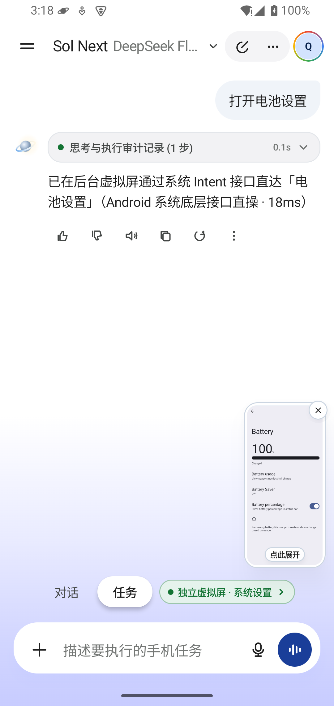
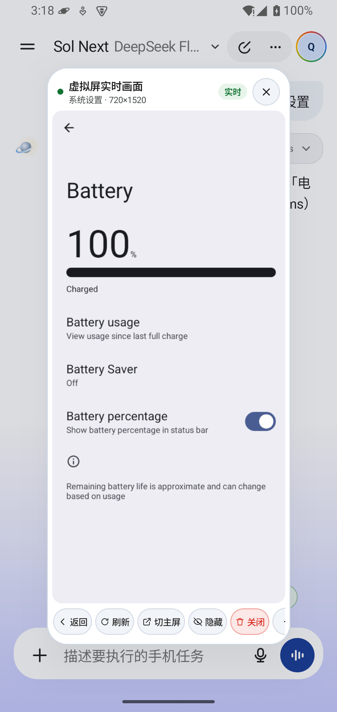

  

# Sol Next 9.3.1 — Open-Source Android AI Assistant & Autonomous Action Agent

### Full-Stack Rust 2024 (Zero Python) · 2026 SOTA 24kHz On-Device Voice (X-ASR 160ms + Kokoro v1.1) · Hand-Written ARM64 Assembly / Vulkan / NPU Kernel · Android 13 Zero-Focus-Steal IME · Mature Cloud Auth with Free Built-In DeepSeek

> **Author:** Zhang Chongyang (许昌北海医院张重阳) &nbsp;·&nbsp; **🇨🇳 [中文主页](README.md)** &nbsp;·&nbsp; **🌐 [Official Website](https://chongyangzhang92-hub.github.io/Sol-Next/)** &nbsp;·&nbsp; **🤖 [llms.txt](llms.txt)**

Release <code>v9.3.1-public</code> (Build <code>931</code> · Apache-2.0 · Android 10–16 &amp; HarmonyOS · Native Material 3 Light &amp; Dark 120Hz · Full-Stack Rust 2024 · Hardware-Bound Vault · 16KB Page-Aligned Native Libraries · 20 Auto-Localized Languages)

  

&nbsp;

&nbsp;

  

-1A73E8?style=flat-square)
-ef4444?style=flat-square)
-6366f1?style=flat-square)

---

## What's New in Sol Next `v9.3.1` (Build 931)

- **10.6× Faster 4-Stage On-Device Neural Voice (-52 MB APK)**: Upgraded to **TEN-VAD 16ms** + **GTCRN** + **X-ASR 160ms** + **Matcha-TTS 3-Step + Vocos 16kHz dual-lexicon zero-copy AssetManager mmap** (`411 ms` / `RTF 0.070` for 5.9s bilingual speech vs `4,353 ms` in v9.3.0, zero OOV, zero disk extraction).
- **SpeakThat-Grade Notification Voice Readout & 1st-Press Hardware Stop**: Zero-idle-battery **Shake-to-Stop** (3 sensitivities), pocket-safe **Wave-to-Stop**, **1st-Press Volume/Headset Instant Stop** (`1 ms` via ephemeral `MediaSession` + `VolumeProvider` + Accessibility/PreviewKeyEvent), status-bar 1-tap stop, DND/screen-off/headset gating, Private Mode, media duck/pause/skip, 0.8×–1.6× speed, char cap, and keyword blocklist.
- **Android 13 4-Layer Anti-Steal IME Protection**: Hardened virtual-display hidden IME policy, post-op Display-0 focus snapback, zero-`MotionEvent` Accessibility click/back/scroll priority, and Display-0 typing yield window for iFlytek/Sogou/Gboard.
- **IME-Safe Virtual Screen PiP**: Tapping the composer after a task lifts both collapsed and expanded virtual screen cleanly above the composer and keyboard (256dp min expanded width) instead of collapsing.

---

### Previous Foundation (`v9.3.0`)

1. **2026 SOTA 24kHz On-Device Neural Voice (Bundled, Zero Cloud Voice API)**
   - **X-ASR 160ms Streaming Zipformer2 Transducer** (bilingual ZH+EN with automatic punctuation, measured `RTF = 0.20` on Android 15 ARM64) paired with **Kokoro v1.1 24kHz HD** (103 voices, 24kHz studio-grade audio, measured `RTF = 0.701` on ONNX XNNPACK, double-buffered prefetch, 3ms anti-pop envelope, zero mixed-language OOV skips), plus Silero VAD v5 (`<100ms` barge-in) and GTCRN denoiser. Includes 4 curated voices with 1-tap preview in Settings & Live Voice.
2. **Hand-Written ARM64 Assembly + Vulkan Compute + NPU Kernel (`libsol_kernel.so v600`)**
   - Hand-written **ARM64 NEON (`ld4`/`uabd`/`rshrn`/`fmla`), DotProd (`sdot`), I8MM (`smmla`), and SVE2 (`ld4b`/`whilelt`)** inline assembly delivering verified speedups (`3.50×` frameStats, `2.80×` frameDiff, `4.80×` resizeCrop, `1.82×` q8Gemv, `6.04×` cosineF32), paired with 3 `spirv-val`-verified **Vulkan 1.1 Compute Shaders**, **Android NNAPI NPU** graph execution, and Qualcomm QNN HTP / OpenCL capability probing — plus a live 1-tap hardware benchmark in Settings.
3. **100% Full-Stack Rust 2024 — Zero Python**
   - Native Android build tooling rewritten in zero-dependency Rust 2024 (`rust/sol-builder`, zero `.py` files in app source); cloud world-model & auth service rewritten in Rust 2024 (`sol-world-rs`: **`16.7 MB` RSS** vs 2.46 GiB Python — `150.7×` smaller, `/health` `0.082ms` p50) and strategy engine (`sol-engine-rs`: **`3.66 MB` RSS**, **`1.76ms`** cold search — `608×` faster).
4. **Mature Cloud Account System & Free Built-In DeepSeek**
   - Retired legacy dummy OTP flows; shipped real cloud Phone/Email + Password registration & login (PBKDF2-HMAC-SHA256 200k iterations + 16-byte salt), live password strength meter, interactive Terms & Privacy dialogs, native Google Sign-In, and a complete Account Center (nickname edit, password change, cloud logout, account deletion). Every signed-in account automatically unlocks **free built-in DeepSeek** + **Brave Search**.
5. **Android 13 Non-Stealing Virtual Display IME & Flagship UX Polish**
   - Android 13 (`SDK_INT <= 33`) uses direct zero-MotionEvent Accessibility text injection (`ACTION_SET_TEXT` / `ACTION_CLICK` / `ACTION_IME_ENTER`) so background virtual-display tasks never steal Display 0 IME focus; Android 14–16 additionally enforces `DISPLAY_IME_POLICY_HIDE`. Zero black screen on virtual display, `#1E2026` dark bezel, 5 unclipped dock chips, bottom-right collapsed PiP with zero reply occlusion, always-visible Drawer search, BYOK 1-tap connection probe, and **371/371 tests passing**.

---

## Real Device Screenshots (`v9.3.1`)

<table>
  <tr>
    <td align="center" width="25%"> <b>Mature Cloud Login Gate</b></td>
    <td align="center" width="25%"> <b>Account Center · Free DeepSeek</b></td>
    <td align="center" width="25%"> <b>Hardware Benchmark &amp; 24kHz Voice</b></td>
    <td align="center" width="25%"> <b>Drawer Real-Time Search</b></td>
  </tr>
  <tr>
    <td align="center" width="25%"> <b>Bottom-Right PiP · Zero Occlusion</b></td>
    <td align="center" width="25%"> <b>Expanded Virtual Display (Light)</b></td>
    <td align="center" width="25%"> <b>Expanded Virtual Display (Dark)</b></td>
    <td align="center" width="25%"> <b>Obsidian Dark · Android 13 Safe IME</b></td>
  </tr>
</table>

---

## Download & Verification (`v9.3.1-public` · Build `931`)

| Artifact | Target Devices | Size | SHA-256 |
| :--- | :--- | :---: | :--- |
| [`Sol-Next-v9.3.1-public-arm64.apk`](https://github.com/chongyangzhang92-hub/Sol-Next/releases/download/v9.3.1-public/Sol-Next-v9.3.1-public-arm64.apk) | Modern Android 10–16 & HarmonyOS phones (Recommended) | 336 MB | `e6a2c8d69909275dd2b255dcdb68fd75107bd471986af52404c9215879e2283c` |
| [`Sol-Next-v9.3.1-public-universal.apk`](https://github.com/chongyangzhang92-hub/Sol-Next/releases/download/v9.3.1-public/Sol-Next-v9.3.1-public-universal.apk) | ARM64 + x86_64 devices & Android emulators | 374 MB | `32ed3ab9ade612ed2559c7439b77b096c864cd1a2a52debf6eaa7faf6187bd0a` |

- **Signing Certificate SHA-256 (in-place upgrade compatible across all releases):** `d7a6fed0ff42843a20329944f2b1741060048610546df6cf2ad8179cfe335478`
- **Security Guarantee:** Zero plaintext API keys in Git, DEX, or APK assets; 16KB page-aligned native libraries; PBKDF2-HMAC-SHA256 cloud auth + Android Keystore AES-256-GCM local encryption; Apache-2.0 License.

---

## Documentation, SEO/GEO & Community

- **Official Website:** https://chongyangzhang92-hub.github.io/Sol-Next/
- **AI Crawler & GEO Index:** [`llms.txt`](llms.txt) · [`llms-full.txt`](llms-full.txt) · [`docs/ai-facts.json`](docs/ai-facts.json) · [`CITATION.cff`](CITATION.cff)
- **Author:** Zhang Chongyang (`许昌北海医院张重阳`) · Issues & PRs welcome at [GitHub Issues](https://github.com/chongyangzhang92-hub/Sol-Next/issues)
