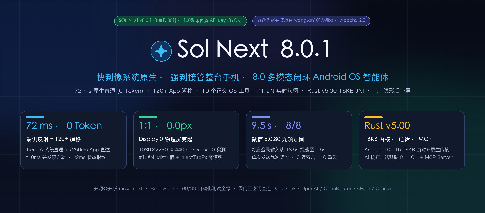
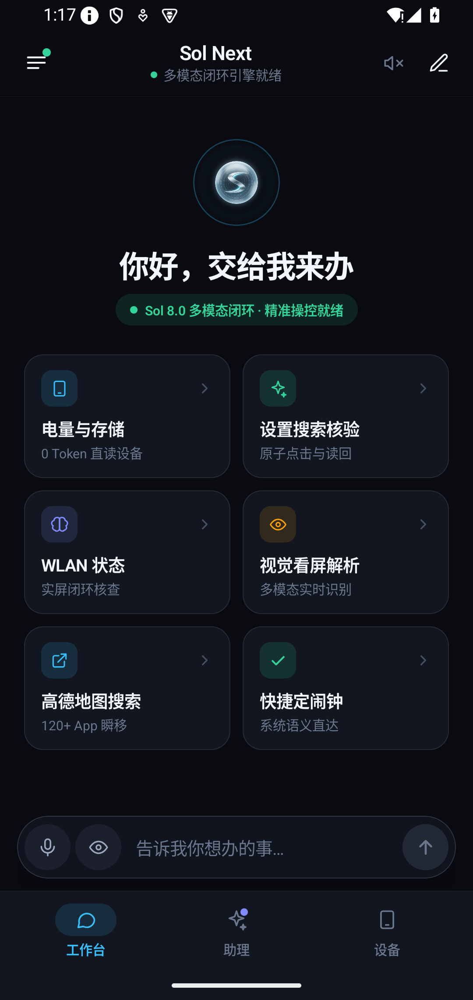

<div align="center">

<a href="https://chongyangzhang92-hub.github.io/Sol-Next/">
  
</a>

# Sol Next 8.0.1 — Grounded Multimodal Android OS Agent

[简体中文](README.md) · **English** · [🌐 Interactive Product Website](https://chongyangzhang92-hub.github.io/Sol-Next/) · [📦 Download v8.0.1-public](https://github.com/chongyangzhang92-hub/Sol-Next/releases/tag/v8.0.1-public) · [🔑 BYOK Setup Guide](docs/guides/BYOK_SETUP.md) · [📊 vs Mika](docs/guides/COMPARISON_WITH_MIKA.md) · [🤖 `llms.txt`](llms.txt)

<br/>

<a href="https://github.com/chongyangzhang92-hub/Sol-Next/releases/download/v8.0.1-public/Sol-Next-v8.0.1-public-arm64.apk"></a>
<a href="https://chongyangzhang92-hub.github.io/Sol-Next/"></a>
<a href="https://github.com/wangzan101/Mika"></a>

<br/>

-0ea5e9)
-3DDC84?logo=android&logoColor=white)


</div>

---

## 📱 Sol Next 8.0.1 Studio Interface (Live Android 15 Captures)

<table>
  <tr>
    <td align="center" width="33.3%">
      <br/>
      <b>Studio Workspace</b><br/>
      <sub>Calm command surface with instant screen vision &amp; quick tasks</sub>
    </td>
    <td align="center" width="33.3%">
      <br/>
      <b>Verified Closed-Loop Trace</b><br/>
      <sub>Collapsible handle-level proof with latency &amp; verification badges</sub>
    </td>
    <td align="center" width="33.3%">
      <br/>
      <b>Device Hub &amp; Native BYOK</b><br/>
      <sub>2×2 readiness matrix, wireless VirtualDisplay &amp; local BYOK engine</sub>
    </td>
  </tr>
</table>

---

## ✨ What's New in Sol Next 8.0.1

1. **Grounded Multimodal Execution Kernel (`SolGroundedAgent`)**: 10 orthogonal typed tools (`ui_click`, `ui_type`, `ui_scroll`, `ui_navigate`, `app_open`, `sys_action`, `ui_inspect`, `ui_gesture`, `task_note`, `task_finish`) with live `#1..#N` Accessibility handle binding and zero-cache `<2ms` state fingerprinting.
2. **Real-App Hardening (WeChat 8.0.80 · 9 Targeted Fixes)**: Single-shot Send Contract (`4×85ms` read-only bubble verification with terminal stop on uncertain delivery), goal-pinned sliding context window (`>22` messages), formatted numeric readback (`138 0013 8000` == `13800138000`), off-screen `ViewPager` subtree pruning, and `SolIME` active-turn protection.
3. **Automatic 1:1 Set-of-Mark Inline Vision**: Automatically attaches 1:1 annotated `#1..#N` screenshots on WebViews, mini-programs, sparse trees, or `NO_CHANGE` steps while retaining only the latest visual frame for crisp latency.
4. **Rust v5.00 16KB JNI Kernel & 1:1 Background VirtualDisplay**: Android 15–16 16KB page-aligned `libsol_kernel.so` paired with native-DPI Display-0 cloning and zero-drift `injectTapPx` input.
5. **100% Zero Built-In API Keys (Public BYOK Edition)**: Standalone package `ai.sol.next` audited for zero embedded credentials (`assets/sol-models.properties` absent) and identical signing certificate (`d7a6fed0...5478`) for seamless in-place upgrades.

---

## 📈 Verified Benchmarks (Android 15 Emulator · 99/99 Unit Tests)

| Benchmark Scenario | Execution Path | v8.0.0 Baseline | **v8.0.1 Verified** |
|---|---|---:|---:|
| System Battery & Storage Telemetry | Tier-0A Native System API (0 Tokens) | `72 ms` | **`72 ms` · PASS** |
| Multimodal Screen Vision Analysis | 1:1 Set-of-Mark Inline Vision (1 round) | `5.1 s` | **`5.1 s` · PASS** |
| Settings → WLAN Navigation | Prelaunch + Live Handle Click | `7.2 s` | **`7.2 s` · PASS** |
| WeChat 8.0.80 Cold Start → Login → Grouped Phone `138 0013 8000` | `app_open` + `ui_click(#id)` + `ACTION_SET_TEXT` | `18.5 s` | **`9.5 s` · 1st-Try** |
| WeChat 8.0.80 Region Search + Switch Login + CJK Input (8 steps) | Live Handle Grounding (0 double-taps) | `20.5 s` | **`20.8 s` · 8/8 1st-Try** |
| Automated Unit & Regression Suite | `:sol-core:test` (73) + `:app:testReleaseUnitTest` (26) | `96 / 96` | **`99 / 99` · 0 Crashes** |

---

## 📦 Verified Release Artifacts (`v8.0.1-public` · Build 801)

| Artifact | ABI | Size | SHA-256 |
|---|---|---:|---|
| [**`Sol-Next-v8.0.1-public-arm64.apk`**](https://github.com/chongyangzhang92-hub/Sol-Next/releases/download/v8.0.1-public/Sol-Next-v8.0.1-public-arm64.apk) *(Recommended)* | `arm64-v8a` | `33.6 MB` | `b6fc90c79fc4d927549c17414244ab6e276b1002da7fbf3b98451ce7c779c3cb` |
| [**`Sol-Next-v8.0.1-public-universal.apk`**](https://github.com/chongyangzhang92-hub/Sol-Next/releases/download/v8.0.1-public/Sol-Next-v8.0.1-public-universal.apk) | `arm64-v8a` + `x86_64` | `45.9 MB` | `7969661db1f9682012a144b79cd744c702238a4aa0b21aaf3e10f7ee679bf046` |

- **Signing Certificate SHA-256**: `d7a6fed0ff42843a20329944f2b1741060048610546df6cf2ad8179cfe335478`
- **Zero-Key Audit**: `unzip -l Sol-Next-v8.0.1-public-arm64.apk | grep sol-models` *(expected: empty)*

---

## 🚀 Quick Start (30 Seconds, Zero Built-In Keys)

1. **Install APK**: Grab `Sol-Next-v8.0.1-public-arm64.apk` from [Releases](https://github.com/chongyangzhang92-hub/Sol-Next/releases/tag/v8.0.1-public).
2. **Enter Your Own API Key (BYOK)**: Open the **Device** tab → **Custom Model API (BYOK)** → pick a preset (`DeepSeek`, `OpenAI`, `OpenRouter`, `SiliconFlow`, `Qwen`) or custom OpenAI-compatible Base URL → paste your API key → tap **Save & Test**.
3. **Optional — Enable 1:1 Background VirtualDisplay**: Tap **Auto-Pair Wireless Debugging** to unlock the isolated 1:1 VirtualDisplay and zero-animation turbo without needing a PC.

## 🤖 Agent-Ready: Zero-Dependency CLI (`--json`) & Stdio MCP Server

```bash
python3 scripts/sol-cli.py status --json
python3 scripts/sol-cli.py install --verify-sha256 --grant-permissions --json
python3 scripts/sol-cli.py start-helper --json
python3 scripts/sol-cli.py run --intent "Open Settings and check battery status" --json
```

```json
{
  "mcpServers": {
    "sol-next": {
      "command": "python3",
      "args": ["/path/to/Sol-Next/mcp/sol_mcp_server.py"]
    }
  }
}
```

## 🙏 Tribute to Mika (`@wangzan101`) & License

**Sol Next** is proudly built upon and pays sincere tribute to [**wangzan101/Mika**](https://github.com/wangzan101/Mika) (Apache-2.0), which pioneered background VirtualDisplay execution and non-intrusive companion calling on Android. Please star both projects!

Licensed under **Apache-2.0** — see [LICENSE](LICENSE) and [NOTICE](NOTICE).
