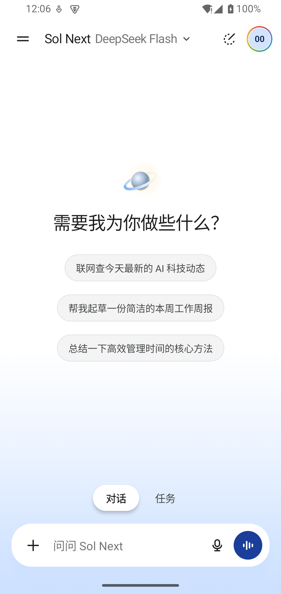
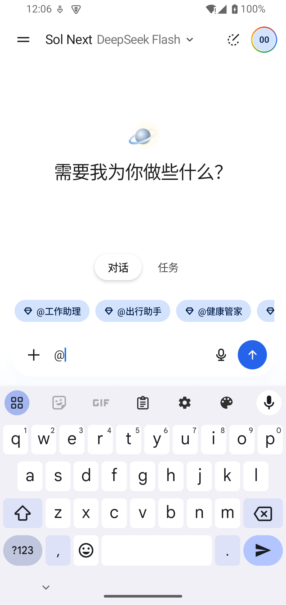
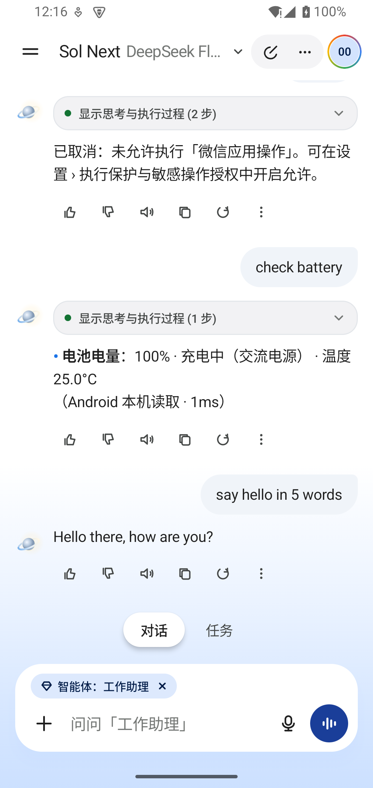
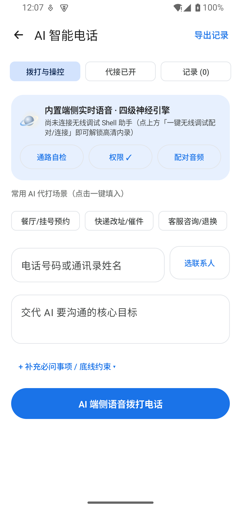
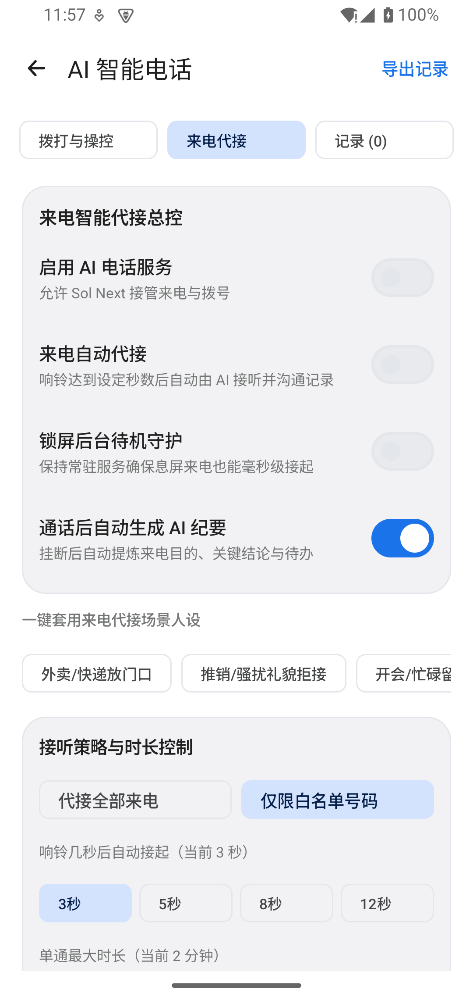

  

# Sol Next 9.2.0 — Open-Source Android AI Assistant & Autonomous Action Agent

### 12-Upgrade Precision Execution Kernel · System Zero-Animation Toggle · Headset/Car-Bluetooth Task Voice Gating · Zero-Lag `TextFieldState` IME · Full 3-Tab AI Phone Call Suite · Real Photo/Document/Agent/Memory Loop

> **Author:** Zhang Chongyang (许昌北海医院张重阳) &nbsp;·&nbsp; **🇨🇳 [中文主页](README.md)** &nbsp;·&nbsp; **🌐 [Official Website](https://chongyangzhang92-hub.github.io/Sol-Next/)** &nbsp;·&nbsp; **🤖 [llms.txt](llms.txt)**

Release <code>v9.2.0-public</code> (Build <code>920</code> · Apache-2.0 · Android 10–16 &amp; HarmonyOS · Native Material 3 Light &amp; Dark 120Hz · Rust ChaCha20+HMAC-SHA256 Hardware-Bound Vault · 16KB Page-Aligned Native Libraries · 20 Auto-Localized Languages)

  

&nbsp;

&nbsp;

  

-1A73E8?style=flat-square)

---

## What's New in Sol Next `v9.2.0` (Build 920)

1. **12-Upgrade Apex Execution Kernel (Speed, Precision & Reliability)**
   - Immutable-prefix KV Cache with 8-message fixed-stride epoch compaction (preserving strict role alternation across every LLM provider).
   - Intent-scoped dual tool profiles (11 lean core tools for everyday UI tasks, cutting ~52% schema token overhead).
   - `near_text` row-anchor disambiguation for repeated list buttons, hybrid mid-viewport OCR fusion for WebViews/Mini-Programs, zero-waste `encodeImage=false` fast path for text models, mid-SSE `ui_action_chain` streaming extraction, 40ms fake-search-bar dynamic `EditText` takeover, `ui_scroll_collect` 5× faster batch scroll collector, zero-token safe popup/splash auto-dismiss reflex, and verified Tier-0D RSI zero-cloud skill replay.
2. **System Zero-Animation Turbo Toggle**
   - Dedicated toggle in **Settings › Virtual Screen & Task Automation** that applies `0x` transition scales when enabled and restores your device's exact original animation scales when disabled.
3. **3-Mode Task Voice Broadcast Control (`Off` / `Headset & Car BT` / `Always`)**
   - Powered by live Android `AudioDeviceInfo` route detection (wired earphones, USB-C audio, Bluetooth A2DP/SCO/BLE, and car Bluetooth). Stays 100% silent on phone speakers in public and speaks automatically the moment headphones or car audio connect.
4. **Zero-Lag IME & Typing Adaptation Overhaul**
   - Composer rebuilt on Compose `TextFieldState` (`PartialGapBuffer`, zero parent recomposition on every keystroke), leaf-isolated 30fps virtual-display frame flow, 95ms GPU-composited buffered Markdown crossfade, automatic IME dismissal on Drawer/`+` sheet open, IME-aware PiP auto-tucking so the Send button is never obstructed, and automation `clearFirst` + 420ms clipboard auto-restore.
5. **Complete 3-Tab AI Phone Call Suite (`Dial & Control` | `Auto-Answer` | `History`)**
   - Live timer, anti-fraud alert banner, live bidirectional transcript, silent mid-call **Live Whisper** steering, collapsible DTMF keypad, Mute/Speaker/Takeover/Hangup, native Android Contact Picker, Dual-SIM selector, 4 outbound & 4 incoming persona presets, pause/resume controls, VIP bypass numbers, and searchable call history with AI summaries and 1-tap redial.
6. **Real End-to-End Agents, Memory & Multimodal Attachments**
   - Specialist Agent instructions and encrypted Saved Memory inject directly into both Chat and Task system prompts (isolated cleanly from raw `userIntent`), with `@` quick-mention picker, removable composer chips, native Gallery photo picking (on-device ML Kit OCR + JPEG Base64), and document import.

---

## Real Device Screenshots (`v9.2.0`)

<table>
  <tr>
    <td align="center" width="25%"> <b>Native Material 3 Home</b></td>
    <td align="center" width="25%"> <b>`@` Quick Agent Mention</b></td>
    <td align="center" width="25%"> <b>1ms System-0 & Live Chat</b></td>
    <td align="center" width="25%"> <b>Photo & File Attachments</b></td>
  </tr>
  <tr>
    <td align="center" width="25%"> <b>Zero-Anim & Voice Gating</b></td>
    <td align="center" width="25%"> <b>AI Call · Dial & Cockpit</b></td>
    <td align="center" width="25%"> <b>AI Call · Auto-Answer</b></td>
    <td align="center" width="25%"> <b>Encrypted Saved Memory</b></td>
  </tr>
</table>

---

## Download & Verification (`v9.2.0-public` · Build `920`)

| Artifact | Target Devices | Size | SHA-256 |
| :--- | :--- | :---: | :--- |
| [`Sol-Next-v9.2.0-public-arm64.apk`](https://github.com/chongyangzhang92-hub/Sol-Next/releases/download/v9.2.0-public/Sol-Next-v9.2.0-public-arm64.apk) | Modern Android 10–16 & HarmonyOS phones (Recommended) | 93 MB | `398145f17f1cb17b228aeae6bb94b9d0e47320cc6ffd76afff6b511dbfc6305f` |
| [`Sol-Next-v9.2.0-public-universal.apk`](https://github.com/chongyangzhang92-hub/Sol-Next/releases/download/v9.2.0-public/Sol-Next-v9.2.0-public-universal.apk) | ARM64 + x86_64 devices & Android emulators | 132 MB | `5d721c2681b755df415bd167ea6276ffa5c77ff48a3c40268f09c4cd1b6b796e` |

- **Signing Certificate SHA-256 (in-place upgrade compatible across all releases):** `d7a6fed0ff42843a20329944f2b1741060048610546df6cf2ad8179cfe335478`
- **Security Guarantee:** Zero plaintext API keys in Git, DEX, or APK assets; 16KB page-aligned native libraries; Android Keystore AES-256-GCM local encryption; Apache-2.0 License.

---

## Documentation, SEO/GEO & Community

- **Official Website:** https://chongyangzhang92-hub.github.io/Sol-Next/
- **AI Crawler & GEO Index:** [`llms.txt`](llms.txt) · [`llms-full.txt`](llms-full.txt) · [`docs/ai-facts.json`](docs/ai-facts.json) · [`CITATION.cff`](CITATION.cff)
- **Author:** Zhang Chongyang (`许昌北海医院张重阳`) · Issues & PRs welcome at [GitHub Issues](https://github.com/chongyangzhang92-hub/Sol-Next/issues)
