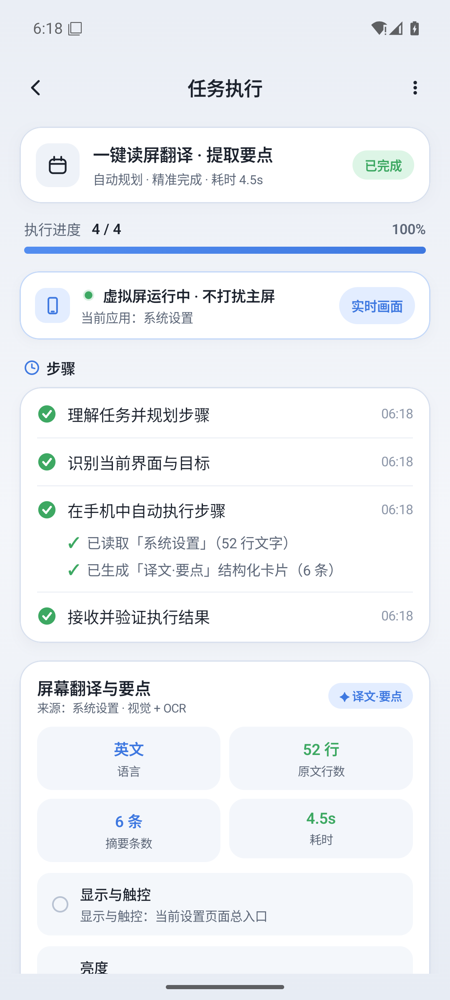
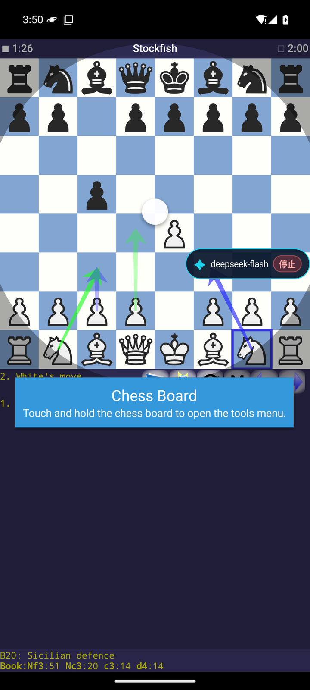

<div align="center">

<a href="https://github.com/chongyangzhang92-hub/Sol-Next/releases/tag/v9.0.8-public">
  
</a>

<br/><br/>

# Sol Next 9.0.8 — Your Open-Source AI "Hands" on Android & HarmonyOS

### Speak or Type Naturally. Let AI Operate Apps in a Hidden 1:1 Background Screen, Handle Real Phone Calls & Play Games — Free Built-In DeepSeek, Wi-Fi-Off Persistent, 20 Languages

> **👨‍💻 Author: Zhang Chongyang (许昌北海医院张重阳)** &nbsp;·&nbsp; **💬 [WeChat QR & Official User Group](#-contact-author--official-user-group)** &nbsp;·&nbsp; **📕 RedNote: `871348474` (映像河南)**

<sub>Brand-New Independent Apache-2.0 Mobile OS Agent (Build <code>908</code> · Android 10–16/17 &amp; HarmonyOS · 16KB Page-Aligned Rust JNI Kernel · Free Built-In Rust-Encrypted DeepSeek V4.1 Flash + Universal BYOK · 20 World Languages Auto-Matching Phone Language + Arabic RTL · Auto-Popup OTA with Release Notes &amp; 4-Stream Multi-Mirror Boost · Wi-Fi-Off Persistent Shell Helper)</sub>

<br/><br/>

<a href="https://github.com/chongyangzhang92-hub/Sol-Next/releases/download/v9.0.8-public/Sol-Next-v9.0.8-public-arm64.apk"></a>
&nbsp;
<a href="https://webui.67-230-181-51.sslip.io/assets/sol-public/v9.0.8/Sol-Next-v9.0.8-public-arm64.apk"></a>
&nbsp;
<a href="https://github.com/chongyangzhang92-hub/Sol-Next/releases/download/v9.0.8-public/Sol-Next-v9.0.8-public-universal.apk"></a>

<br/><br/>

🌐 **Languages (20)**:
[简体中文](README.md) · [繁體中文](docs/i18n/README.zh-TW.md) · **English** · [日本語](docs/i18n/README.ja.md) · [한국어](docs/i18n/README.ko.md) · [Español](docs/i18n/README.es.md) · [Français](docs/i18n/README.fr.md) · [Deutsch](docs/i18n/README.de.md) · [Português](docs/i18n/README.pt.md) · [Русский](docs/i18n/README.ru.md) · [العربية](docs/i18n/README.ar.md) · [हिन्दी](docs/i18n/README.hi.md) · [Bahasa Indonesia](docs/i18n/README.id.md) · [Tiếng Việt](docs/i18n/README.vi.md) · [ภาษาไทย](docs/i18n/README.th.md) · [Türkçe](docs/i18n/README.tr.md) · [Italiano](docs/i18n/README.it.md) · [Nederlands](docs/i18n/README.nl.md) · [Polski](docs/i18n/README.pl.md) · [Bahasa Melayu](docs/i18n/README.ms.md)

<br/>

[💡 What It Is](#-1-what-is-sol-next-30-second-overview) &nbsp;·&nbsp; [🎯 What It Can Do](#-2-what-can-sol-next-do-for-you) &nbsp;·&nbsp; [📖 How to Use](#-3-how-to-use-3-minute-quick-start) &nbsp;·&nbsp; [🎬 Live Demos](#-4-real-device-demos-android-1516) &nbsp;·&nbsp; [⚔️ Why It Beats Mika](#-5-where-mika-falls-short--why-sol-next-904-decisively-leads) &nbsp;·&nbsp; [🌐 20-Lang Website](https://chongyangzhang92-hub.github.io/Sol-Next/)

</div>

---

### 🆕 What's New in v9.0.8 (Build 908)
- **⚡ New "Singularity OS Command Center" (World-Frontier Super-Compute Suite)**: Ships **🚀 Full-Autopilot Geek Mode** (1-tap zero-popup uninterrupted autonomy), **🐝 4-Agent Parallel Swarm Council** (Architect · Analyst · Innovator · Chief Synthesizer), **🌐 Autonomous Multi-Hop Web Deep Research** (headless cited research reports + `web_deep_research` tool), **🌳 Test-Time Compute Tree Search + PRM Verifier**, **🧬 AlphaEvolve Goal Optimizer**, **🎨 Generative HTML5 Mini-App Studio (Artifacts)** (4 built-in apps + 1-sentence AI generator), **💻 0ms Deterministic Compute & Bill-Stats Sandbox (`compute_engine`)**, **🔮 Probabilistic World Model & Bellman Rollout Simulator**, **🧠 Google Titans/MIRAS Surprise Memory + 2-Hop GraphRAG Knowledge Graph**, **🛠️ Project Mariner Teach & Repeat Macro Studio**, **🔌 Universal MCP (Streamable HTTP) + Google A2A v1.0 Hub**, and **Magic Cue 2.0 (12 contextual triggers)**.
- **✍️ Free Report Operations & Full Archive Lifecycle**: Native free text drag-selection, inline title/Markdown editing + 3-preset 0-UI **AI Quick Rewrite**, single & batch export (`.md` / `.txt` / `.html` to `Download/SolNext/`), Android FileProvider Share Sheet, confirmed delete, and 1-tap Convert to Scheduled Routine.
- **🚀 Multi-Edition High-Speed OTA Upgrade**: Public Edition now ships with China high-speed VPS OTA mirrors + structured JSON fallback (`latest.json`), device-ABI-aware ARM64/Universal asset selection, strict edition isolation, mirror-race fast-fail bugfix, and automatic stale APK cache cleanup.
- **🎯 Unbounded Goal-Driven Execution (No Artificial Step Limits)**: Removes fixed 56/72-step caps so complex multi-app workflows finish in one run. Pins an explicit Goal Contract + Sub-Goal Checklist across the entire lifecycle, blocks premature incomplete finishes, auto-pivots on stalls (4/8 turns), and auto-renews WakeLocks for 30+ min runs.
- **📚 Permanent Searchable Multi-Round Task Report Archive**: Permanently archives every round's full verbatim report (up to 300 reports with auto-backfill from older versions). Retrieve earlier rounds via the **Screen 2 Round Switcher Strip**, **Searchable Report Archive Sheet** (with 1-tap merge), **0ms direct recall**, or the native **`task_report_query`** agent tool.
- **📱 Scan-to-Connect WeChat & Feishu Plugins (Zero Manual Copy-Paste)**: Official Tencent iLink WeChat QR login (1-phone gallery save + live bidirectional WeChat task bridge) & official Feishu/Lark OAuth Device-Registration QR flow (1-tap on-device launch + automatic App ID/Secret/`open_id` provisioning), plus Direct TLS integrations for **Feishu/Lark Custom Bot Webhooks (HMAC-SHA256)**, **Feishu OpenAPI App Interactive Cards**, **WeCom Group Bot Webhooks (auto-chunked)**, and **Personal WeChat safe local bridge** — all credentials encrypted on-device via Android KeyStore AES-256-GCM with 1-tap test, auto-push on completion, and the **`connector_plugin`** agent tool.

## 💡 1. What Is Sol Next? (30-Second Overview)

**Sol Next is a free, open-source AI action agent installed directly on your Android or HarmonyOS phone.**

Regular AI chat apps (ChatGPT, DeepSeek Web, Gemini) can only *talk*—they cannot touch your screen or finish tasks inside your apps. **Sol Next actually operates your phone for you:**

- **Executes real multi-app workflows in a hidden 1:1 background Virtual Display**: While Sol Next taps, searches, translates, and verifies tasks in the background, your foreground screen stays completely free for normal use.
- **Zero-friction start — no API key required**: Ships with **free built-in Rust-encrypted DeepSeek V4.1 Flash** out of the box (plus instant BYOK support for OpenAI, Claude, Gemini, DeepSeek V4 Pro, Qwen, OpenRouter, or local Ollama).
- **No Root, No PC, No AccessibilityService**: Avoids banking/enterprise app risk flags; **HarmonyOS skips wireless debugging automatically**, and on Android it stays **100% connected even after you turn off Wi-Fi and switch to 5G**.
- **Privacy & Confirmation Guardrails**: On-device PII redaction masks IDs/bank cards before any cloud call, and **payments, transfers, WeChat messages, and deletions always pause for your explicit tap confirmation**.

---

## 🎯 2. What Can Sol Next Do for You?

| Use Case | Example Voice / Text Prompt | How Sol Next Executes It |
| --- | --- | --- |
| **🛒 Cross-App Price & Food Search** | *"Compare prices for Sony WH-1000XM5 across shopping apps and summarize the cheapest 3 options"* | Opens apps in the background 1:1 Virtual Display, compares results, and **always pauses before checkout/payment** for your approval |
| **⚡ Instant System Reflexes (`72 ms`)** | *"Turn on Dark Mode"* / *"Check battery, storage & network status"* / *"Set a 7:30 AM alarm"* | Runs locally via 0-Token native System APIs in **`72 ms`** (zero cloud round-trip); teleports directly into 120+ apps in `<250 ms` |
| **📞 Real-Time AI Phone Calls** | *"Answer this delivery call and ask them to leave the package at the locker"* / *"Call the restaurant to book a table for 4"* | Full-duplex AI voice with 35-bar live voiceprint, **`<0.1 ms` on-device anti-scam radar**, live mid-call **Whisper instructions**, and 1-tap human takeover |
| **🌐 4.5s Screen Translation & 20 Languages** | *"Translate this foreign app screen and list the 5 key points"* | Reads and summarizes 50+ lines into structured native cards in **4.5 s**; UI auto-matches your phone's system language across 20 languages (including Arabic RTL) |
| **🎮 60Hz Multi-Touch Gaming** | *"Play a round of DouDiZhu"* / *"Play chess with Stockfish"* / *"Assist Golden Spatula positioning"* | 4-finger concurrent multi-touch + 60Hz visual servoing (`3/3` DouDiZhu win rate in `32.5 s`, Rust `<15 µs` SwiGLU Golden Spatula engine) |
| **💻 AI Coding Agent Bridge (CLI + MCP)** | Call `sol_run_phone_task` from Claude Code / Cursor / Codex | Ships with zero-dependency `scripts/sol-cli.py` and stdio `mcp/sol_mcp_server.py` so desktop AI agents can drive real Android devices |

---

## 📖 3. How to Use (3-Minute Quick Start)

1. **Install the APK**: Download **ARM64 (90 MB)** from GitHub Releases or the high-speed direct mirror above (use Universal 128 MB for x86_64 emulators).
2. **Start Talking Immediately (No Key Needed)**: Open Sol Next — the built-in Rust-encrypted DeepSeek V4.1 Flash works right away. To use your own OpenAI / DeepSeek V4 Pro / Claude / Gemini key, go to **Settings › Model API Configuration (BYOK)** anytime.
3. **Enable One-Time Background Phone Control (30 Seconds)**:
   - **HarmonyOS**: Auto-detected — skips wireless debugging and finishes in 3 taps.
   - **Android 10–16**: Enable *Wireless Debugging* in Developer Options, tap *Pair device with pairing code*, and enter the 6-digit code inside Sol Next (no PC, no Root). Once connected, Sol Next locks `adb_enabled=1` + `127.0.0.1:5555` loopback so **turning off Wi-Fi on 5G never disconnects it**.
4. **Give Your First Command**: Tap the Dawn Orbit voice orb or type in the bottom bar (e.g., *"Open Settings › Display and turn on Dark theme"*). Watch the live step tree or expand the inline Virtual Display preview anytime!

---

## 🎬 4. Real-Device Demos (Android 15/16)

<table>
  <tr>
    <td align="center" width="25%">
      <br/>
      <b>1. Voice &amp; Text Command Home</b><br/>
      <sub>60fps Dawn Orbit orb + glass text bar · 20 languages auto-matching phone language</sub>
    </td>
    <td align="center" width="25%">
      <br/>
      <b>2. Hidden 1:1 Background Screen</b><br/>
      <sub>Prompt: "Enable Dark theme in Settings" → runs in 1:1 background display with live inline preview &amp; green checkmarks</sub>
    </td>
    <td align="center" width="25%">
      <br/>
      <b>3. 4.5s Screen Translation Card</b><br/>
      <sub>Reads 52 lines of foreign UI &amp; renders 6 structured native summary cards in 4.5s</sub>
    </td>
    <td align="center" width="25%">
      <br/>
      <b>4. AI HD Call + Anti-Scam Shield</b><br/>
      <sub>35-bar live voiceprint, &lt;0.1ms anti-scam radar, Whisper coaching &amp; 1-tap human takeover</sub>
    </td>
  </tr>
  <tr>
    <td align="center" width="25%">
      <br/>
      <b>5. 72ms 0-Token Native GenUI</b><br/>
      <sub>Instant system telemetry cards without cloud LLM delay</sub>
    </td>
    <td align="center" width="25%">
      <br/>
      <b>6. DouDiZhu 3/3 Win (32.5s)</b><br/>
      <sub>Real-time board vision + 60Hz multi-touch control</sub>
    </td>
    <td align="center" width="25%">
      <br/>
      <b>7. Stockfish Live Chess</b><br/>
      <sub>Board recognition + engine search + 0.0px drag moves</sub>
    </td>
    <td align="center" width="25%">
      <br/>
      <b>8. 4/4 Multi-Touch Gestures</b><br/>
      <sub>Tap, long-press, swipe &amp; 4-finger pinch verified in 18.7s</sub>
    </td>
  </tr>
</table>

---

## ⚔️ 5. Where Mika Falls Short & Why Sol Next 9.0.8 Decisively Leads

**Sol Next 9.0.8** is a completely independent next-generation product built from the ground up. Earlier mobile agents like **Mika** suffer from major everyday usability bottlenecks that Sol Next 9.0.8 eliminates completely:

1. **Mika cannot work out of the box** (requires manually buying and configuring API keys before your first message) → **Sol Next 9.0.8** includes **free built-in Rust-encrypted DeepSeek V4.1 Flash** (with APK signing cert binding & TLS SPKI pinning) plus universal BYOK anytime.
2. **Mika disconnects the moment you turn off Wi-Fi** (leaving home breaks wireless debugging; HarmonyOS still needs tedious ADB pairing) → **Sol Next 9.0.8** locks `adb_enabled=1` + `127.0.0.1:5555` loopback so **Wi-Fi-off / 5G mobile data stays 100% connected**, and **HarmonyOS auto-skips wireless debugging**.
3. **Mika is slow, token-heavy, and drifts on scaled virtual screens** (`~2,400 ms` cloud loops even for simple device toggles, Kotlin/JVM UI parsing, scaled grid coordinate rounding) → **Sol Next 9.0.8** runs **`72 ms` 0-token native reflexes (33× faster)**, `<250 ms` deep-link teleports across 120+ apps, a **pure-Rust 16KB JNI kernel (`-74% to -97%` UI pruning)**, and **1:1 Display 0 physical cloning (`scale=1.0`, `0.0px` drift)**.
4. **Mika exposes raw engineering logs & lacks built-in offline voice** → **Sol Next 9.0.8** delivers the zero-learning-curve **Dawn Orbit 4-screen UI** plus **built-in 16KB offline neural ASR (`770 ms`) & TTS (`112 ms`)** requiring zero Google services or voice API keys.
5. **Mika uploads raw screen text, packs a heavy browser/Linux attack surface & risks duplicate WeChat sends** → **Sol Next 9.0.8** runs a minimal-attack-surface native engine with an **on-device Privacy Firewall**, **9 WeChat 8.0.80 reliability fixes (`0` duplicate sends, `9.5s` first-try login)**, and mandatory confirmation before payments or messaging.
6. **Mika is single-language, slow to update & lacks multi-finger gaming / full AI call defense** → **Sol Next 9.0.8** supports **20 world languages (with Arabic RTL)**, **auto-popup OTA with release notes & 4-stream multi-mirror acceleration (3–8× faster)**, **60Hz 4-finger gaming**, and **35-bar voiceprint AI calling with `<0.1ms` on-device anti-scam shield**.

👉 Full 16-dimension benchmarks & 2K architecture charts: [Sol Next 9.0.8 vs Mika Deep Dive](docs/guides/COMPARISON_WITH_MIKA.md)

---

## 📦 SHA-256 Checksums (`v9.0.8-public`) & MCP Setup

```text
1e6d99fce3bb966efe60be5b8b3a78de791760dbffc19d03a9eeed66587f3795  Sol-Next-v9.0.8-public-arm64.apk
310d5c5f37947ad3353387fe7102bda661072d5e01fd2e15278455336bc80b4f  Sol-Next-v9.0.8-public-universal.apk
```

```json
{
  "mcpServers": {
    "sol-next": {
      "command": "python3",
      "args": ["/path/to/Sol-Next/mcp/sol_mcp_server.py"]
    }
  }
}
```

---

## 💬 Contact Author & Official User Group

<div align="center">
  <br/><br/>
  <b>Scan with WeChat to connect directly with the author</b><br/>
  <b>Author: Zhang Chongyang (许昌北海医院张重阳)</b> · RedNote (Xiaohongshu): <code>871348474</code>
</div>

### 📕 Join the Official RedNote (Xiaohongshu) "SolNext用户群" User Group
Copy the full invite code below and open RedNote (Xiaohongshu) to join (valid through Dec 25):

```text
0【一键复制，小红书等你】 12月25日前有效，"SolNext用户群"邀你一起聊 ZH9959 :/#c🍌🍅😉😙🦊🥕😇🐭😗🍇🐦😉
```
