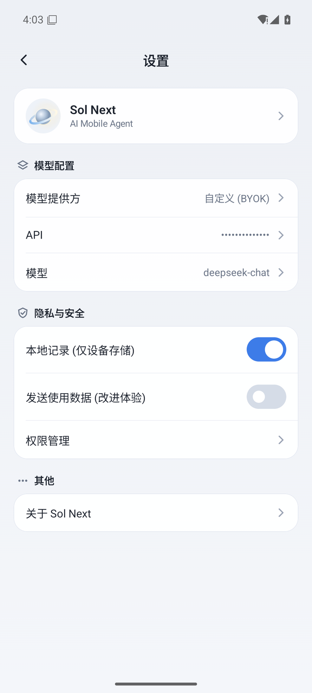
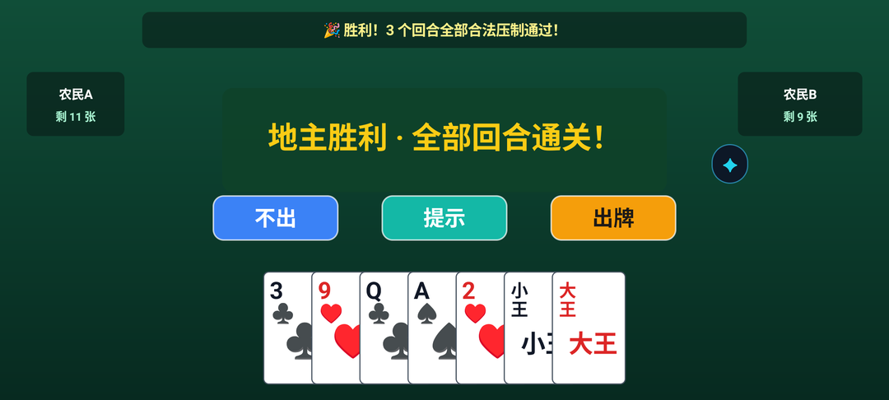

<div align="center">

<a href="https://github.com/chongyangzhang92-hub/Sol-Next/releases/tag/v9.0.2-public">
  
</a>

<br/><br/>

# Sol Next 9.0.2 — Dawn Orbit · Your AI Action Partner

### Speak or Type Naturally. Drive Real Mobile Actions. Built for the Android 16/17 Intelligent OS Era.

> **👨‍💻 Author: 许昌北海医院张重阳 (Zhang Chongyang, Xuchang Beihai Hospital)** &nbsp;·&nbsp; **📕 Xiaohongshu (RedNote): `871348474` (映像河南)**

<sub>Next-Generation Voice + Text Android 10–16 OS Agent (Build <code>901</code> · 16KB Page-Aligned · Auto-Detects HarmonyOS to Skip Wireless Debugging · Keep-Screen-On &amp; Touch Guard · Sensitive Payment/WeChat Confirmation Gate · 100% Zero Built-In Keys / Universal BYOK · Tribute to <code>wangzan101/Mika</code>)</sub>

<br/><br/>

<a href="https://github.com/chongyangzhang92-hub/Sol-Next/releases/download/v9.0.2-public/Sol-Next-v9.0.2-public-arm64.apk"></a>
&nbsp;
<a href="https://github.com/chongyangzhang92-hub/Sol-Next/releases/download/v9.0.2-public/Sol-Next-v9.0.2-public-universal.apk"></a>
&nbsp;
<a href="https://github.com/chongyangzhang92-hub/Sol-Next/releases/tag/v9.0.2-public"></a>

<br/><br/>

[简体中文](README.md) &nbsp;·&nbsp; **English** &nbsp;·&nbsp; [🌐 Website](https://chongyangzhang92-hub.github.io/Sol-Next/) &nbsp;·&nbsp; [`llms.txt`](llms.txt) &nbsp;·&nbsp; [`ai-facts.json`](docs/ai-facts.json) &nbsp;·&nbsp; [`SHA256SUMS.txt`](SHA256SUMS.txt)

</div>

---

## ✨ What Makes Sol Next 9.0.2 a Generational Leap

Sol Next 9.0.2 reinvents the mobile AI agent from the ground up with **zero learning curve**: no cramped text input box on the home screen, no cryptic developer logs, and zero self-hosted local server dependencies. Speak naturally, watch clean human-readable progress & native Android 17 Generative UI cards unfold, and let Sol Next execute across apps, games, and live phone calls.

### 1. The Unified 4-Screen "Dawn Orbit" Experience (Live Android 16 Captures)

<table>
  <tr>
    <td align="center" width="25%">
      <br/>
      <b>1. Voice + Text Home</b><br/>
      <sub>60fps Dawn voice orb + translucent text bar for effortless voice or typing</sub>
    </td>
    <td align="center" width="25%">
      <br/>
      <b>2. Visual Task Execution</b><br/>
      <sub>Progress bar, human step tree, execution timeline &amp; Generative UI cards</sub>
    </td>
    <td align="center" width="25%">
      <br/>
      <b>3. AI Live Phone Calls</b><br/>
      <sub>35-bar voice spectrum, live transcript, Scam Shield &amp; 1-tap Live Whisper</sub>
    </td>
    <td align="center" width="25%">
      <br/>
      <b>4. BYOK &amp; Privacy Settings</b><br/>
      <sub>3-row universal cloud model config, on-device Privacy Firewall &amp; Auto-OTA</sub>
    </td>
  </tr>
</table>

### 2. Six Flagship Breakthroughs Shipping in Executable Code

1. **Zero-Voice-API Real-Time Neural Voice Agent (Built-In 16KB Offline Streaming ASR + TTS)**: Ships Apache-2.0 `sherpa-onnx v2.0.3` + `streaming-zipformer-small-ctc-zh-int8` (`770ms` live Chinese transcription) + `vits-icefall-zh-aishell3` neural Chinese TTS (`573ms` synthesis) directly inside the APK. Works seamlessly with **text-only models (DeepSeek, Claude, Kimi, GLM)** and **zero Google Services / zero voice API keys**, alongside hardware DSP (`AEC + NS + AGC`), forced loudspeaker routing, and `<20ms` barge-in queue flush.
2. **Google Android 16 / 17 Intelligent OS Roadmap Implemented Today**:
   - **Android 17 Generative UI**: Instant `0-Token` native 120Hz Compose dashboards, 2×2 non-truncating verification/translation cards (`sol://copy|speak|save_fact` at 0ms), and agent-rendered interactive cards.
   - **Android 16/17 Magic Cue**: `<0.1ms` on-device proactive whisper pills (OTP copy, parcel tracking, hotlines, navigation, battery saver).
   - **Android 16 AppFunctions & Live Updates**: Native on-device capability discovery (`AppFunctionManager` + `120+` Deep-Links) and `Notification.ProgressStyle` live status chips.
   - **On-Device Private Compute Privacy Firewall & Minimal 2-Step Permissions**: Redacts national IDs, Luhn bank cards, API keys, and passwords locally; encrypts BYOK keys, routines, and Personal AI Memory with Android KeyStore AES-256; requires ONLY Mic + Accessibility (zero custom keyboard, zero default assistant takeover, zero device admin).
3. **Universal Any-Cloud-Model BYOK Engine (Incl. Native Anthropic `/v1/messages`)**: Works out-of-the-box with OpenAI, DeepSeek, official Anthropic Claude (`/v1/messages`), Gemini, Qwen-VL, OpenRouter, or any OpenAI-compatible API — with automatic endpoint capability learning, ML Kit OCR fallback, persistent episodic memory, anti-stall recovery, and blocking high-risk confirmations.
4. **Golden Spatula (`JccSkillPack` + Rust FSD) & Universal Multi-Genre 60Hz Gaming**: Full real execution for Battle of Golden Spatula (`com.tencent.jkchess`) via Rust `<15µs` SwiGLU Value Network + `4×7` Hex Simulator + zero-slip drag, plus multi-genre 60Hz `SolVisualServoEngine` (`FPS`, `MOBA/ARPG` dual-thumb joystick + hazard dodge + skill combos, `Arcade/Runner`, `Tap/Rhythm`, with foreground Accessibility fallback) and 1-tap Quick Center Game Hub.
5. **Carrier-Grade AI Phone Calls, Smart Routines & Live Screen Translator**: Non-default-dialer Telecom companion with `<0.1ms` Scam Shield, 1-tap Live Whisper, 4.5s one-tap Screen Translate & Summary GenUI card, encrypted scheduled routines, and Personal AI Memory Manager.
6. **Hardened Cert-Verified OTA, R8 + True 16KB Alignment & Default Background Virtual Display**: Startup + 6h update checks with APK signing-cert + SHA-256 verification, R8 minification with uncompressed 16KB-aligned native `.so`, and default `uid=2000` Background Virtual Display with an inline collapsible live preview card.

---

## 📊 Verified Android 16 (API 36 · 16KB) Benchmarks

<table>
  <tr>
    <td align="center" width="25%"><br/><sub><b>0-Token Android 17 GenUI</b></sub></td>
    <td align="center" width="25%"><br/><sub><b>Dou Dizhu 3/3 Win (32.5s)</b></sub></td>
    <td align="center" width="25%"><br/><sub><b>Stockfish Chess + Auto-Permission</b></sub></td>
    <td align="center" width="25%"><br/><sub><b>4/4 Hardware Gestures (18.7s)</b></sub></td>
  </tr>
</table>

- **Complex Multi-Step Settings Verification & Restore**: **9.3s · 4/4 verified** (`Dark theme OFF → ON → OFF` verified readback + native Generative UI report card).
- **Dou Dizhu 3-Round Landscape Zero-A11y**: **32.5s · 10 steps · 3/3 rounds won**.
- **4-Primitive Hardware Gesture Arena**: **18.7s · 4/4 first-try** (Tap ✓, Long-Press `823ms / 0px drift` ✓, Drag ✓, Two-Finger Pinch `1.63x` ✓).
- **Android 16 `uid=2000` Background Virtual Display**: **24ms frame capture** with live floating PiP inside Task Execution.
- **Zero-Voice-API Offline Neural ASR + TTS (Android 16 R8)**: **770ms** live Chinese WAV transcription (`streaming-zipformer-small-ctc-zh-int8`) + **573ms** neural Mandarin TTS (`vits-icefall-zh-aishell3`), verified zero-crash with DeepSeek text-only BYOK & zero voice API key.
- **One-Tap Live Screen Translate & Summary**: **4.5s** reading 52 lines from active Virtual Display into a 2×2 Android 17 GenUI card.
- **Verification**: **206/206 tests passed** (`:sol-core:test` 93, `:app:testReleaseUnitTest` 75, Rust `cargo test` 38), `:app:lintVitalRelease`, R8 + true 16KB uncompressed `.so` alignment, and zero-key audit passed.

---

## 📦 SHA-256 Checksums (`v9.0.2-public`)

```text
33bea509d0ffb4da9c6cbfeb2aba2708ed91b3deecfb29fdebb5376618c4df5e  Sol-Next-v9.0.2-public-arm64.apk
1e2c641f8ffe4f2708243f89d732cc6aa06079877eecde11991e178496b07880  Sol-Next-v9.0.2-public-universal.apk
```
