<div align="center">

<a href="https://chongyangzhang92-hub.github.io/Sol-Next/">
  
</a>

<br/><br/>

# ✦ Sol Next 8.0.1

### Millisecond OS Reflexes · Full-Phone Multimodal Mastery · Zero-Trust Privacy

<sub>Open-Source Grounded Multimodal Android 10–16 OS Agent (Build <code>801</code> · 100% Zero Built-In Keys / BYOK · Built Upon &amp; Paying Tribute to <code>wangzan101/Mika</code>)</sub>

<br/><br/>

<a href="https://github.com/chongyangzhang92-hub/Sol-Next/releases/download/v8.0.1-public/Sol-Next-v8.0.1-public-arm64.apk"></a>
&nbsp;
<a href="https://chongyangzhang92-hub.github.io/Sol-Next/"></a>
&nbsp;
<a href="https://chongyangzhang92-hub.github.io/Sol-Next/mika-vs-sol-next.html"></a>
&nbsp;
<a href="https://github.com/wangzan101/Mika"></a>

<br/><br/>

[简体中文](README.md) &nbsp;·&nbsp; **English** &nbsp;·&nbsp; [🛡️ Security & Privacy](https://chongyangzhang92-hub.github.io/Sol-Next/security-and-privacy.html) &nbsp;·&nbsp; [⚡ Benchmarks](https://chongyangzhang92-hub.github.io/Sol-Next/android-ai-agent-benchmarks.html) &nbsp;·&nbsp; [🤖 MCP & BYOK](https://chongyangzhang92-hub.github.io/Sol-Next/mcp-and-byok-guide.html) &nbsp;·&nbsp; [`llms.txt`](llms.txt) &nbsp;·&nbsp; [`ai-facts.json`](docs/ai-facts.json)

<br/>

-0ea5e9?style=flat-square)

-8b5cf6?style=flat-square)


</div>

<br/>

---

<div align="center">

<sub><b>ACT I &nbsp;·&nbsp; LIVE MOTION CINEMA</b></sub>

## 🎬 Sol Next 8.0.1 Live Android 15 Recording & 1080p HD Cinema

<sub>Real Android 15 (1080×2280 @ 440dpi) live capture: 72ms reflex · 1:1 VirtualDisplay live <code>#1..#15</code> Set-of-Mark annotations · Studio 8.0.1 tour · Zero-Key BYOK</sub>

<br/>

<a href="https://chongyangzhang92-hub.github.io/Sol-Next/#demo">
  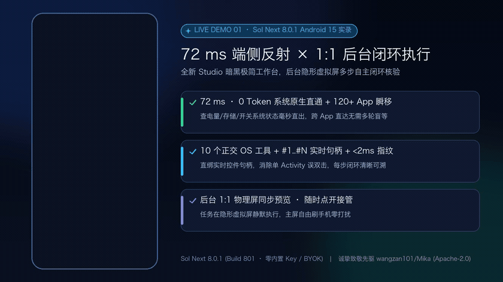
</a>

<br/><br/>

<a href="https://chongyangzhang92-hub.github.io/Sol-Next/#demo"></a>
&nbsp;&nbsp;
<a href="https://chongyangzhang92-hub.github.io/Sol-Next/media/v801/sol-next-demo.mp4"></a>

</div>

<br/>

---

<div align="center">

<sub><b>ACT II &nbsp;·&nbsp; STUDIO 8.0.1 VISUAL GALLERY</b></sub>

## 🎨 Sol Next 8.0.1 Real-Device Studio Showcase (All 10 Live Captures)

<br/>

<a href="docs/media/v801/showcase-studio-trio.png">
  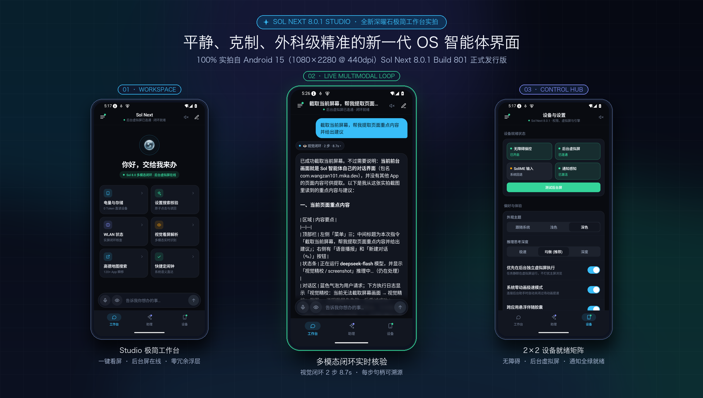
</a>

<sub>Full-res individual screens: <a href="docs/media/v801/screen-v8-workspace.png">Studio Workspace</a> · <a href="docs/media/v801/screen-v8-multimodal.png">Multimodal Closed-Loop Proof</a> · <a href="docs/media/v801/screen-v8-control-hub.png">2×2 Readiness Matrix</a></sub>

<br/><br/>

<a href="docs/media/v801/showcase-superpowers-stage.png">
  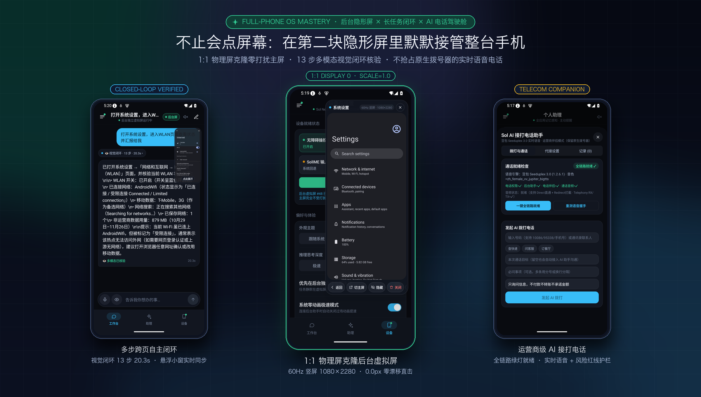
</a>

<sub>Full-res individual screens: <a href="docs/media/v801/screen-26step-task.png">13-Step Verified Loop</a> · <a href="docs/media/v801/screen-vdisplay-1to1.png">1:1 Background VirtualDisplay</a> · <a href="docs/media/v801/screen-ai-call-active.png">Carrier AI Call Cockpit</a></sub>

<br/><br/>

<a href="docs/media/v801/showcase-ecosystem-byok.png">
  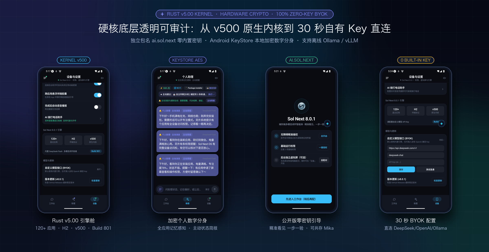
</a>

<sub>Full-res individual screens: <a href="docs/media/v801/screen-brain-cockpit.png">Rust v5.00 Engine</a> · <a href="docs/media/v801/screen-personal-twin.png">Encrypted Personal Twin</a> · <a href="docs/media/v801/screen-public-welcome.png">Zero-Key Welcome</a> · <a href="docs/media/v801/screen-public-byok.png">30s BYOK Setup</a></sub>

</div>

<br/>

---

<div align="center">

<sub><b>ACT III &nbsp;·&nbsp; ZERO-TRUST SECURITY &amp; PRIVACY</b></sub>

## 🛡️ Six-Layer Zero-Trust Security, Privacy & Minimal Attack Surface

<sub>Full auditable whitepaper 👉 <a href="https://chongyangzhang92-hub.github.io/Sol-Next/security-and-privacy.html">Sol Next 8.0.1 Security &amp; Privacy Architecture →</a></sub>

<br/>

<a href="docs/media/v801/compare-security-privacy.png">
  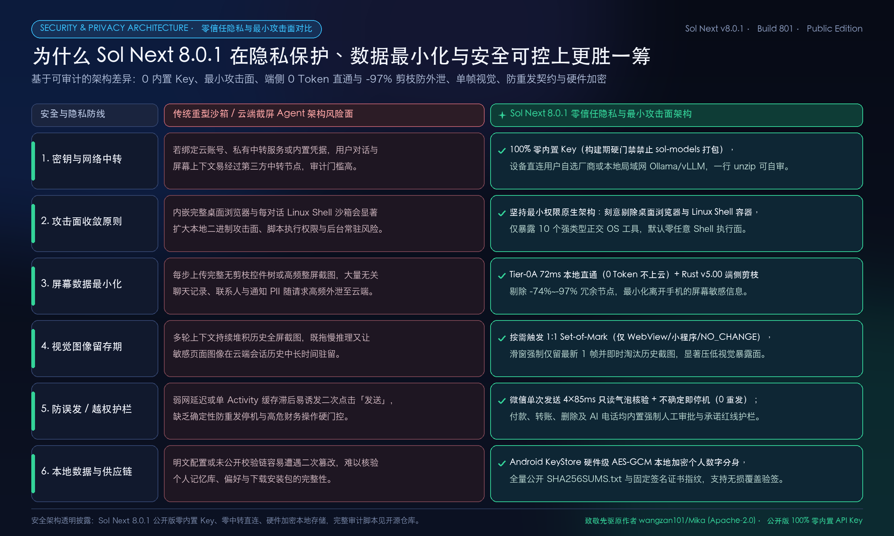
</a>

</div>

<br/>

---

<div align="center">

<sub><b>ACT IV &nbsp;·&nbsp; TRIBUTE TO MIKA &amp; FULL 7-CHART COMPARISON</b></sub>

## 💜 Sincere Tribute to Pioneer Mika (`@wangzan101`) & Full Comparison

<br/>

<a href="https://github.com/wangzan101/Mika">
  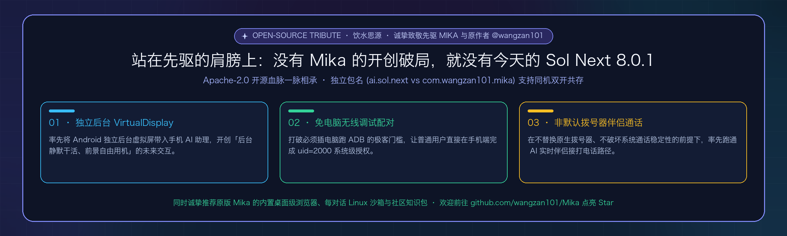
</a>

</div>

<br/>

<table>
  <tr>
    <td align="center" width="50%">
      <a href="docs/media/v801/compare-architecture.png">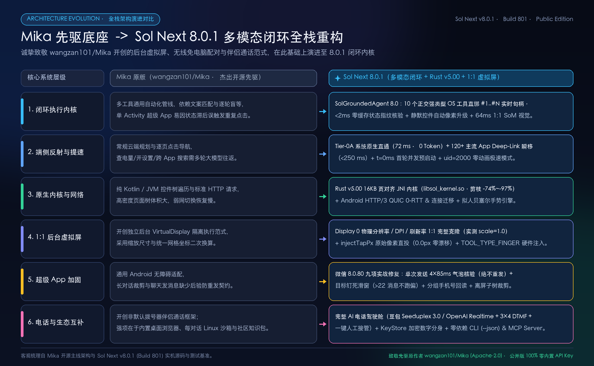</a><br/>
      <b>① Six-Layer Architecture Evolution (Mika → Sol Next 8.0.1)</b>
    </td>
    <td align="center" width="50%">
      <a href="docs/media/v801/compare-benchmark.png">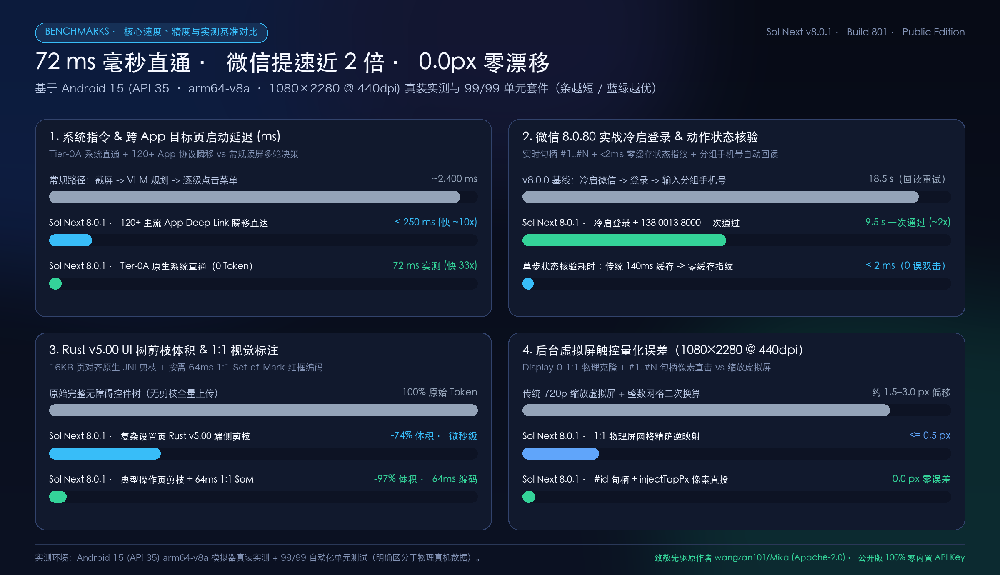</a><br/>
      <b>② Verified Speed, Pruning &amp; Coordinate Drift Benchmarks</b>
    </td>
  </tr>
  <tr>
    <td align="center" width="50%">
      <a href="docs/media/v801/compare-execution-pipeline.png">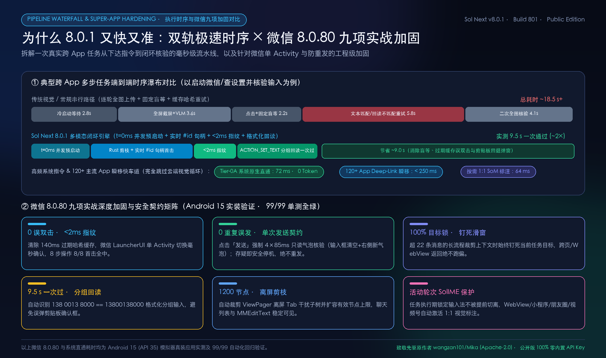</a><br/>
      <b>③ Dual-Track Latency Waterfall &amp; WeChat 8.0.80 9-Fix Hardening</b>
    </td>
    <td align="center" width="50%">
      <a href="docs/media/v801/compare-vdisplay-precision.png">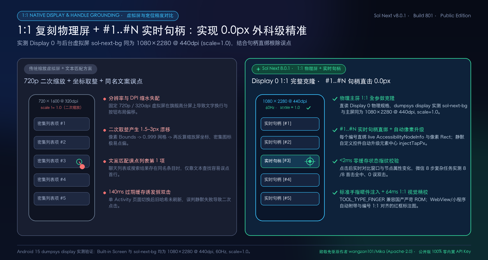</a><br/>
      <b>④ 1:1 Display-0 Clone + Live `#1..#N` Handles (`0.0px`)</b>
    </td>
  </tr>
  <tr>
    <td align="center" width="50%">
      <a href="docs/media/v801/compare-radar-matrix.png">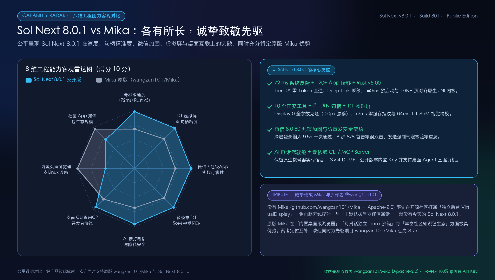</a><br/>
      <b>⑤ 8-Dimension Objective Capability Radar</b>
    </td>
    <td align="center" width="50%">
      <a href="docs/media/v801/compare-ecosystem-matrix.png">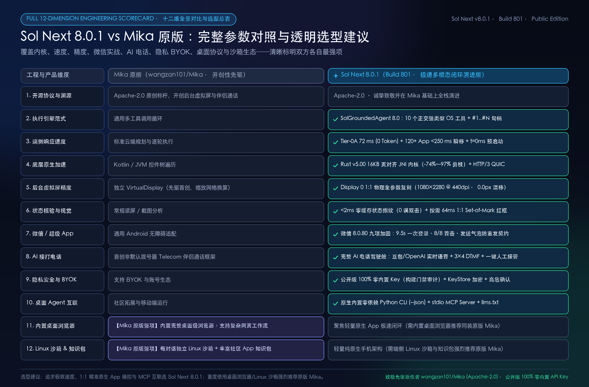</a><br/>
      <b>⑥ Complete 12-Dimension Engineering &amp; Ecosystem Scorecard</b>
    </td>
  </tr>
</table>

<br/>

---

## 📦 Verified Release Artifacts (`v8.0.1-public` · Build 801)

| Artifact | Target ABI | Size | SHA-256 Digest |
|---|---|---:|---|
| [**`Sol-Next-v8.0.1-public-arm64.apk`**](https://github.com/chongyangzhang92-hub/Sol-Next/releases/download/v8.0.1-public/Sol-Next-v8.0.1-public-arm64.apk) *(Recommended)* | `arm64-v8a` | `33.6 MB` | `b6fc90c79fc4d927549c17414244ab6e276b1002da7fbf3b98451ce7c779c3cb` |
| [**`Sol-Next-v8.0.1-public-universal.apk`**](https://github.com/chongyangzhang92-hub/Sol-Next/releases/download/v8.0.1-public/Sol-Next-v8.0.1-public-universal.apk) | `arm64-v8a` + `x86_64` | `45.9 MB` | `7969661db1f9682012a144b79cd744c702238a4aa0b21aaf3e10f7ee679bf046` |

- **Signing Certificate SHA-256**: `d7a6fed0ff42843a20329944f2b1741060048610546df6cf2ad8179cfe335478`
- **One-Line Zero-Key Audit** *(expected: empty output)*: `unzip -l Sol-Next-v8.0.1-public-arm64.apk | grep sol-models`

```bash
python3 scripts/sol-cli.py status --json
python3 scripts/sol-cli.py install --verify-sha256 --grant-permissions --json
python3 scripts/sol-cli.py start-helper --json
python3 scripts/sol-cli.py run --intent "Open Settings and check battery status" --json
```

```json
{
  "mcpServers": {
    "sol-next": {
      "command": "python3",
      "args": ["/path/to/Sol-Next/mcp/sol_mcp_server.py"]
    }
  }
}
```

<div align="center">

**✦ Sol Next 8.0.1 (Build 801)** · Apache-2.0 · Built with deep respect for [**`wangzan101/Mika`**](https://github.com/wangzan101/Mika)

</div>
