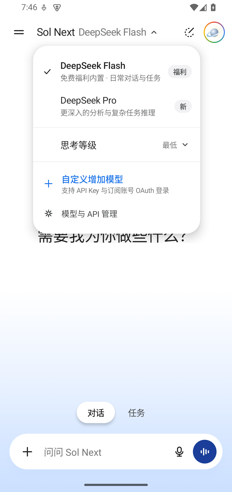

  

# Sol Next 9.1.2 — Open-Source Android AI Assistant & Autonomous Action Agent

### Minimalist Material 3 Dual-Mode (`Chat | Task`) · Built-In Free DeepSeek Flash & Brave Web Search · 4-Stage On-Device Realtime Neural Voice (Zero Cloud Voice API) · Background Independent Virtual Screen · Hands-Free Driving Notification Readout

> **Author:** Zhang Chongyang (许昌北海医院张重阳) &nbsp;·&nbsp; **🇨🇳 [中文主页](README.md)** &nbsp;·&nbsp; **🌐 [Official Website](https://chongyangzhang92-hub.github.io/Sol-Next/)** &nbsp;·&nbsp; **🤖 [llms.txt](llms.txt)**

Release <code>v9.1.2-public</code> (Build <code>911</code> · Apache-2.0 · Android 10–16 &amp; HarmonyOS · 100% Native Material 3 Light &amp; Dark 120Hz · Rust ChaCha20+HMAC-SHA256 Hardware-Bound Vault · 16KB Page-Aligned Native Libraries · 20 Auto-Localized Languages)

  

&nbsp;

&nbsp;

  

-1A73E8?style=flat-square)

---

## Why Sol Next 9.1.2?

**Sol Next** is a free, open-source (Apache-2.0) **AI personal assistant and autonomous mobile action agent** built natively for Android 10–16 and HarmonyOS in Kotlin, Jetpack Compose Material 3, and Rust.

Unlike chat-only assistants, Sol Next unifies **fast everyday AI chat & real-time web search**, a **bundled 4-stage on-device neural voice stack**, **hands-free notification voice readout**, **AI phone call handling**, and a **background independent virtual screen** that executes multi-app phone tasks without interrupting your main display or collapsing your keyboard.

### What's New in v9.1.2 (Build 912)

1. **100% Native Material 3 Fluid Dual-Mode Experience (`Chat | Task`)**
   - Adaptive Light (`#FFFFFF`) & Obsidian Dark (`#0E0F11`) Material 3 across every screen, drawer, bottom sheet, and dialog at up to 120Hz.
   - Instant top-left model switcher with live thinking-effort control (`DeepSeek Flash` low-effort fast default, `DeepSeek Pro` deep reasoning, plus unlimited **BYOK API Keys** and **Subscription OAuth** including 1-tap OpenRouter OAuth 2.0 PKCE callback & GitHub Models).
2. **Built-In Real-Time Web Search (Brave Search API + Automatic Resilient Fallback)**
   - Sealed inside the Rust hardware-bound credential vault with zero plaintext keys; automatically grounds real-time queries (news, weather, prices, latest releases) and multi-hop Deep Research reports with live source links.
3. **Bundled 4-Stage On-Device Realtime Neural Voice System (No Cloud Voice API Needed)**
   - Ships directly inside the APK: **GTCRN Denoiser** (`535 KB`) → **Silero VAD v5** (`<100ms` barge-in, `2.3 MB`) → **Zipformer-CTC Streaming ASR** (`26.3 MB`) → **AISHELL-3 VITS Neural TTS** (`30.5 MB`).
   - Powers **Full-Screen Live Voice**, **Simultaneous Voice-While-Executing**, **AI Phone Calls** (with anti-scam shield & instant human takeover), and **Offline Notification Voice Readout**.
4. **Hands-Free Notification Voice Readout (Driving & Resting)**
   - Reads incoming messages and important alerts aloud offline with transient **Audio Ducking** (`AUDIOFOCUS_GAIN_TRANSIENT_MAY_DUCK`), automatic call/voice-session yielding, **default OTP & financial-digit privacy redaction**, and optional Bluetooth headset / car-audio-only mode.
5. **Free Universal Multi-Provider Login Component**
   - Free Phone OTP (`+86` & international codes, 60s cooldown, salted SHA-256 verification) & Email OTP, plus Google (native Android Account Picker), WeChat, QQ, Apple ID, GitHub, and Huawei/Feishu — stored encrypted in Android Keystore AES-256-GCM.
6. **Task Mode Background Virtual Display & OEM Accessibility Self-Healing**
   - Preserves Sol Next's precision click engine and `DISPLAY_IME_POLICY_HIDE` keyboard isolation so main-screen typing never collapses while tasks run in the background virtual screen.
   - Eliminates repetitive Accessibility permission re-prompts after app swipe-away on aggressive OEM ROMs (MIUI/HyperOS, ColorOS, OriginOS, HarmonyOS) via one-time onboarding persistence + 200ms silent self-heal when Shell Helper is connected.

---

## Real Device Screenshots (Light & Dark Material 3)

<table>
  <tr>
    <td align="center" width="25%"> <b>Minimalist Light Home</b></td>
    <td align="center" width="25%"> <b>Obsidian Dark Markdown</b></td>
    <td align="center" width="25%"> <b>Task Mode Virtual Screen</b></td>
    <td align="center" width="25%"> <b>On-Device Live Voice</b></td>
  </tr>
  <tr>
    <td align="center" width="25%"> <b>Model & Thinking Switcher</b></td>
    <td align="center" width="25%"> <b>OAuth & BYOK Models</b></td>
    <td align="center" width="25%"> <b>Driving Voice Readout</b></td>
    <td align="center" width="25%"> <b>Universal Free Login</b></td>
  </tr>
</table>

---

## Download & Verification (v9.1.2-public)

| Artifact | Target Devices | Size | SHA-256 |
| :--- | :--- | :---: | :--- |
| [`Sol-Next-v9.1.2-public-arm64.apk`](https://github.com/chongyangzhang92-hub/Sol-Next/releases/download/v9.1.2-public/Sol-Next-v9.1.2-public-arm64.apk) | Modern Android 10–16 & HarmonyOS phones (Recommended) | 93 MB | `4f8ddaa1f001d916742e033d88f6eef6c13d3246b7ab77c98c9f939400e4071f` |
| [`Sol-Next-v9.1.2-public-universal.apk`](https://github.com/chongyangzhang92-hub/Sol-Next/releases/download/v9.1.2-public/Sol-Next-v9.1.2-public-universal.apk) | ARM64 + x86_64 devices & Android emulators | 131 MB | `cbc35c643c00ca8d2b9b78faa266d5d9fc054dbe25717688cd0218eb7f2dfc0b` |

- **Signing Certificate SHA-256 (in-place upgrade compatible across all releases):** `d7a6fed0ff42843a20329944f2b1741060048610546df6cf2ad8179cfe335478`
- **Security Guarantee:** Zero plaintext API keys in Git, DEX, or APK assets; 16KB page-aligned native libraries; Android Keystore AES-256-GCM local encryption for user credentials and memory; Apache-2.0 License.

---

## Documentation, SEO/GEO & Community

- **Official Website:** https://chongyangzhang92-hub.github.io/Sol-Next/
- **AI Crawler & GEO Index:** [`llms.txt`](llms.txt) · [`llms-full.txt`](llms-full.txt) · [`docs/ai-facts.json`](docs/ai-facts.json) · [`CITATION.cff`](CITATION.cff)
- **Author:** Zhang Chongyang (`许昌北海医院张重阳`) · Issues & PRs welcome at [GitHub Issues](https://github.com/chongyangzhang92-hub/Sol-Next/issues)
