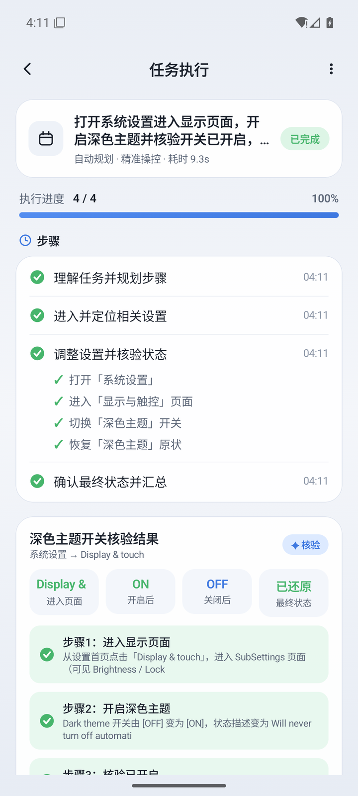

<div align="center">

<a href="https://github.com/chongyangzhang92-hub/Sol-Next/releases/tag/v9.0.1-public">
  
</a>

<br/><br/>

# Sol Next 9.0.1 — Dawn Orbit · Your AI Action Partner

### Speak Naturally. Drive Real Mobile Actions. Built for the Android 16/17 Intelligent OS Era.

<sub>Next-Generation Voice-First Android 10–16 OS Agent (Build <code>901</code> · 16KB Page-Aligned · 100% Zero Built-In Keys / Universal BYOK · Tribute to <code>wangzan101/Mika</code>)</sub>

<br/><br/>

<a href="https://github.com/chongyangzhang92-hub/Sol-Next/releases/download/v9.0.1-public/Sol-Next-v9.0.1-public-arm64.apk"></a>
&nbsp;
<a href="https://github.com/chongyangzhang92-hub/Sol-Next/releases/download/v9.0.1-public/Sol-Next-v9.0.1-public-universal.apk"></a>
&nbsp;
<a href="https://github.com/chongyangzhang92-hub/Sol-Next/releases/tag/v9.0.1-public"></a>

<br/><br/>

[简体中文](README.md) &nbsp;·&nbsp; **English** &nbsp;·&nbsp; [🌐 Website](https://chongyangzhang92-hub.github.io/Sol-Next/) &nbsp;·&nbsp; [`llms.txt`](llms.txt) &nbsp;·&nbsp; [`ai-facts.json`](docs/ai-facts.json) &nbsp;·&nbsp; [`SHA256SUMS.txt`](SHA256SUMS.txt)

</div>

---

## ✨ What Makes Sol Next 9.0.1 a Generational Leap

Sol Next 9.0.1 reinvents the mobile AI agent from the ground up with **zero learning curve**: no cramped text input box on the home screen, no cryptic developer logs, and zero self-hosted local server dependencies. Speak naturally, watch clean human-readable progress & native Android 17 Generative UI cards unfold, and let Sol Next execute across apps, games, and live phone calls.

### 1. The Unified 4-Screen "Dawn Orbit" Experience (Live Android 16 Captures)

<table>
  <tr>
    <td align="center" width="25%">
      <br/>
      <b>1. Voice-First Home</b><br/>
      <sub>Zero text box · Tap the glowing orb or <code>∞</code> for full-duplex live voice</sub>
    </td>
    <td align="center" width="25%">
      <br/>
      <b>2. Visual Task Execution</b><br/>
      <sub>Progress bar, human step tree, execution timeline &amp; Generative UI cards</sub>
    </td>
    <td align="center" width="25%">
      <br/>
      <b>3. AI Live Phone Calls</b><br/>
      <sub>35-bar voice spectrum, live transcript, Scam Shield &amp; 1-tap Live Whisper</sub>
    </td>
    <td align="center" width="25%">
      <br/>
      <b>4. BYOK &amp; Privacy Settings</b><br/>
      <sub>3-row universal cloud model config, on-device Privacy Firewall &amp; Auto-OTA</sub>
    </td>
  </tr>
</table>

### 2. Six Flagship Breakthroughs Shipping in Executable Code

1. **Full-Duplex Real-Time Voice Agent**: Hardware DSP (`AcousticEchoCanceler` + `NoiseSuppressor` + `AutomaticGainControl`), `<20ms` barge-in interruption, `<400ms` conversational replies, and instant OS action dispatching with live spoken verification.
2. **Google Android 16 / 17 Intelligent OS Roadmap Implemented Today**:
   - **Android 17 Generative UI**: Instant `0-Token` native 120Hz Compose dashboards + agent-rendered interactive cards (`ui_render_card`).
   - **Android 16/17 Magic Cue**: `<0.1ms` on-device proactive whisper pills (OTP copy, parcel tracking, hotlines, navigation, battery saver).
   - **Android 16 AppFunctions & Live Updates**: Native on-device capability discovery (`AppFunctionManager` + `120+` Deep-Links) and `Notification.ProgressStyle` live status chips.
   - **On-Device Private Compute Privacy Firewall**: Automatically redacts national IDs, Luhn-validated bank cards, API keys, and passwords locally before any cloud LLM request leaves your phone.
3. **Universal Any-Cloud-Model BYOK Engine**: Zero local GPU servers required. Works out-of-the-box with OpenAI, DeepSeek, Claude, Gemini, Qwen-VL, OpenRouter, or any OpenAI-compatible API — with automatic endpoint capability learning, text-only on-device ML Kit OCR vision fallback, persistent long-horizon episodic memory, anti-oscillation detection, and adaptive test-time compute scaling.
4. **Human-Like Real-Time Gaming**: Simultaneous 4-finger `multi_touch` (left thumb joystick + right thumb skills/aim), burst `ui_tap_sequence`, bottom-row card/button OCR, and 60Hz `realtime_play`.
5. **Carrier-Grade AI Phone Calls + On-Device Scam Shield**: Non-default-dialer Telecom companion with `<0.1ms` real-time scam detection (screen-sharing, OTP theft, impersonation), 1-tap Pixel Call Screen-style live whisper steering, and instant human takeover.
6. **Autonomous Built-In OTA Updater & 60Hz Background Virtual Display**: Startup + 6-hour background update checks, push notifications, Wi-Fi atomic pre-download, and `uid=2000` Picture-in-Picture background virtual screen execution.

---

## 📊 Verified Android 16 (API 36 · 16KB) Benchmarks

<table>
  <tr>
    <td align="center" width="25%"><br/><sub><b>0-Token Android 17 GenUI</b></sub></td>
    <td align="center" width="25%"><br/><sub><b>Dou Dizhu 3/3 Win (32.5s)</b></sub></td>
    <td align="center" width="25%"><br/><sub><b>Stockfish Chess + Auto-Permission</b></sub></td>
    <td align="center" width="25%"><br/><sub><b>4/4 Hardware Gestures (18.7s)</b></sub></td>
  </tr>
</table>

- **Complex Multi-Step Settings Verification & Restore**: **9.3s · 4/4 verified** (`Dark theme OFF → ON → OFF` verified readback + native Generative UI report card).
- **Dou Dizhu 3-Round Landscape Zero-A11y**: **32.5s · 10 steps · 3/3 rounds won**.
- **4-Primitive Hardware Gesture Arena**: **18.7s · 4/4 first-try** (Tap ✓, Long-Press `823ms / 0px drift` ✓, Drag ✓, Two-Finger Pinch `1.63x` ✓).
- **Android 16 `uid=2000` Background Virtual Display**: **24ms frame capture** with live floating PiP inside Task Execution.
- **Verification**: 100% unit tests (`:sol-core:test`, `:app:testReleaseUnitTest`), `:app:lintVitalRelease`, and zero-key audit passed.

---

## 📦 SHA-256 Checksums (`v9.0.1-public`)

```text
e3e877e011907c8a8a92f88271252cb4c4ac653eba898395306367548fa1631b  Sol-Next-v9.0.1-public-arm64.apk
a6bc9791d5717c08e3077bb406af8ce557c8157c28298f6f1285e7cb7359f689  Sol-Next-v9.0.1-public-universal.apk
```
