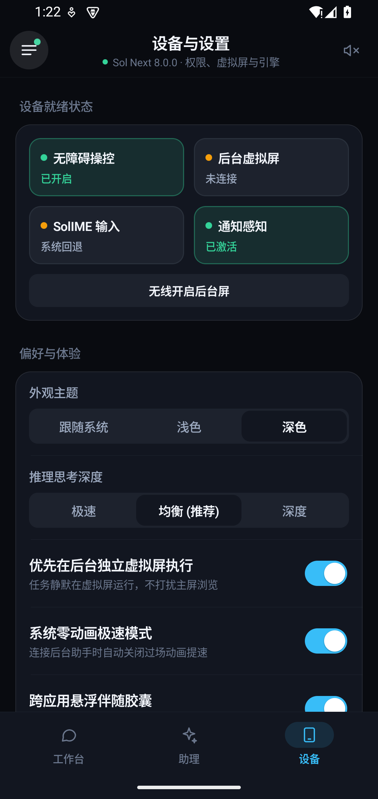

<div align="center">

> **Sol Next 8.0.1 Public Edition (Build 801 · Zero Built-In Keys / BYOK)**: Grounded multimodal closed-loop engine (`SolGroundedAgent` with 10 orthogonal tools, live Accessibility handle grounding, 1:1 Set-of-Mark vision), redesigned Studio minimalist UI, and 9 real-device WeChat 8.0.80 fixes (99/99 unit tests passing). Dedicated package `ai.sol.next` preserving the original public signing certificate for seamless upgrades.


# Sol Next — Open-Source BYOK Android AI Phone Agent (Built Upon Mika)

[简体中文](README.md) · **English** · [🌐 Interactive Product Website & HD Video](https://chongyangzhang92-hub.github.io/Sol-Next/) · [🤖 `llms.txt`](llms.txt) · [🛠 `AGENTS.md`](AGENTS.md) · [📊 Deep Comparison vs Mika](docs/guides/COMPARISON_WITH_MIKA.md) · [🔑 BYOK Setup Guide](docs/guides/BYOK_SETUP.md)

<br/>

<a href="https://github.com/chongyangzhang92-hub/Sol-Next/releases/latest"></a>
<a href="https://chongyangzhang92-hub.github.io/Sol-Next/"></a>
<a href="https://github.com/wangzan101/Mika"></a>

<br/>


<sub>▲ Real Android 16 capture: 1:1 Native Virtual Display (1080×2400 @ 420dpi), Rust v3.10 telemetry cockpit, and carrier-grade AI Phone Calls</sub>

</div>

---

## 🙏 Tribute to Mika (`@wangzan101`)

**Sol Next** is proudly built upon the inspiration and architectural foundation of [**Mika (`github.com/wangzan101/Mika`)**](https://github.com/wangzan101/Mika) (Apache-2.0) created by **`@wangzan101`**.

Mika pioneered the hidden Android `VirtualDisplay` phone agent paradigm, computer-free wireless debugging onboarding, and the non-UI `InCallService` companion phone architecture. **Sol Next** honors that vision and pushes the mobile runtime envelope further with:

1. **Rust v3.10 Native JNI Kernel**: Microsecond on-device UI tree pruning (`-74% to -97%` payload reduction in `17–45 µs`), BM25 + synonym semantic skill routing (`51 µs`, 0 tokens), and mid-SSE incremental action extraction (`80 µs`).
2. **True 1:1 Native Physical Virtual Display Cloning**: Clones Display 0's exact resolution, DPI, and refresh rate (`scale=1.0`, up to 4K / 840dpi) with zero-drift `injectTapPx` raw-pixel taps, sub-pixel float PiP/OCR injection, and standard `TOOL_TYPE_FINGER` hardware events.
3. **HTTP/3 QUIC 0-RTT + Anti-Pause Long-Task Engine**: Chromium `HttpEngine` QUIC transport with a 12s header watchdog & smart circuit breaker, 64-round autonomous loop, `TimeoutCancellationException` isolation, in-process WakeLock + WifiLock keep-alive, Xiaomi HyperOS 3-tier Back & zero false-positive safety shields, and automatic checkpoint recovery.
4. **Complete Carrier AI Phone Call Cockpit & Personal Assistant**: Native dialer untouched, Volcengine Seeduplex 3.0 & OpenAI Realtime BYOK voice bridge, 3×4 interactive DTMF keypad, speakerphone toggle, multi-call isolation, one-tap human takeover, and encrypted on-device personal perception.
5. **100% Zero Built-In API Keys (Public BYOK Edition)**: Standalone package `ai.sol.next` with zero embedded secrets and zero private relay servers — connect directly to DeepSeek, OpenAI, OpenRouter, SiliconFlow, Qwen, or any OpenAI-compatible API right from Settings.

---

## 📱 Sol Next 8.0.1 Studio Interface (Live Android 15 Captures)

<table>
<tr>
<td align="center" width="33%">
<br/>
<b>Studio Workspace</b><br/>
<sub>Calm command surface with instant screen vision &amp; quick tasks</sub>
</td>
<td align="center" width="33%">
<br/>
<b>Verified Closed-Loop Trace</b><br/>
<sub>Collapsible handle-level proof with latency &amp; verification badges</sub>
</td>
<td align="center" width="33%">
<br/>
<b>Device Hub &amp; Native BYOK</b><br/>
<sub>2×2 readiness matrix, wireless VirtualDisplay &amp; local BYOK engine</sub>
</td>
</tr>
</table>

---

## 📊 Visual Comparisons: Sol Next vs Mika

| Architecture Evolution | Measured Latency & Precision |
|---|---|
|  |  |

| 1:1 Physical Display vs Scaled Display | Balanced 8-Axis Capability Radar |
|---|---|
|  |  |

> **Fair & Transparent Credit**: While Sol Next pushes performance, 1:1 display precision, Xiaomi HyperOS anti-pause reliability, and carrier AI calling, the original [**Mika**](https://github.com/wangzan101/Mika) remains outstanding for its built-in desktop-class browser, per-chat Linux sandbox (Python/Node), MCP computer integration, and curated community app knowledge base. Both projects share Apache-2.0 roots — please star [**wangzan101/Mika**](https://github.com/wangzan101/Mika) as well!

---

## 🚀 Quick Start (30 Seconds, Zero Built-In Keys)

1. **Install APK**: Grab `Sol-Next-v8.0.1-public-arm64.apk` from [Releases](https://github.com/chongyangzhang92-hub/Sol-Next/releases/latest).
2. **Enter Your Own API Key (BYOK)**: Open the **Control & Settings** tab → pick a preset (`DeepSeek`, `OpenAI`, `OpenRouter`, `SiliconFlow`, `Qwen`) or custom Base URL → paste your API Key → tap **Save & Test**.
3. **Optional — Enable 1:1 Background Virtual Phone**: Tap **Auto-Pair Wireless Debugging** to unlock the 1:1 Virtual Display, zero-animation turbo, zero-accessibility tree direct read, and AI phone call audio bridge without needing a PC.

## 🤖 Agent-Ready: Zero-Hallucination CLI (`--json`) & Stdio MCP Server

Sol Next ships with [`llms.txt`](llms.txt), [`llms-full.txt`](llms-full.txt), [`AGENTS.md`](AGENTS.md), [`CLAUDE.md`](CLAUDE.md), [`.env.example`](.env.example), a zero-dependency Python 3.9+ CLI, and a native MCP Server:

```bash
python3 scripts/sol-cli.py status --json
python3 scripts/sol-cli.py install --verify-sha256 --grant-permissions --json
python3 scripts/sol-cli.py start-helper --json
python3 scripts/sol-cli.py run --intent "Open Settings and check battery status" --json
```

```json
{
  "mcpServers": {
    "sol-next": {
      "command": "python3",
      "args": ["/path/to/Sol-Next/mcp/sol_mcp_server.py"]
    }
  }
}
```

## 📄 License

Licensed under **Apache-2.0** — see [LICENSE](LICENSE) and [NOTICE](NOTICE).
