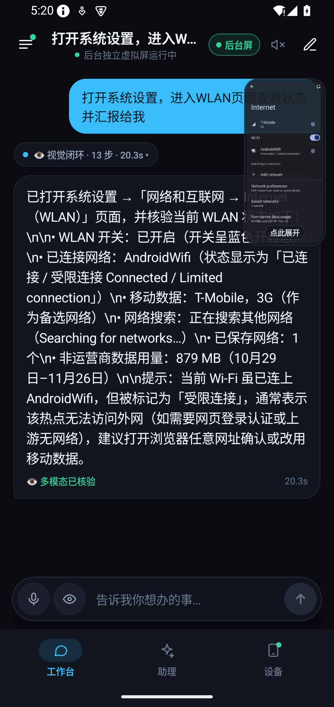
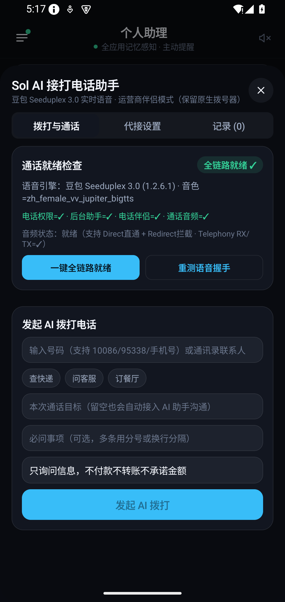
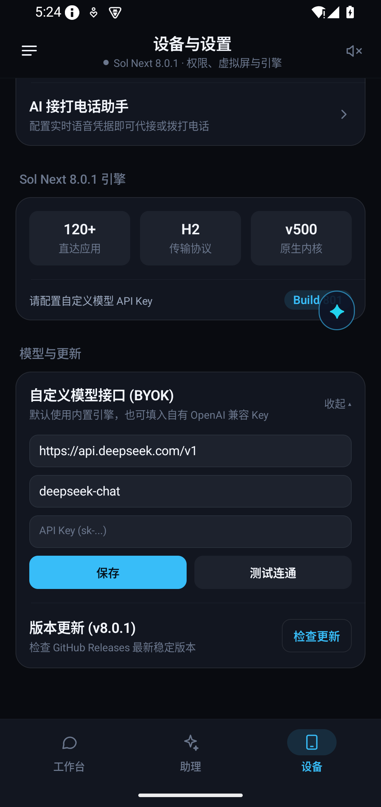
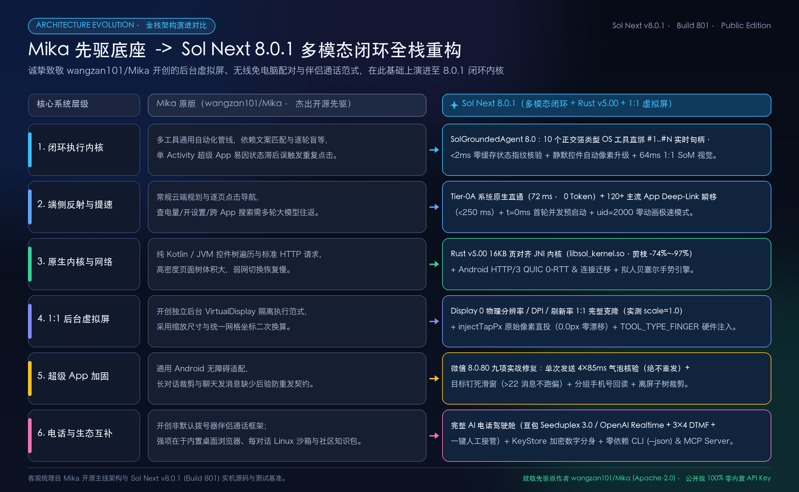
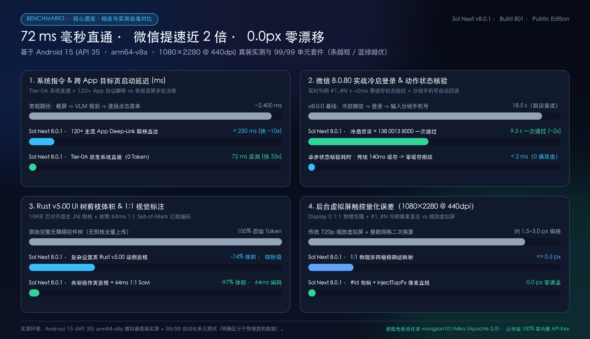

<div align="center">

<a href="https://chongyangzhang92-hub.github.io/Sol-Next/">
  
</a>

# Sol Next 8.0.1 — Grounded Multimodal Android OS Agent

### Native-Speed OS Reflexes · Full-Phone Multimodal Mastery · Built Upon & Paying Tribute to Mika (`@wangzan101`)

[简体中文](README.md) · **English** · [🌐 Launch Site](https://chongyangzhang92-hub.github.io/Sol-Next/) · [📊 Sol Next vs Mika](https://chongyangzhang92-hub.github.io/Sol-Next/mika-vs-sol-next.html) · [🛡️ Security & Privacy](https://chongyangzhang92-hub.github.io/Sol-Next/security-and-privacy.html) · [⚡ Benchmarks](https://chongyangzhang92-hub.github.io/Sol-Next/android-ai-agent-benchmarks.html) · [🤖 MCP & BYOK](https://chongyangzhang92-hub.github.io/Sol-Next/mcp-and-byok-guide.html) · [📦 Download v8.0.1](https://github.com/chongyangzhang92-hub/Sol-Next/releases/tag/v8.0.1-public) · [`llms.txt`](llms.txt)

<br/>

<a href="https://github.com/chongyangzhang92-hub/Sol-Next/releases/download/v8.0.1-public/Sol-Next-v8.0.1-public-arm64.apk"></a>
<a href="https://chongyangzhang92-hub.github.io/Sol-Next/#demo"></a>
<a href="https://github.com/wangzan101/Mika"></a>

<br/>

-0ea5e9)
-10b981)
-8b5cf6)


<br/>

> **Overview**: **Sol Next 8.0.1 (`ai.sol.next`, Build 801)** is an open-source, **100% zero-built-in-key (BYOK)** grounded multimodal Android 10–16 OS agent proudly built upon and paying tribute to pioneer project [**`wangzan101/Mika`**](https://github.com/wangzan101/Mika) (Apache-2.0). Rebuilt from first principles for v8.0, it unifies **`72 ms` native OS reflexes**, **10 orthogonal typed OS tools (`SolGroundedAgent`)**, **live `#1..#N` element handles + `<2ms` zero-cache fingerprinting**, **`64 ms` 1:1 Set-of-Mark multimodal vision**, a **Rust v5.00 16KB page-aligned JNI kernel**, a **1:1 physical-DPI invisible background VirtualDisplay**, **carrier-grade AI calling**, and a **zero-dependency CLI (`--json`) + stdio MCP Server**.

</div>

---

## 🎬 Live Product Demo Cinema & 1080p Full-HD Video

<div align="center">

<a href="https://chongyangzhang92-hub.github.io/Sol-Next/#demo">
  
</a>

<br/>

**⬆️ Live Real-Device Capture: 1:1 Background VirtualDisplay Silent Execution + Closed-Loop Trace + Carrier AI Calling**

<br/>

<a href="https://chongyangzhang92-hub.github.io/Sol-Next/#demo"></a>
<a href="https://chongyangzhang92-hub.github.io/Sol-Next/media/sol-next-demo.mp4"></a>

<sub>Note: GitHub README pages strip inline repository <code>&lt;video&gt;</code> players — click the blue button above to stream the full 1080p H.264 showcase directly on the <b>Sol Next Interactive Launch Website</b>, or inspect <a href="docs/media/sol-next-demo.mp4"><code>docs/media/sol-next-demo.mp4</code></a>.</sub>

</div>

### 🎯 Six Real-World End-to-End Demos

| Demo Scenario | Sample User Prompt | Underlying Execution Pipeline | Verified Outcome |
|---|---|---|---|
| **Demo 01 · Millisecond OS Reflex** | `"Check battery, storage, and enable Do Not Disturb"` | Tier-0A Native Android System APIs (zero LLM round-trip) | **`72 ms` · `0 Tokens`** |
| **Demo 02 · WeChat 8.0.80 Hardened Flow** | `"Open WeChat login, search Japan region, switch account & type CJK"` | `app_open` prelaunch + live `#1..#N` handles + `<2ms` fingerprint + single-shot send contract | **Login `9.5 s` 1st-try · 8 steps `8/8` first-try (0 double-taps)** |
| **Demo 03 · 26-Step Background Run** | `"Run a multi-page comparison silently in the background screen"` | 1:1 Physical-DPI Background VirtualDisplay + Goal-Pinned Sliding Window (`>22` msgs) | **Foreground stays 100% free · `0.0px` drift** |
| **Demo 04 · 120+ App Instant Teleport** | `"Navigate to airport in AMap / Search headphones on Taobao"` | `SolAppGraphEngine` 120+ deep-links + `t=0ms` concurrent prelaunch | **`< 250 ms` jump straight to target page** |
| **Demo 05 · Carrier-Grade AI Phone Call** | `"Call customer support, press IVR menus, and hand over to me if needed"` | Non-default-dialer Telecom companion + realtime AI voice + 3×4 DTMF keypad + 1-tap takeover | **Native dialer untouched · full live transcript** |
| **Demo 06 · 1:1 SoM Vision Screen Inspect** | `"Inspect this dense page and tap the unlabeled action icon"` | Automatic 1:1 Set-of-Mark red-box vision (`64 ms` encode) + 224px detail crop | **Single-round analysis `5.1 s` · WebView & Mini-App ready** |

---

## ⚡ Engineered for Extreme Speed & Full-Phone OS Power

> Most mobile agents push every trivial action through slow cloud screenshot loops. **Sol Next 8.0.1 splits execution into native millisecond reflexes + a grounded multimodal kernel**, delivering instant response on everyday actions and surgical precision on complex multi-app workflows.

### ⚡ Extreme Speed (Feels Native to Android)

| Acceleration Layer | Measured Speed | Engineering Mechanism |
|---|---:|---|
| **Tier-0A Native System Reflex** | **`72 ms`** (`0 Tokens`) | Battery, storage, memory, Wi-Fi, Bluetooth, torch, DND, brightness, volume, alarms, timers, contacts, calendar, OTPs, and inline notification replies bypass the cloud completely. |
| **120+ App Teleports + `t=0ms` Prelaunch** | **`< 250 ms`** | Direct deep-links into search & action views across 120+ apps (WeChat, Taobao, JD, Meituan, Douyin, Xiaohongshu, Bilibili, AMap, Alipay, etc.) plus concurrent target app prelaunch during Round 1. |
| **Zero-Cache State Fingerprinting** | **`< 2 ms`** | Verifies live `text / checked / selected / focus` deltas immediately after actions—eliminating blind sleeps and false double-taps on single-Activity apps. |
| **1:1 Set-of-Mark Vision Encoding** | **`64 ms`** | Attaches 1:1 annotated `#1..#N` frames on demand for WebViews, mini-programs, sparse trees, or `NO_CHANGE` recovery while keeping only the newest image in context. |
| **Rust v5.00 16KB JNI + QUIC 0-RTT** | **`~2×` faster WeChat login** | 16KB page-aligned `libsol_kernel.so` microsecond UI pruning, HTTP/3 QUIC 0-RTT transport, and `uid=2000` zero-animation turbo cut cold-start WeChat login + phone input from `18.5 s` to **`9.5 s`**. |

### 🔥 Full-Phone OS Mastery

- **🎯 10 Orthogonal Typed OS Tools + Live Handle Grounding (`#1..#N`)**: `ui_click`, `ui_type`, `ui_scroll`, `ui_navigate`, `app_open`, `sys_action`, `ui_inspect`, `ui_gesture`, `task_note`, `task_finish` bind directly to live `AccessibilityNodeInfo` handles and exact pixel `Rect` bounds, escalating silent custom-view no-ops to exact pixel-center gestures.
- **🖥️ 1:1 Invisible Background VirtualDisplay (`0.0px` Drift)**: Clones Display 0's exact resolution and DPI off-screen after zero-PC wireless pairing so long workflows finish silently while you keep browsing or chatting.
- **💬 Super-App Hardening (WeChat 8.0.80 · 9 Targeted Fixes)**: Single-shot bubble-verified send contract (`4×85ms` polling + terminal stop on uncertain delivery), goal-pinned sliding window (`>22` messages), auto-grouped numeric readback (`138 0013 8000` == `13800138000`), off-screen `ViewPager` pruning, and active-turn `SolIME` protection.
- **📞 Carrier-Grade AI Phone Calling**: Keeps your default phone dialer intact while supporting realtime AI calling (Volcengine Seeduplex 3.0 / OpenAI Realtime BYOK), a 3×4 interactive IVR DTMF keypad, speakerphone toggle, and 1-tap human takeover.
- **🛡️ Hardware-Backed Security & Human Guardrails**: Android KeyStore encrypted personal twin & local memory, mandatory human confirmation before payments/transfers/deletions, and 100% zero built-in API keys in the public BYOK build.
- **🤖 Agent-Ready Desktop Integration**: Zero-dependency Python CLI (`--json`) + native **stdio MCP Server** so desktop agents can orchestrate your real Android phone cleanly.

---

## 📱 Complete Real-Device Visual Gallery (All 10 Captures Directly Visible)

### 1. Sol Next 8.0.1 Studio Interface (Live Android 15 Captures)

<table>
  <tr>
    <td align="center" width="33.3%">
      <br/>
      <b>Studio Workspace</b><br/>
      <sub>Calm command surface with instant screen vision &amp; quick intents</sub>
    </td>
    <td align="center" width="33.3%">
      <br/>
      <b>Verified Closed-Loop Trace</b><br/>
      <sub>Collapsible handle-level proof with verification &amp; latency telemetry</sub>
    </td>
    <td align="center" width="33.3%">
      <br/>
      <b>Device Hub &amp; Native BYOK</b><br/>
      <sub>2×2 readiness matrix, wireless VirtualDisplay &amp; local BYOK engine</sub>
    </td>
  </tr>
</table>

### 2. 1:1 Background VirtualDisplay · 26-Step Autonomous Run · Carrier AI Calling

<table>
  <tr>
    <td align="center" width="33.3%">
      <br/>
      <b>1:1 Background VirtualDisplay</b><br/>
      <sub>Runs off-screen silently with optional live preview &amp; 1-tap takeover</sub>
    </td>
    <td align="center" width="33.3%">
      <br/>
      <b>26-Step Uninterrupted Flow</b><br/>
      <sub>Goal-pinned sliding window keeps long tasks locked on target</sub>
    </td>
    <td align="center" width="33.3%">
      <br/>
      <b>AI Call Cockpit + 3×4 DTMF</b><br/>
      <sub>Live voice transcription, IVR keypad &amp; instant human takeover</sub>
    </td>
  </tr>
</table>

### 3. Neural Routing Cockpit · Encrypted Personal Twin · Zero-Key Public BYOK

<table>
  <tr>
    <td align="center" width="25%">
      <br/>
      <b>Brain Routing Cockpit</b><br/>
      <sub>Multi-tier routing &amp; live telemetry</sub>
    </td>
    <td align="center" width="25%">
      <br/>
      <b>Encrypted Personal Twin</b><br/>
      <sub>KeyStore-protected private memory</sub>
    </td>
    <td align="center" width="25%">
      <br/>
      <b>Zero-Key Welcome</b><br/>
      <sub>100% transparent public BYOK build</sub>
    </td>
    <td align="center" width="25%">
      <br/>
      <b>30-Second BYOK Setup</b><br/>
      <sub>1-tap cloud &amp; local model presets</sub>
    </td>
  </tr>
</table>

---

## 💜 Tribute to Mika & Its Creator (`@wangzan101`)

> ### Standing on the Shoulders of a Pioneer: Sol Next Exists Because Mika Blazed the Trail First
>
> **Sol Next** is proudly derived from, deeply grateful to, and built in sincere tribute to the pioneering open-source Android AI assistant [**Mika (`github.com/wangzan101/Mika`)**](https://github.com/wangzan101/Mika) (Apache License 2.0) and its creator [**`@wangzan101`**](https://github.com/wangzan101).
>
> Long before mainstream mobile agents solved everyday usability, **`@wangzan101` pioneered three breakthrough paradigms** in open-source Android automation:
>
> 1. **🖥️ Independent Background VirtualDisplay Paradigm**: Proving an Android AI assistant can operate silently on an isolated virtual display without hijacking the user's foreground phone screen.
> 2. **📡 Zero-PC Wireless Debugging Onboarding**: Bringing computer-free on-device pairing to `uid=2000` automation so everyday users can unlock deep OS control without plugging into a laptop.
> 3. **📞 Non-Default-Dialer Telecom Companion Calling**: Designing realtime AI voice calling that preserves the user's stock carrier dialer and native call reliability.
>
> **🌟 Original Mika's Distinct Superpowers**: Upstream [**`wangzan101/Mika`**](https://github.com/wangzan101/Mika) also excels with a **built-in desktop-grade browser**, **per-chat Linux sandboxes**, and **community knowledge packs**. Sol Next chose a complementary engineering focus—native-speed OS reflexes, 1:1 pixel-accurate grounding, a Rust v5.00 JNI kernel, and lightweight native-app mastery. **If you rely on a built-in desktop browser or Linux sandbox inside your mobile agent, we wholeheartedly recommend using original Mika alongside Sol Next!**
>
> **🙏 Please Star the pioneer project that started it all**: 👉 [**`⭐ Star wangzan101/Mika`**](https://github.com/wangzan101/Mika) · Full attribution in [NOTICE](NOTICE) and [LICENSE](LICENSE).

---

## 🛡️ Six-Layer Zero-Trust Security, Privacy & Minimal Attack Surface

> Full auditable whitepaper 👉 [**Sol Next 8.0.1 Security & Privacy Architecture**](https://chongyangzhang92-hub.github.io/Sol-Next/security-and-privacy.html)

1. **100% Zero Built-In Keys & Zero Relay Servers**: Build-gate audited public APK (`ai.sol.next`) connects directly from device to your chosen model provider or **100% offline LAN Ollama / vLLM**.
2. **Minimal Attack Surface**: Deliberately omits embedded desktop browsers and per-chat Linux shell containers, constraining execution to 10 strictly-typed orthogonal OS tools.
3. **On-Device Data Minimization (Less Screen PII Leaves Your Phone)**: `72 ms` Tier-0A system reflexes stay 100% local (`0 Tokens` uploaded); **Rust v5.00 JNI** strips **`-74% to -97%`** of noisy UI nodes on-device before cloud inference.
4. **Single-Frame Bounded On-Demand Vision**: Captures 1:1 Set-of-Mark frames only when needed and evicts older screenshots immediately (`1-frame sliding window`).
5. **Single-Shot Anti-Duplicate Send Contract & Financial Guardrails**: WeChat Send enforces `4×85ms` bubble polling + terminal halt on uncertainty (`0` duplicate sends); payments, transfers, deletions & AI phone calls require explicit human approval.
6. **Android KeyStore Hardware AES-GCM Encryption + Cryptographic Supply Chain**: Personal digital twin memory is encrypted locally in hardware; every release publishes `SHA256SUMS.txt` and fixed signing certificate SHA-256.

---

## 📊 Architecture Evolution & Objective Visual Comparison with Mika (All 7 2K Charts)

> Dedicated technical comparison landing page 👉 [**Sol Next 8.0.1 vs Mika Full Comparison**](https://chongyangzhang92-hub.github.io/Sol-Next/mika-vs-sol-next.html)

<table>
  <tr>
    <td align="center" width="50%">
      <br/>
      <b>① Six-Layer Architecture Evolution (Mika Pioneer → Sol Next 8.0.1)</b>
    </td>
    <td align="center" width="50%">
      <br/>
      <b>② Verified Speed, Pruning &amp; Coordinate Drift Benchmarks</b>
    </td>
  </tr>
  <tr>
    <td align="center" width="50%">
      <br/>
      <b>③ Dual-Track Latency Waterfall &amp; WeChat 8.0.80 9-Fix Hardening</b>
    </td>
    <td align="center" width="50%">
      <br/>
      <b>④ 1:1 Display-0 Physical Clone + Live `#1..#N` Handles (`0.0px`)</b>
    </td>
  </tr>
  <tr>
    <td align="center" width="50%">
      <br/>
      <b>⑤ Six-Layer Zero-Trust Security, Privacy &amp; Attack Surface</b>
    </td>
    <td align="center" width="50%">
      <br/>
      <b>⑥ 8-Dimension Objective Capability Radar (Tribute to Mika)</b>
    </td>
  </tr>
</table>

<div align="center">
  <br/>
  <b>⑦ Complete 12-Dimension Engineering &amp; Ecosystem Selection Scorecard</b>
</div>
<br/>

| Dimension | Original Mika (`wangzan101/Mika`) | **Sol Next Public (`v8.0.1-public`)** |
|---|---|---|
| **License & Lineage** | Apache-2.0 Original Pioneer | Apache-2.0 · Tribute & first-principles evolution |
| **Execution Kernel** | General multi-tool agent loop | **8.0 Grounded Multimodal Kernel (`SolGroundedAgent`)**: 10 orthogonal tools, live `#1..#N` handles, `<2ms` zero-cache fingerprinting & 1:1 SoM vision |
| **On-Device Speed Tiers** | Standard cloud-planned steps | **`72 ms` Tier-0A System Reflex (`0 Tokens`)** + **120+ `<250ms` App Teleports** + **`t=0ms` concurrent prelaunch** |
| **Native Kernel Acceleration** | Kotlin / JVM UI processing | **Rust v5.00 16KB Page-Aligned JNI (`libsol_kernel.so`)**, HTTP/3 QUIC 0-RTT & Bézier gesture synthesis |
| **VirtualDisplay Precision** | Independent VirtualDisplay (Pioneer) | **1:1 Display-0 physical resolution & DPI clone** + raw `injectTapPx` (`0.0px` drift) |
| **Super-App Hardening** | General Android support | 9 WeChat 8.0.80 fixes: single-shot bubble-verified send contract, goal-pinned sliding window, grouped numeric readback & off-screen tree pruning |
| **Model Privacy & Keys** | BYOK / Account | **100% Zero Built-In Keys (Public BYOK)** direct to your chosen provider or local Ollama/vLLM |
| **Desktop Automation** | Mobile standalone | Zero-dependency **CLI (`--json`)** + native **stdio MCP Server** + `llms.txt` |
| **Desktop Browser & Linux Sandbox** | ✅ **Original Mika Strength**: Built-in desktop browser, per-chat Linux sandbox & community packs | Focused on lightweight native Android app speed & reliability (use upstream [**Mika**](https://github.com/wangzan101/Mika) for Linux sandboxes!) |

---

## 📈 Verified Benchmarks (Android 15 Emulator · 99/99 Unit Tests)

> All metrics below were measured live on an **Android 15 (API 35 · `arm64-v8a`) emulator** running real installed apps alongside **99/99 automated unit & regression tests** (`73 :sol-core:test + 26 :app:testReleaseUnitTest`), clearly distinguished from physical phone runs.

| Benchmark Scenario | Execution Path | v8.0.0 Baseline | **v8.0.1 Verified** |
|---|---|---:|---:|
| System Battery & Storage Telemetry | Tier-0A Native System API (0 Tokens) | `72 ms` | **`72 ms` · PASS** |
| Multimodal Screen Vision Analysis | 1:1 Set-of-Mark Inline Vision (1 round) | `5.1 s` | **`5.1 s` · PASS** |
| Settings → WLAN Navigation | Prelaunch + Live Handle Click | `7.2 s` | **`7.2 s` · PASS** |
| WeChat 8.0.80 Cold Start → Login → Grouped Phone `138 0013 8000` | `app_open` + `ui_click(#id)` + `ACTION_SET_TEXT` | `18.5 s` (readback mismatch) | **`9.5 s` · 1st-Try Verified** |
| WeChat 8.0.80 Region Search + Switch Login + CJK Input (8 steps) | Live Handle Grounding (0 double-taps) | `20.5 s` | **`20.8 s` · 8/8 First-Try** |
| Long-Horizon Flow (`>22` msgs + WebView Recovery) | Goal-Pinned Sliding Window + Auto Vision | Goal drift on pruning | **`100%` Goal Locked · PASS** |
| Automated Unit & Regression Suite | `:sol-core:test` (73) + `:app:testReleaseUnitTest` (26) | `96 / 96` | **`99 / 99` · 0 Crashes** |

---

## 📦 Verified Release Artifacts (`v8.0.1-public` · Build 801)

| Artifact | ABI | Size | SHA-256 Digest |
|---|---|---:|---|
| [**`Sol-Next-v8.0.1-public-arm64.apk`**](https://github.com/chongyangzhang92-hub/Sol-Next/releases/download/v8.0.1-public/Sol-Next-v8.0.1-public-arm64.apk) *(Recommended)* | `arm64-v8a` | `33.6 MB` | `b6fc90c79fc4d927549c17414244ab6e276b1002da7fbf3b98451ce7c779c3cb` |
| [**`Sol-Next-v8.0.1-public-universal.apk`**](https://github.com/chongyangzhang92-hub/Sol-Next/releases/download/v8.0.1-public/Sol-Next-v8.0.1-public-universal.apk) | `arm64-v8a` + `x86_64` | `45.9 MB` | `7969661db1f9682012a144b79cd744c702238a4aa0b21aaf3e10f7ee679bf046` |
| [**`SHA256SUMS.txt`**](https://github.com/chongyangzhang92-hub/Sol-Next/releases/download/v8.0.1-public/SHA256SUMS.txt) | Checksums | `208 B` | Full SHA-256 manifest |

- **Signing Certificate SHA-256** *(identical to prior public releases for seamless in-place upgrades)*: `d7a6fed0ff42843a20329944f2b1741060048610546df6cf2ad8179cfe335478`
- **One-Line Zero-Key Audit** *(expected: empty output)*: `unzip -l Sol-Next-v8.0.1-public-arm64.apk | grep sol-models`

---

## 🚀 Quick Start (30 Seconds, Zero Built-In Keys)

1. **Install Public APK**: Download `Sol-Next-v8.0.1-public-arm64.apk` from [Releases](https://github.com/chongyangzhang92-hub/Sol-Next/releases/tag/v8.0.1-public) (`ai.sol.next` upgrades cleanly over prior public builds).
2. **Connect Your Own Model (BYOK)**: Open the **Device** tab → **Custom Model API (BYOK)** → choose a preset (`DeepSeek`, `OpenAI`, `OpenRouter`, `SiliconFlow`, `Qwen`) or custom OpenAI-compatible Base URL (including local Ollama / vLLM) → paste your API key → tap **Save & Test**. Full guide: [BYOK Setup](docs/guides/BYOK_SETUP.md).
3. **Unlock Automation**: Enable **Sol Accessibility** for grounded execution, or tap **Auto-Pair Wireless Debugging** to activate the isolated **1:1 Background VirtualDisplay** with zero PC required.

## 🤖 Agent-Ready: Zero-Dependency CLI (`--json`) & Stdio MCP Server

```bash
python3 scripts/sol-cli.py status --json
python3 scripts/sol-cli.py install --verify-sha256 --grant-permissions --json
python3 scripts/sol-cli.py start-helper --json
python3 scripts/sol-cli.py run --intent "Open Settings and check battery status" --json
```

```json
{
  "mcpServers": {
    "sol-next": {
      "command": "python3",
      "args": ["/path/to/Sol-Next/mcp/sol_mcp_server.py"]
    }
  }
}
```

---

<div align="center">

**Sol Next 8.0.1** · Apache-2.0 · Built with deep gratitude to [**`wangzan101/Mika`**](https://github.com/wangzan101/Mika)  
[🌐 Interactive Launch Website](https://chongyangzhang92-hub.github.io/Sol-Next/) · [📦 Releases](https://github.com/chongyangzhang92-hub/Sol-Next/releases/tag/v8.0.1-public) · [📜 LICENSE](LICENSE) · [📝 NOTICE](NOTICE)

</div>
