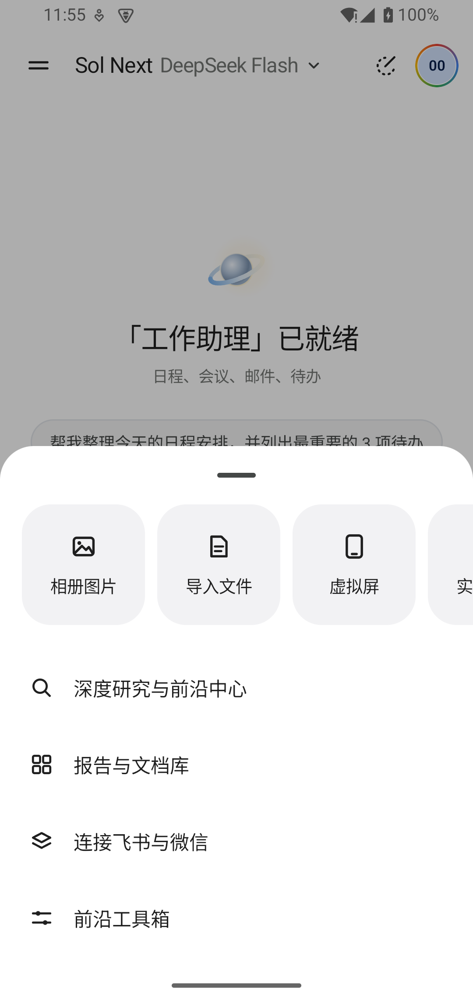
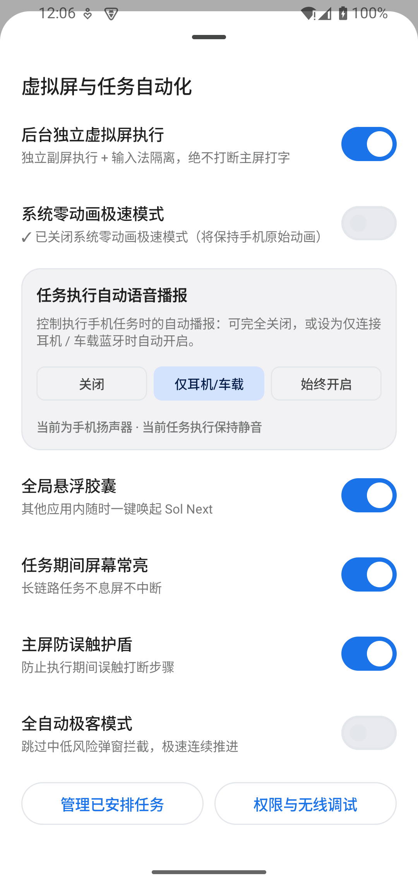
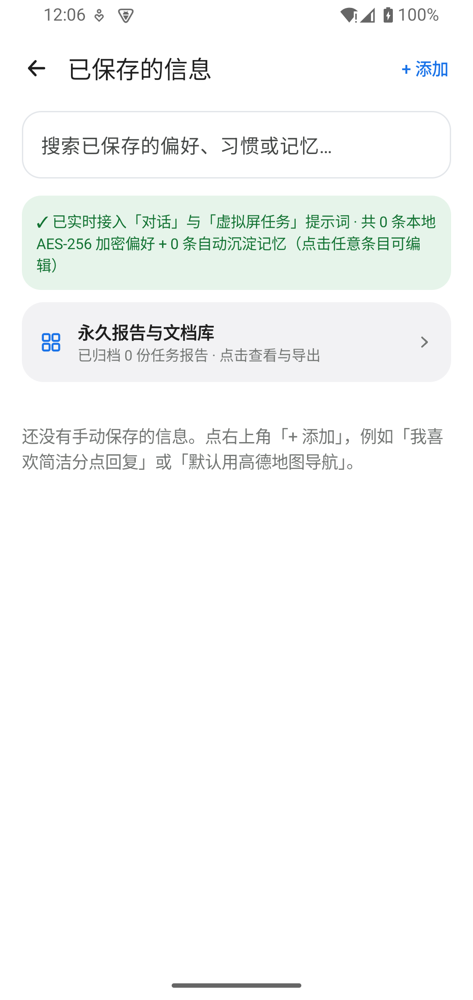
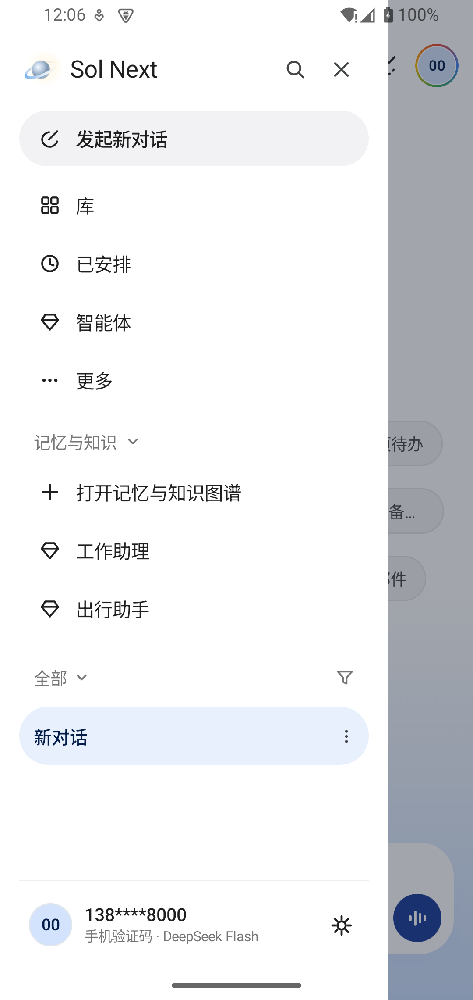
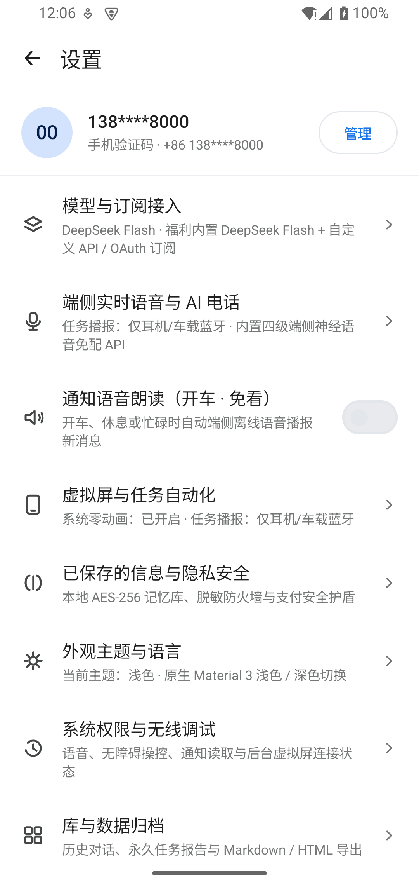
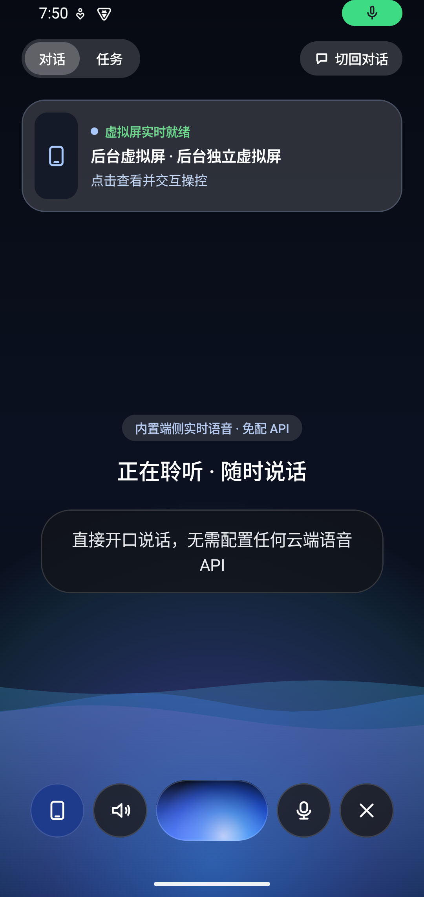

<div align="center">

<a href="https://github.com/chongyangzhang92-hub/Sol-Next/releases/tag/v9.2.0-public">
  
</a>

<br/><br/>

# Sol Next 9.2.0 — 装在手机上的开源免费 AI 助手与「自主行动替身」

### 12 项极致精准执行内核升级 · 系统零动画开关 · 仅耳机/车载蓝牙任务播报 · Compose `TextFieldState` 零卡顿输入 · 全功能三栏 AI 智能电话 · 真实相册/文档/智能体/记忆闭环

> **👨‍💻 作者：许昌北海医院张重阳** &nbsp;·&nbsp; **💬 [微信扫码联系作者 / 加入官方交流群](#-联系作者与官方交流群)** &nbsp;·&nbsp; **📕 小红书：`871348474`（映像河南）**

<sub>全新 <code>v9.2.0</code>（Build <code>920</code> · Apache-2.0 开源 · 支持 Android 10–16 与 HarmonyOS · 原生 Material 3 浅色 / 深色 120Hz 自适应 · Rust 硬件加密内置 DeepSeek Flash + Brave 实时联网搜索 · 四级端侧神经语音零配置即用 · 20 国语言自动适配）</sub>

<br/><br/>

<a href="https://webui.67-230-181-51.sslip.io/assets/sol-public/v9.2.0/Sol-Next-v9.2.0-public-arm64.apk"></a>
&nbsp;
<a href="https://github.com/chongyangzhang92-hub/Sol-Next/releases/download/v9.2.0-public/Sol-Next-v9.2.0-public-arm64.apk"></a>
&nbsp;
<a href="https://cdn.gh-proxy.org/https://github.com/chongyangzhang92-hub/Sol-Next/releases/download/v9.2.0-public/Sol-Next-v9.2.0-public-arm64.apk"></a>
&nbsp;
<a href="https://webui.67-230-181-51.sslip.io/assets/sol-public/v9.2.0/Sol-Next-v9.2.0-public-universal.apk"></a>

<br/><br/>

🌐 **Language / 全球 20 国语言**：**简体中文** · [English](README.en.md) · [繁體中文](docs/i18n/README.zh-TW.md) · [日本語](docs/i18n/README.ja.md) · [한국어](docs/i18n/README.ko.md) · [Español](docs/i18n/README.es.md) · [Français](docs/i18n/README.fr.md) · [Deutsch](docs/i18n/README.de.md) · [Português](docs/i18n/README.pt.md) · [Русский](docs/i18n/README.ru.md) · [العربية](docs/i18n/README.ar.md) · [हिन्दी](docs/i18n/README.hi.md) · [Bahasa Indonesia](docs/i18n/README.id.md) · [Tiếng Việt](docs/i18n/README.vi.md) · [ภาษาไทย](docs/i18n/README.th.md) · [Türkçe](docs/i18n/README.tr.md) · [Italiano](docs/i18n/README.it.md) · [Nederlands](docs/i18n/README.nl.md) · [Polski](docs/i18n/README.pl.md) · [Bahasa Melayu](docs/i18n/README.ms.md)

<br/>

[✨ v9.2.0 重磅升级](#-v920-重磅升级一览极致执行内核与用户反馈全面落地) &nbsp;·&nbsp; [📱 v9.2.0 真机实拍](#-v920-真机界面实拍全流程实测验证) &nbsp;·&nbsp; [⚡ 执行内核 12 项升级](#-极致执行内核-12-项底层突破速度--精度--稳定性) &nbsp;·&nbsp; [🧠 6 大核心能力](#-sol-next-的-6-大核心能力) &nbsp;·&nbsp; [🔒 安全与校验](#-安全加密与官方校验值) &nbsp;·&nbsp; [❓ FAQ](#-常见问题-faq) &nbsp;·&nbsp; [🌐 官网](https://chongyangzhang92-hub.github.io/Sol-Next/)

<br/>

-1A73E8?style=flat-square)


</div>

---

## 💡 30 秒看懂 Sol Next 是什么？

**Sol Next** 是一款专为 Android 10–16 与鸿蒙（HarmonyOS）手机打造的**开源、免费、开箱即用的原生 AI 个人助手与自主操作手机智能体（Mobile AI Agent）**。

与只能“聊天给文字建议”的普通 AI App 不同，Sol Next 将**丝滑原生 Material 3 对话体验**、**内置免费 DeepSeek Flash & Brave 实时联网搜索**、**四级端侧神经实时语音**、**全功能 AI 智能接打电话**与**后台独立虚拟屏手机操控能力**融为一体：

- **日常问答 & 多模态深度理解（对话模式）**：免费内置 **DeepSeek Flash**（支持一键切换 `DeepSeek Pro` 深度思考或自有 API Key / 订阅 OAuth）与 **Brave Search 实时联网搜索**；支持直接发**相册图片（内置端侧 ML Kit 中文 OCR）**、**导入文档代码**、输入 `@` 呼出专属智能体，并结合你的本地加密记忆给出个性化高质量回答。
- **真正帮你动手操作手机（任务模式）**：轻点底部「**任务**」，在**后台独立虚拟屏**里跨 App 替你办事（查订单、比价、点外卖、发消息、整理日程、定时自动化），主屏正常使用不打断、不抢键盘；高风险支付与微信操作严格触发二次确认护盾。
- **全场景端侧实时语音（免配任何云端语音 API）**：安装包原生集成 GTCRN 降噪 + Silero VAD v5 + Zipformer-CTC 识别 + AISHELL-3 VITS 语音合成，统一驱动**全屏 Live 实时语音**、**三栏 AI 智能接打电话**与**开车/休息免看屏通知语音朗读**。

---

## ✨ v9.2.0 重磅升级一览（极致执行内核与用户反馈全面落地）

| 升级维度 | v9.2.0 (Build 920) 全新落地内容 |
| :--- | :--- |
| 🚀 **极致执行内核 12 项底层跃升** | 不可变前缀 KV Cache + 8 消息定步长纪元压缩、意图分档精简 11 工具集、`near_text` 同行锚点零误触消歧、混合中屏小程序/WebView OCR 自动融合、纯文本模型零编码加速、假搜索框 40ms 动态接管、`ui_scroll_collect` 批量滚动采集（提速 5 倍）、0-Token 开屏广告/弹窗自清反射与 RSI 零云端技能复放。 |
| 🔇 **任务执行自动语音播报三档精细控制** | 彻底响应用户反馈：在设置页新增 **「关闭」 / 「仅耳机/车载」（默认） / 「始终开启」** 三档开关，基于 Android `AudioDeviceInfo` 实时检测有线、USB-C、蓝牙耳机与车载蓝牙；**公共场所手机外放 100% 静音，连上耳机或车载蓝牙自动开启播报**。 |
| ⚡ **系统零动画极速模式（默认开启 · 支持开关）** | 在「设置 › 虚拟屏与任务自动化」新增**系统零动画极速模式**开关：**默认开启**，连接无线调试后自动写 `0x` 跨页极速提速；如需保留原机动画，随时一键关闭即可自动还原手机原始过渡与窗口动画缩放。 |
| ⌨️ **根治输入法适配 Bug 与打字卡顿** | 全面迁移至 Jetpack Compose `TextFieldState`（`PartialGapBuffer` 零父级重组）+ 叶组件隔离 30fps 虚拟屏帧流 + 95ms GPU 缓冲交叉淡入流式排版；打开抽屉自动收起键盘、弹出软键盘时折叠态虚拟屏浮窗自动避让发送按钮、修复自动化 `clearFirst` 并实现剪贴板粘贴后 420ms 自动恢复原剪贴板内容。 |
| 📞 **AI 智能电话全面升级三栏实战工作台** | 彻底告别简陋界面！全新 **「拨打与操控」｜「来电代接」｜「记录」** 三栏架构：实时计时器、反诈预警横幅、双向转写、通话中**静默暗语传话**、可折叠 DTMF 按键、静音/免提/AI 接管/真人接管、通讯录选联系人、双卡选卡、4 套拨打预设、4 套来电人设（外卖快递/推销拒接/开会转告/全能秘书）、暂停 30 分/2 小时、VIP 直通与完整通话摘要/回拨管理。 |
| 🧩 **全部子模块真实闭环，绝不浮于表面** | **专属智能体**指令真实注入对话与任务系统提示词（支持 `@` / `＠` 中英文快捷切换、输入框内可关闭芯片、查看与编辑自定义智能体）；**已保存的信息**支持全文搜索、点击直接编辑并实时同步推理；`+` 面板真实接入**相册图片（ML Kit OCR + JPEG）**与**文档导入**；**扩展与工具**实时呈现各模块运行状态。 |
| 🔐 **两步强制安全启用闭环** | 严格执行「**① 免费账号登录 → ② 开启必选系统权限 → ③ 解锁完整工作区**」安全引导，登录凭证与本地记忆均经 Android Keystore AES-256-GCM 硬件加密保存。 |

---

## 📱 v9.2.0 真机界面实拍（全流程实测验证）

<div align="center">
<table>
  <tr>
    <td align="center" width="25%">
      <br/>
      <b>极简原生 Material 3 主页</b><br/><sub>对话 | 任务 双模式 + 快捷推荐</sub>
    </td>
    <td align="center" width="25%">
      <br/>
      <b>`@` 快捷呼出专属智能体</b><br/><sub>TextFieldState 零卡顿输入</sub>
    </td>
    <td align="center" width="25%">
      <br/>
      <b>1ms 系统 0 + DeepSeek 实测</b><br/><sub>工作助理绑定 · 外放静音零误触</sub>
    </td>
    <td align="center" width="25%">
      <br/>
      <b>相册图片 / 文档真实接入</b><br/><sub>端侧 ML Kit OCR + 多模态理解</sub>
    </td>
  </tr>
  <tr>
    <td align="center" width="25%">
      <br/>
      <b>零动画开关 & 三档任务播报</b><br/><sub>关闭 / 仅耳机车载 / 始终开启</sub>
    </td>
    <td align="center" width="25%">
      <br/>
      <b>AI 智能电话 · 拨打与操控</b><br/><sub>选联系人 · 场景预设 · 暗语传话</sub>
    </td>
    <td align="center" width="25%">
      <br/>
      <b>AI 智能电话 · 来电代接</b><br/><sub>4 套代接人设 · 暂停与 VIP 直通</sub>
    </td>
    <td align="center" width="25%">
      <br/>
      <b>已保存的信息（实时同步）</b><br/><sub>搜索 · 编辑 · AES-256 加密记忆</sub>
    </td>
  </tr>
</table>
</div>

<details>
<summary>📸 展开查看深色模式、全屏端侧 Live 语音、模型下拉与侧边导航抽屉实拍</summary>
<br/>
<div align="center">
<table>
  <tr>
    <td align="center" width="25%">
      <br/>
      <b>侧边导航抽屉</b><br/><sub>展开自动收起输入法</sub>
    </td>
    <td align="center" width="25%">
      <br/>
      <b>设置中心</b><br/><sub>零动画与语音状态一目了然</sub>
    </td>
    <td align="center" width="25%">
      <br/>
      <b>深色模式自适应</b><br/><sub>#0E0F11 纯黑护眼排版</sub>
    </td>
    <td align="center" width="25%">
      <br/>
      <b>全屏端侧 Live 语音</b><br/><sub>免配云端语音 API 即开即聊</sub>
    </td>
  </tr>
</table>
</div>
</details>

---

## ⚡ 极致执行内核 12 项底层突破（速度 · 精度 · 稳定性）

| # | 优化机制 | 解决的核心痛点 | 实测收益 |
| :---: | :--- | :--- | :--- |
| **1** | **不可变前缀 KV Cache + 8 消息定步长纪元压缩** | 旧版每步改写历史头导致云端前缀缓存全失效 | 长链路任务前缀缓存命中率大幅跃升，首字响应显著提速 |
| **2** | **意图驱动双工具集分档（11 核心 vs 扩展）** | 每次任务都传 25+ 工具 Schema 浪费 Token 且易选错工具 | 常规操作精简 ~52% 工具 Schema 长度，工具调用更准更快 |
| **3** | **`near_text` 同行锚点消歧** | 电商/设置列表多个同名「加入购物车」「开启」按钮易误点首项 | 结合同行商品/标题坐标精准锁定目标行，零误点 |
| **4** | **混合中屏稀疏 OCR 融合** | 小程序/WebView 仅顶栏底栏有节点、中屏空白导致传统无障碍失明 | 自动检测中屏稀疏并运行端侧 ML Kit OCR 补全交互点 |
| **5** | **纯文本模型 `encodeImage = false` 零浪费通道** | 纯文本模型不吃图却仍支付红框重绘与 JPEG/Base64 编码耗时 | 省去冗余绘图与编码开销，同时保留端侧 OCR 文本增强 |
| **6** | **流式 `ui_action_chain` 增量步骤抽取** | 多步连招需等整包 JSON 吐完才能感知进度 | SSE 流中实时解析 `"op"` 步态，规划状态即时反馈 |
| **7** | **假搜索框 40ms 动态 `EditText` 接管** | 淘宝/美团点击假搜索框跳转新页出现新输入框时旧句柄死等超时 | 40ms 内自动捕获新页 `EditText` 句柄并无缝写入 |
| **8** | **`ui_scroll_collect` 批量滚动采集** | 统计订单/账单/长聊天记录每翻 1 屏调 1 次大模型耗时极长 | 1 轮连翻 1~6 屏本地去重汇总，命中终止词自动停，提速 5 倍 |
| **9** | **任务途中 0-Token 安全弹窗自清反射** | 跨页突现开屏广告、推广弹窗、系统权限框白耗大模型轮次 | `<200ms` 零云端自清，严格排除含支付/登录/删除字样界面 |
| **10** | **Tier 0D 验证式 RSI 零云端技能复放** | 高频固定多步操作每次都重新走云端规划 | 熟练纯 UI 技能直接零云端复放，每步均强制过敏感防护 |
| **11** | **去除冗余前台等待** | 虚拟屏与 Deep-Link 已稳态却重复等待 300~520ms | 单步跨页响应再压减数百毫秒 |
| **12** | **进入任务模式通道预热** | 用户切入任务页开始打字期间连接冷启动 | 切入即异步预热 TLS 1.3 与 KV Cache，发送即达 |

---

## 🧠 Sol Next 的 6 大核心能力

1. **对话与任务双模式 (`对话 | 任务`)**：日常问答、多模态看图读文档、Brave 实时联网调研与后台独立虚拟屏自主操作无缝融合；系统提示词与用户输入严格隔离，专属智能体与长期记忆绝不干扰 1ms 系统 0 通道与敏感防护。
2. **四级端侧实时神经语音（免配任何云端语音 API）**：原生集成 **GTCRN 降噪 (535 KB) → Silero VAD v5 (`<100ms` 打断, 2.3 MB) → Zipformer-CTC 识别 (26.3 MB) → AISHELL-3 VITS 语音合成 (30.5 MB)**，驱动全屏 Live 语音、AI 电话与通知语音朗读。
3. **AI 智能电话三栏工作台**：支持通讯录选号、双卡选卡、场景预设、来电自动代接人设、暂停/恢复、VIP 白名单直通、反诈护盾、实时双向转写、通话中暗语传话、DTMF 按键与 AI 摘要归档。
4. **开车 / 休息通知语音朗读 & 三档任务播报**：通知朗读支持 Audio Ducking 压低音乐与自动隐藏短信验证码；任务执行自动播报支持「关闭 / 仅耳机·车载蓝牙 / 始终开启」，兼顾公共场所安静与开车解放双手。
5. **免费内置模型 + Brave 联网搜索 + 订阅 OAuth / BYOK 无限扩展**：开箱即用免费内置 DeepSeek Flash 与 Brave Search，支持零重启热切换 DeepSeek Pro、OpenRouter PKCE OAuth、GitHub Models、OpenAI、Anthropic、硅基流动等任意模型。
6. **永久本地 AES-256 记忆库 · 智能体 · 每日定时自动化 · 报告库导出**：支持搜索编辑已保存信息、`@` 一键调用智能体、自然语言定时任务，以及 Markdown / HTML / TXT 导出与飞书/企微直推。

---

## 🔒 安全加密与官方校验值

| 安全与工程维度 | 实现方案 |
| :--- | :--- |
| **Rust 2024 原生加密保险库 (`libsol_kernel.so`)** | ChaCha20 + Encrypt-then-MAC HMAC-SHA256 + HKDF-SHA256 构建期封箱，运行时校验包名、APK v2/v3 证书 SHA-256 及反调试，公开 APK 中 **0 明文密钥**。 |
| **Android Keystore AES-256-GCM 本地加密** | 用户自有 API Key、OAuth 令牌、账号凭证与个人记忆 100% 本地硬件加密保存。 |
| **端侧隐私脱敏防火墙 & 高危二次确认** | 发往云端前自动脱敏身份证、银行卡与密码；支付、转账、微信发送等高危操作强制触发确认护盾。 |
| **Android 15/16 16KB 页对齐** | 全部 `.so` 动态库（Rust 内核 + Sherpa-ONNX）严格满足 Android 15/16 **16KB 内存页对齐**规范。 |

### 官方发布校验值（`v9.2.0-public` · Build `920`）

```text
签名证书 SHA-256 (兼容全部历史版本覆盖升级):
d7a6fed0ff42843a20329944f2b1741060048610546df6cf2ad8179cfe335478

APK 文件 SHA-256:
398145f17f1cb17b228aeae6bb94b9d0e47320cc6ffd76afff6b511dbfc6305f  Sol-Next-v9.2.0-public-arm64.apk
5d721c2681b755df415bd167ea6276ffa5c77ff48a3c40268f09c4cd1b6b796e  Sol-Next-v9.2.0-public-universal.apk
```

---

## ❓ 常见问题 FAQ

<details>
<summary><b>Q1: 执行任务时不想手机外放自动播报语音怎么办？</b></summary>
<p>v9.2.0 默认将任务执行语音播报设为「<b>仅耳机/车载蓝牙</b>」——日常手机外放时完全保持静音，插上有线耳机或连接蓝牙耳机/车载蓝牙后自动开启播报。你也可以在「设置 › 虚拟屏与任务自动化」或「端侧实时语音与 AI 电话」中一键切换为「<b>关闭</b>」或「<b>始终开启</b>」。</p>
</details>

<details>
<summary><b>Q2: 我不想让 App 修改手机的系统过渡动画可以关掉吗？</b></summary>
<p>可以。前往「设置 › 虚拟屏与任务自动化」，直接关闭「<b>系统零动画极速模式</b>」即可立即恢复你手机原本的系统动画缩放比例（开启则享受 0x 跨页极速体验）。</p>
</details>

<details>
<summary><b>Q3: Sol Next 完全免费吗？需要自己买 API Key 或配置语音服务吗？</b></summary>
<p>完全免费、Apache-2.0 开源、无广告无订阅墙。安装包内置免费 <b>DeepSeek Flash</b>、<b>Brave Search 实时联网搜索</b>及<b>四级端侧神经语音引擎</b>，完成登录与权限设置即可开箱使用；也支持随时添加自有 API Key 或订阅 OAuth 模型。</p>
</details>

<details>
<summary><b>Q4: 此前部分国产手机输入法打字卡顿或误收键盘的问题修复了吗？</b></summary>
<p>v9.2.0 已彻底重构输入框为 Compose 原生 <code>TextFieldState</code>（<code>PartialGapBuffer</code> 零父级重组），将 30fps 虚拟屏帧流隔离至叶组件，加入键盘弹出自动隐藏折叠态浮窗防遮挡、打开抽屉自动收键盘，并修复了自动化剪贴板覆盖与 <code>clearFirst</code> 问题。</p>
</details>

<details>
<summary><b>Q5: 不配对无线调试也能用吗？</b></summary>
<p>完全可以！不配对无线调试即可正常使用「对话模式（含相册/文档理解与 Brave 实时联网搜索）」、「Live 端侧实时语音」、「开车通知语音朗读」、「AI 智能电话」及基础无障碍任务执行；配对无线调试后进一步解锁 1:1 后台独立虚拟屏与系统零动画极速模式。</p>
</details>

---

## 💬 联系作者与官方交流群

- **作者**：许昌北海医院张重阳（Zhang Chongyang）
- **小红书**：搜索 **`871348474`**（映像河南）
- **GitHub Issues / 功能反馈**：[提交 Issue](https://github.com/chongyangzhang92-hub/Sol-Next/issues)
- **微信扫码联系作者 / 加入 Sol Next 官方用户交流群**：

<div align="center">
  
</div>

---

<div align="center">
  <sub>Made with ❤️ by <b>许昌北海医院张重阳 (Zhang Chongyang)</b> · Apache-2.0 License · <a href="https://chongyangzhang92-hub.github.io/Sol-Next/">官网</a> · <a href="llms.txt">llms.txt</a> · <a href="docs/ai-facts.json">ai-facts.json</a></sub>
</div>
