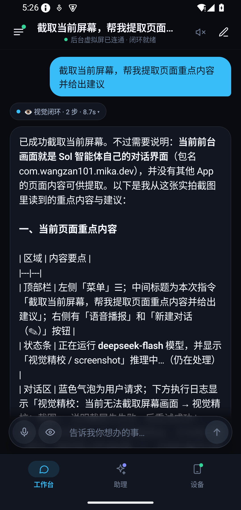
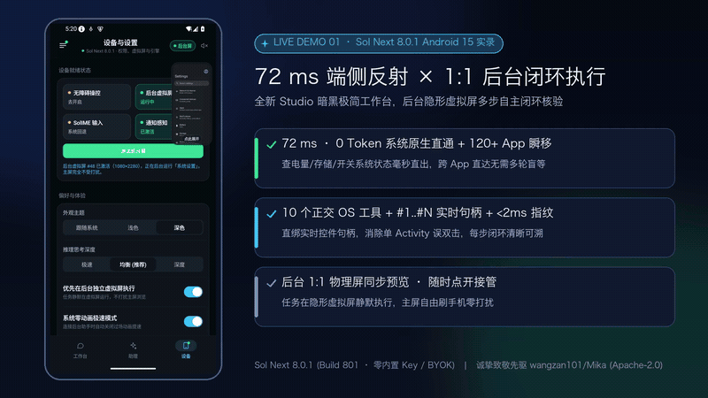

<div align="center">

<a href="https://chongyangzhang92-hub.github.io/Sol-Next/">
  
</a>

# Sol Next 8.0.1 — Grounded Multimodal Android OS Agent

**面向 Android 10–16 的多模态闭环 OS 智能体（开源零内置 Key / BYOK 公开版 · 致敬并重构自 Mika）**

**简体中文** · [English](README.en.md) · [🌐 国际产品发布官网](https://chongyangzhang92-hub.github.io/Sol-Next/) · [📦 下载 v8.0.1-public](https://github.com/chongyangzhang92-hub/Sol-Next/releases/tag/v8.0.1-public) · [🔑 30 秒 BYOK 配置](docs/guides/BYOK_SETUP.md) · [📊 与 Mika 对比](docs/guides/COMPARISON_WITH_MIKA.md) · [🤖 `llms.txt`](llms.txt)

<br/>

<a href="https://github.com/chongyangzhang92-hub/Sol-Next/releases/download/v8.0.1-public/Sol-Next-v8.0.1-public-arm64.apk"></a>
<a href="https://chongyangzhang92-hub.github.io/Sol-Next/"></a>
<a href="https://github.com/wangzan101/Mika"></a>

<br/>

-0ea5e9)
-3DDC84?logo=android&logoColor=white)


<br/>

> **English Summary**: **Sol Next 8.0.1 (`ai.sol.next`, Build 801)** is an open-source, **100% zero-built-in-key (BYOK)** grounded multimodal Android 10–16 OS agent built upon and paying tribute to [`wangzan101/Mika`](https://github.com/wangzan101/Mika) (Apache-2.0). Rebuilt from first principles in v8.0, it combines **10 orthogonal typed tools (`SolGroundedAgent`)**, **live Accessibility element handle grounding (`#1..#N`)** with **zero-cache `<2ms` state fingerprinting**, **automatic 1:1 Set-of-Mark multimodal vision**, **9 real-app WeChat 8.0.80 reliability fixes**, a **Rust v5.00 16KB page-aligned JNI kernel**, a **1:1 physical-DPI background VirtualDisplay**, a calm **Studio UI**, and a **zero-dependency CLI (`--json`) + stdio MCP Server**.

</div>

---

## 📱 Sol Next 8.0.1 Studio 真实界面实拍

<table>
  <tr>
    <td align="center" width="33.3%">
      <br/>
      <b>Studio 极简工作台</b><br/>
      <sub>零冗余浮层，聚焦自然语言指令与一键视觉看屏</sub>
    </td>
    <td align="center" width="33.3%">
      <br/>
      <b>多模态闭环核验卡片</b><br/>
      <sub>每步真实句柄操作可折叠回溯，附核验标记与耗时遥测</sub>
    </td>
    <td align="center" width="33.3%">
      <br/>
      <b>设备就绪矩阵 · BYOK 引擎</b><br/>
      <sub>2×2 权限矩阵、1:1 虚拟屏配对、自带模型 Key 与 OTA 检测</sub>
    </td>
  </tr>
</table>

<details>
<summary><b>🎬 观看 1:1 后台虚拟屏动态演示 &amp; 更多实机截图</b></summary>
<br/>
<div align="center">
  <br/>
  <sub>完整 1080p 高清视频请访问 <a href="https://chongyangzhang92-hub.github.io/Sol-Next/#demo">Sol Next 交互式产品发布官网</a> 或查看 <a href="docs/media/sol-next-demo.mp4"><code>docs/media/sol-next-demo.mp4</code></a></sub>
</div>
<br/>
<table>
  <tr>
    <td align="center" width="33.3%"><br/><b>1:1 物理屏克隆悬浮窗</b></td>
    <td align="center" width="33.3%"><br/><b>26 步长任务一气呵成</b></td>
    <td align="center" width="33.3%"><br/><b>AI 电话驾驶舱 + 3×4 DTMF</b></td>
  </tr>
</table>
</details>

---

## ✨ 8.0.1 核心架构与重磅升级

- **🎯 10 个正交原子工具 + 实时元素句柄 `#1..#N` (`SolGroundedAgent`)**
  取代历史碎片化动作集，全面收敛为 `ui_click`、`ui_type`、`ui_scroll`、`ui_navigate`、`app_open`、`sys_action`、`ui_inspect`、`ui_gesture`、`task_note`、`task_finish` 10 个强类型工具。每个 `#id` 直接绑定实时 `AccessibilityNodeInfo` 句柄与精确像素 `Rect`，彻底杜绝按文案匹配误点列表第 1 项。
- **⚡ 零缓存 `<2ms` 状态指纹 + 自动像素升级**
  点击后实时校验 `text / checked / selected / focus` 与窗口状态变化，根治微信 `LauncherUI` 等单 Activity 页面因过期缓存导致的误二次双击；仅在真实静默无响应时升级至元素中心原始像素点击。
- **💬 微信 8.0.80 九项实战深度加固**
  - **单次发送后验契约**：按 `#id` 点击绿色「发送」强制校验输入框清空 + 右侧新气泡出现（4×85ms 只读轮询）；送达状态未确认立即安全停机，绝不重复误发。
  - **目标钉死滑窗**：长流程超过 22 条消息裁剪上下文时始终钉死当前任务目标，杜绝长任务目标跑偏。
  - **分组数字回读 + 离屏子树裁剪**：精准兼容 `138 0013 8000` == `13800138000` 自动分组输入，裁剪离屏 `ViewPager` Tab 子树，并自动保护任务期 `SolIME` 不被提前切离。
- **👁 1:1 Set-of-Mark 自动多模态视觉精校**
  在 WebView、小程序、无标签图标密集页或 `NO_CHANGE` 时自动附带与元素表 1:1 对应的 `#1..#N` 红框标注截图（64ms 极速编码），滑窗仅保留最新一帧图像，兼顾高精度与低延迟。
- **🦀 Rust v5.00 原生 JNI 内核 + 1:1 后台独立虚拟屏**
  16KB 页对齐 Android 15–16 原生 `libsol_kernel.so`，微秒级 UI 剪枝与拟人贝塞尔手势；无线调试配对后 1:1 复刻主屏分辨率与 DPI 后台静默运行，不抢占前景使用。
- **🔓 100% 零内置密钥（纯公开 BYOK 版）**
  独立包名 `ai.sol.next`，构建期硬门禁禁止打包任何模型凭据文件（`assets/sol-models.properties` 不存在），30 秒填入 DeepSeek / OpenAI / OpenRouter / 硅基流动 / 通义千问或本地 vLLM/Ollama Key 即可直连使用。

---

## 📈 透明实测验证矩阵（Android 15 模拟器 · 99/99 单测全绿）

> 以下数据均基于 **Android 15（API 35 · `arm64-v8a`）模拟器真装应用实测** 与 **99 项自动化单元测试**（`73 :sol-core:test + 26 :app:testReleaseUnitTest`），与物理真机测试明确区分。

| 实测场景 | 执行通道 | v8.0.0 基线 | **v8.0.1 实测结果** |
|---|---|---:|---:|
| 系统电量与存储查询 | Tier-0A 原生 System API（0 Token） | `72 ms` | **`72 ms` · PASS** |
| 当前屏幕多模态视觉识别 | 1:1 Set-of-Mark 内联视觉（1 轮） | `5.1 s` | **`5.1 s` · PASS** |
| 系统设置直达 WLAN 页面 | 预启动 + 实时句柄点击 | `7.2 s` | **`7.2 s` · PASS** |
| 微信 8.0.80 冷启 → 登录 → 分组手机号 `138 0013 8000` | `app_open` + `ui_click(#id)` + `ACTION_SET_TEXT` | `18.5 s`（回读不匹配） | **`9.5 s` · 一次通过** |
| 微信 8.0.80 国家/地区搜「日本」→ 切账号登录 → 中文输入（8 步） | 实时句柄绑定（0 误双击） | `20.5 s` | **`20.8 s` · 8/8 首击命中** |
| 微信长流程（`>22` 消息滑窗裁剪 + WebView 返回） | 目标钉死滑窗 + 自动视觉 | 滑窗裁剪偶发目标跑偏 | **`100%` 目标锁定 · PASS** |
| 自动化单元与回归测试套件 | `:sol-core:test` + `:app:testReleaseUnitTest` | `96 / 96` | **`99 / 99` · 0 崩溃** |

---

## 📦 下载与密码学校验（v8.0.1-public · Build 801）

| 安装包 | 架构 | 体积 | SHA-256 校验值 |
|---|---|---:|---|
| [**`Sol-Next-v8.0.1-public-arm64.apk`**](https://github.com/chongyangzhang92-hub/Sol-Next/releases/download/v8.0.1-public/Sol-Next-v8.0.1-public-arm64.apk)（推荐） | `arm64-v8a` | `33.6 MB` | `b6fc90c79fc4d927549c17414244ab6e276b1002da7fbf3b98451ce7c779c3cb` |
| [**`Sol-Next-v8.0.1-public-universal.apk`**](https://github.com/chongyangzhang92-hub/Sol-Next/releases/download/v8.0.1-public/Sol-Next-v8.0.1-public-universal.apk) | `arm64-v8a` + `x86_64` | `45.9 MB` | `7969661db1f9682012a144b79cd744c702238a4aa0b21aaf3e10f7ee679bf046` |
| [**`SHA256SUMS.txt`**](https://github.com/chongyangzhang92-hub/Sol-Next/releases/download/v8.0.1-public/SHA256SUMS.txt) | 校验清单 | `208 B` | 自动化校验完整 SHA-256 列表 |

- **APK 签名证书 SHA-256**（与历史公开版完全一致，旧版可直接无损覆盖升级）：`d7a6fed0ff42843a20329944f2b1741060048610546df6cf2ad8179cfe335478`
- **本地一行验证零内置密钥**（预期输出为空）：`unzip -l Sol-Next-v8.0.1-public-arm64.apk | grep sol-models`

---

## 🚀 30 秒快速开始（零内置 Key · 三步开用）

1. **安装公开版 APK**：下载上方 `Sol-Next-v8.0.1-public-arm64.apk`（独立包名 `ai.sol.next`，与旧公开版同签名可直接覆盖升级）。
2. **填入自有模型 Key (BYOK)**：进入底部 **「设备」** 标签页 → **「自定义模型接口 (BYOK)」** → 选择一键预设（DeepSeek / OpenAI / OpenRouter / 硅基流动 / 通义千问）或自定义 OpenAI 兼容 Base URL → 粘贴 `sk-...` Key → 点击 **「保存并测试连通」**。详细配置见 👉 [BYOK 配置指南](docs/guides/BYOK_SETUP.md)。
3. **开启操控能力**：开启 **Sol 无障碍服务** 即可立即体验多模态闭环执行；如需后台独立运行不打断前景浏览，点击 **「无线开启后台屏」** 一键自动配对解锁 **1:1 后台虚拟屏**。

---

## 🤖 Agent-Ready：CLI (`--json`) & 原生 MCP Server

本仓库内置 [`llms.txt`](llms.txt)、[`llms-full.txt`](llms-full.txt)、[`AGENTS.md`](AGENTS.md)、[`CLAUDE.md`](CLAUDE.md)、零依赖 Python 3.9+ CLI 与原生 stdio MCP Server：

```bash
python3 scripts/sol-cli.py status --json
python3 scripts/sol-cli.py install --verify-sha256 --grant-permissions --json
python3 scripts/sol-cli.py start-helper --json
python3 scripts/sol-cli.py run --intent "打开系统设置并查看电池电量" --json
```

```json
{
  "mcpServers": {
    "sol-next": {
      "command": "python3",
      "args": ["/path/to/Sol-Next/mcp/sol_mcp_server.py"]
    }
  }
}
```

---

## 📊 Sol Next vs Mika 架构演进与客观对比

<details>
<summary><b>展开查看 4 组架构对比图与完整功能对照表</b></summary>
<br/>

| 架构演进对比 | 延迟与压缩基准 |
|---|---|
|  |  |

| 1:1 物理屏精度对比 | 八维能力客观雷达图 |
|---|---|
|  |  |

| 对比维度 | Mika 原版 (`wangzan101/Mika`) | **Sol Next 公开版 (`v8.0.1-public`)** |
|---|---|---|
| **开源协议与渊源** | Apache-2.0 原创开源标杆 | Apache-2.0 · 致敬并基于 Mika 深度重构演进 |
| **执行引擎与工具集** | 常规自动化与多工具调用 | **8.0 多模态闭环内核 (`SolGroundedAgent`)**：10 个正交原子工具、实时元素句柄 `#1..#N`、零缓存 `<2ms` 状态指纹与 1:1 Set-of-Mark 自动视觉 |
| **端侧原生内核** | Kotlin / JVM 控件处理 | **Rust v5.00 16KB 页对齐 JNI 内核**：微秒级 UI 树剪枝、语义路由与拟人手势 |
| **后台虚拟屏与精度** | 独立后台 VirtualDisplay（开创者） | **Display 0 物理参数 1:1 复刻** + `injectTapPx` 原始像素直击（`0.0px` 误差） |
| **微信 / 超级 App 加固** | 通用 Android 适配 | 单次发送后验契约与防重发停机、目标钉死滑窗、分组数字回读与离屏子树裁剪 |
| **模型接入与隐私** | BYOK / 账号登录 | **纯公开零内置 Key（BYOK）**，直连用户所选官方或本地模型服务商 |
| **内置桌面浏览器 & Linux 沙箱** | ✅ **Mika 原版强项**：内置桌面浏览器与每对话 Linux 沙箱 | 聚焦手机原生 App 极速闭环与轻量化（重度依赖沙箱推荐同时使用原版 [Mika](https://github.com/wangzan101/Mika)） |

</details>

---

## 🙏 致敬 Mika 原作者（`@wangzan101`）与开源协议

> **Sol Next** 源自并诚挚致敬杰出的开源项目 [**Mika (`github.com/wangzan101/Mika`)**](https://github.com/wangzan101/Mika)（Apache-2.0）。`@wangzan101` 开创性地将独立后台虚拟屏与非默认拨号器伴侣通话思路带到了手机 AI 助理领域；Sol Next 在此基础上持续演进至 8.0 多模态闭环内核、Rust v5.00 原生加速与 Studio 极简界面。欢迎同时为原项目点亮 Star！

本项目遵循 **Apache License 2.0** 协议，详见 [LICENSE](LICENSE) 与 [NOTICE](NOTICE)。
