<div align="center">

<a href="https://chongyangzhang92-hub.github.io/Sol-Next/">
  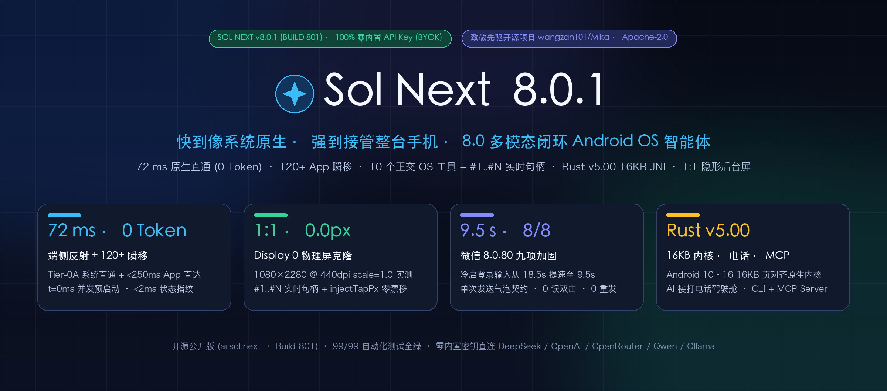
</a>

<br/><br/>

# ✦ Sol Next 8.0.1

### 快到像系统原生 · 强到接管整台手机 · 零信任隐私架构

<sub>面向 Android 10–16 的开源多模态闭环 OS 智能体（Build <code>801</code> · 100% 零内置 Key / BYOK · 致敬先驱 <code>wangzan101/Mika</code>）</sub>

<br/><br/>

<a href="https://github.com/chongyangzhang92-hub/Sol-Next/releases/download/v8.0.1-public/Sol-Next-v8.0.1-public-arm64.apk"></a>
&nbsp;
<a href="https://chongyangzhang92-hub.github.io/Sol-Next/"></a>
&nbsp;
<a href="https://chongyangzhang92-hub.github.io/Sol-Next/mika-vs-sol-next.html"></a>
&nbsp;
<a href="https://github.com/wangzan101/Mika"></a>

<br/><br/>

**简体中文** &nbsp;·&nbsp; [English](README.en.md) &nbsp;·&nbsp; [🛡️ 安全与隐私白皮书](https://chongyangzhang92-hub.github.io/Sol-Next/security-and-privacy.html) &nbsp;·&nbsp; [⚡ Android 15 性能基准](https://chongyangzhang92-hub.github.io/Sol-Next/android-ai-agent-benchmarks.html) &nbsp;·&nbsp; [🤖 MCP & BYOK 指南](https://chongyangzhang92-hub.github.io/Sol-Next/mcp-and-byok-guide.html) &nbsp;·&nbsp; [`llms.txt`](llms.txt) &nbsp;·&nbsp; [`ai-facts.json`](docs/ai-facts.json)

<br/>

-0ea5e9?style=flat-square)

-8b5cf6?style=flat-square)


</div>

<br/>

---

<div align="center">

<sub><b>ACT I &nbsp;·&nbsp; LIVE MOTION CINEMA</b></sub>

## 🎬 Sol Next 8.0.1 真机实录动态演示 & 1080p 高清影院

<sub>Android 15（1080×2280 @ 440dpi）实机录屏：72 ms 反射 · 1:1 后台屏实时 <code>#1..#15</code> 视觉标注 · Studio 8.0.1 引擎巡礼 · 零密钥 BYOK</sub>

<br/>

<a href="https://chongyangzhang92-hub.github.io/Sol-Next/#demo">
  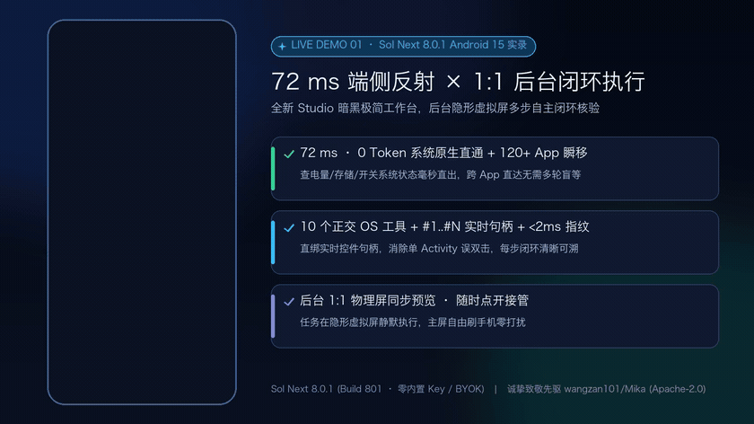
</a>

<br/><br/>

<a href="https://chongyangzhang92-hub.github.io/Sol-Next/#demo"></a>
&nbsp;&nbsp;
<a href="https://chongyangzhang92-hub.github.io/Sol-Next/media/v801/sol-next-demo.mp4"></a>

</div>

<br/>

### 🎯 六大端到端真实场景 Demo 速览

| 场景编号 | 一句话自然语言指令 | 底层执行引擎与核心技术 | Android 15 实测表现 |
|---|---|---|---|
| **Demo 01 · 毫秒反射** | `查电量、剩余存储并开启勿扰` | Tier-0A 原生 Android System API 直通（数据 100% 不离机） | **`72 ms` · `0 Token`** |
| **Demo 02 · 微信实战** | `冷启微信登录、搜日本区号、切账号输中文` | `app_open` 预启动 + 实时 `#1..#N` 句柄 + `<2ms` 指纹 + 单次发送气泡契约 | **登录 `9.5 s` 一次过 · 8 步 `8/8` 首击** |
| **Demo 03 · 隐形副屏** | `在后台虚拟屏打开设置查 WLAN 并汇报` | 1:1 Display 0 克隆（`scale=1.0`）+ 目标钉死滑窗（`>22` 轮不跑偏） | **前景刷手机零打扰 · `0.0px` 零漂移** |
| **Demo 04 · 应用瞬移** | `高德导航去机场 / 淘宝搜降噪耳机` | `SolAppGraphEngine` 120+ Deep-Link 协议直达 + `t=0ms` 并发预启动 | **`< 250 ms` 空降目标功能页** |
| **Demo 05 · AI 电话** | `致电客服查询账单，遇语音菜单自动按键` | 非默认拨号器 Telecom 伴侣 + 豆包/OpenAI 实时语音 + 3×4 DTMF + 接管 | **保留原生拨号器 · 全链路绿灯就绪** |
| **Demo 06 · 视觉精校** | `截取当前屏幕提取重点并点击无标签图标` | 按需 `64 ms` 1:1 Set-of-Mark 红框标注 + 单帧视觉滑窗 | **单轮看屏 `5.1 s` · 隐私低暴露** |

<br/>

---

<div align="center">

<sub><b>ACT II &nbsp;·&nbsp; EXTREME SPEED &amp; FULL-PHONE MASTERY</b></sub>

## ⚡ 为什么 Sol Next 8.0.1 又快、又准、又强？

</div>

<table>
  <tr>
    <td align="center" width="25%">
      <h3><code>72 ms</code></h3>
      <b>Tier-0A 原生反射</b><br/>
      <sub>0 Token · 本地零上云直出</sub>
    </td>
    <td align="center" width="25%">
      <h3><code>&lt; 250 ms</code></h3>
      <b>120+ App 协议瞬移</b><br/>
      <sub>t=0ms 首轮并发预启动</sub>
    </td>
    <td align="center" width="25%">
      <h3><code>9.5 s · 8/8</code></h3>
      <b>微信 8.0.80 实战加固</b><br/>
      <sub>提速 ~2× · 0 误双击 · 0 重发</sub>
    </td>
    <td align="center" width="25%">
      <h3><code>1:1 · 0.0px</code></h3>
      <b>物理屏克隆后台副屏</b><br/>
      <sub>Rust v5.00 16KB JNI 内核</sub>
    </td>
  </tr>
</table>

<br/>

<table>
  <tr>
    <td width="50%" valign="top">
      <h4>⚡ 快到像系统原生功能</h4>
      <ul>
        <li><b><code>72 ms</code> · 0 Token 系统直通</b>：电量、存储、内存、Wi-Fi、蓝牙、手电筒、勿扰、亮度音量、闹钟计时器、日程与验证码全部本地毫秒直出。</li>
        <li><b><code>&lt; 250 ms</code> · 120+ App Deep-Link</b>：微信、淘宝、京东、美团、抖音、小红书、B 站、高德、支付宝等 120+ 应用空降目标页。</li>
        <li><b><code>&lt; 2 ms</code> 零缓存状态指纹</b>：动作后实时比对控件与窗口变化，消灭固定盲等与微信单 Activity 误双击。</li>
        <li><b>Rust v5.00 16KB JNI + HTTP/3 QUIC</b>：端侧微秒级剪枝 <code>-74%~-97%</code>，配合后台 <code>uid=2000</code> 零动画加速，微信冷启登录输入从 <code>18.5s</code> 提速至 <b><code>9.5s</code></b>。</li>
      </ul>
    </td>
    <td width="50%" valign="top">
      <h4>🔥 强到接管整台手机</h4>
      <ul>
        <li><b>10 个正交强类型 OS 工具 + <code>#1..#N</code> 实时句柄</b>：直绑实时 <code>AccessibilityNodeInfo</code> 与精确 <code>Rect</code>，静默控件自动升级元素中心像素直击。</li>
        <li><b>1:1 隐形后台虚拟手机</b>：实测 Display 0 与 <code>sol-next-bg</code> 同为 <code>1080×2280 @ 440dpi, scale=1.0</code>，前景继续刷手机互不打扰。</li>
        <li><b>微信 8.0.80 九项实战加固</b>：单次发送 4×85ms 气泡核验（不确定即停机，绝不重发）、超 22 轮目标钉死滑窗、分组手机号自动回读与 <code>SolIME</code> 保护。</li>
        <li><b>运营商级 AI 电话 + CLI &amp; MCP Server</b>：保留原生拨号器实时语音 + 3×4 DTMF；内置零依赖 CLI (<code>--json</code>) 与原生 stdio MCP Server。</li>
      </ul>
    </td>
  </tr>
</table>

<br/>

---

<div align="center">

<sub><b>ACT III &nbsp;·&nbsp; STUDIO 8.0.1 VISUAL GALLERY</b></sub>

## 🎨 Sol Next 8.0.1 真机实拍视觉画廊（全 10 屏深曜石美学呈现）

<sub>全部画面均 100% 实拍自 Android 15 上运行的 Sol Next 8.0.1 (Build 801) 正式版，零概念渲染假图</sub>

<br/>

<a href="docs/media/v801/showcase-studio-trio.png">
  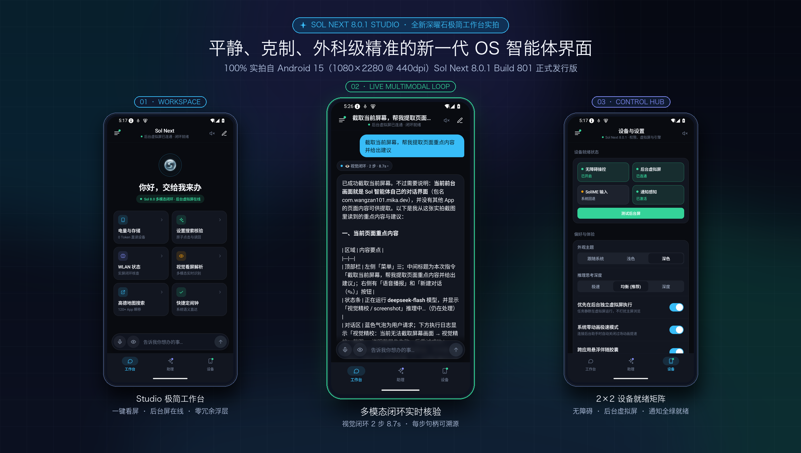
</a>

<sub>单屏原图直览：<a href="docs/media/v801/screen-v8-workspace.png">Studio 极简工作台</a> · <a href="docs/media/v801/screen-v8-multimodal.png">多模态闭环实时核验</a> · <a href="docs/media/v801/screen-v8-control-hub.png">2×2 设备就绪矩阵</a></sub>

<br/><br/>

<a href="docs/media/v801/showcase-superpowers-stage.png">
  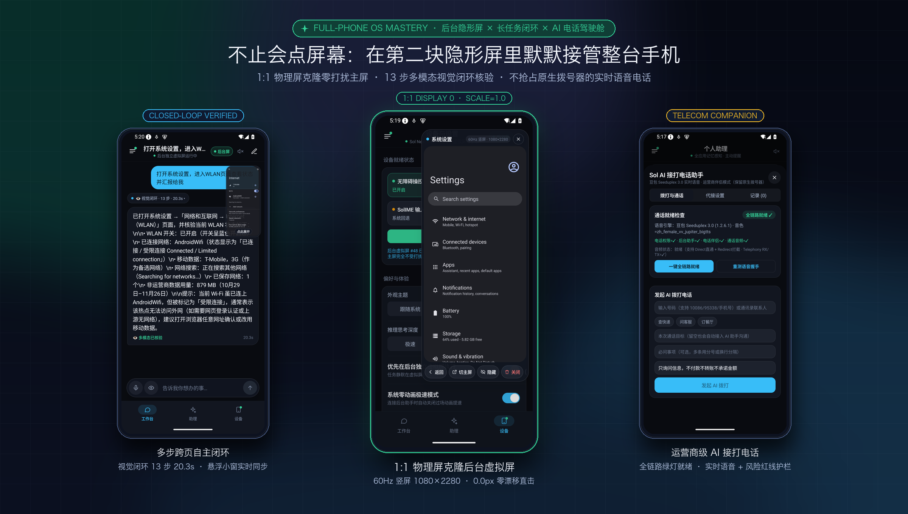
</a>

<sub>单屏原图直览：<a href="docs/media/v801/screen-26step-task.png">13 步视觉闭环核验</a> · <a href="docs/media/v801/screen-vdisplay-1to1.png">1:1 物理屏克隆悬浮窗</a> · <a href="docs/media/v801/screen-ai-call-active.png">AI 接打电话驾驶舱</a></sub>

<br/><br/>

<a href="docs/media/v801/showcase-ecosystem-byok.png">
  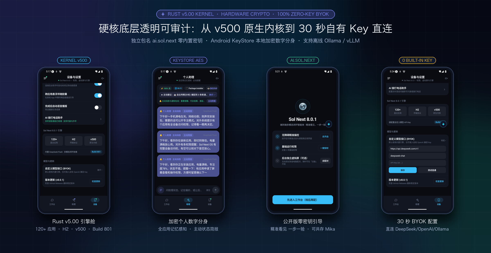
</a>

<sub>单屏原图直览：<a href="docs/media/v801/screen-brain-cockpit.png">Rust v5.00 引擎舱</a> · <a href="docs/media/v801/screen-personal-twin.png">加密个人数字分身</a> · <a href="docs/media/v801/screen-public-welcome.png">公开版零密钥引导</a> · <a href="docs/media/v801/screen-public-byok.png">30 秒 BYOK 表单</a></sub>

</div>

<br/>

---

<div align="center">

<sub><b>ACT IV &nbsp;·&nbsp; ZERO-TRUST SECURITY &amp; PRIVACY ARCHITECTURE</b></sub>

## 🛡️ 六重零信任安全、隐私保护与最小攻击面防线

<sub>把手机操作权交给 AI 时，更快的端侧收敛与更小的攻击面就是最硬核的隐私防线 · <a href="https://chongyangzhang92-hub.github.io/Sol-Next/security-and-privacy.html">阅读完整安全与隐私白皮书 →</a></sub>

<br/>

<a href="docs/media/v801/compare-security-privacy.png">
  
</a>

</div>

<br/>

| 安全与隐私防线 | Sol Next 8.0.1 可审计工程实现 |
|---|---|
| **1. 零内置 Key & 零私服中转** | 构建期硬门禁禁止打包任何模型凭据文件（`unzip -l Sol-Next-v8.0.1-public-arm64.apk \| grep sol-models` 必为空），设备直连用户自选厂商或 **100% 离线本地 Ollama / vLLM**。 |
| **2. 最小攻击面原则** | 刻意剔除嵌入式桌面浏览器引擎与每对话 Linux Shell 容器，收敛本地二进制与脚本命令攻击面，严格收口至 **10 个强类型正交 OS 工具**。 |
| **3. 端侧数据最小化防 PII 外泄** | `72 ms` Tier-0A 本地直通 100% 不上云；复杂页面先经 **Rust v5.00 端侧剪枝剔除 `-74% ~ -97%` 无关节点**，极大减少无关聊天记录与屏幕敏感信息外传。 |
| **4. 单帧按需视觉滑窗** | 仅在 WebView / 小程序 / `NO_CHANGE` 按需附带 1:1 标注帧，并强制滑窗只保留最新 1 帧、即时淘汰历史截图，杜绝连续录屏流上传云端。 |
| **5. 防误发与高危财务护栏** | 微信点击「发送」强制 4×85ms 只读气泡核验，存疑即触发 `SEND_CONFIRMATION_PENDING` 停机（0 重发）；付款、转账、删除与 AI 电话强制人工确认。 |
| **6. KeyStore 硬件加密 + 验签链** | 个人数字分身与私有记忆由 Android Hardware KeyStore AES-GCM 本地加密；全量公开 `SHA256SUMS.txt` 与固定签名证书指纹。 |

<br/>

---

<div align="center">

<sub><b>ACT V &nbsp;·&nbsp; TRIBUTE TO MIKA &amp; FULL 7-CHART COMPARISON</b></sub>

## 💜 诚挚致敬先驱 Mika (`@wangzan101`) × 全景深度对比

<br/>

<a href="https://github.com/wangzan101/Mika">
  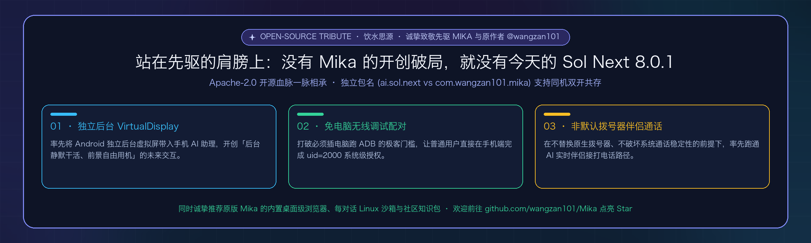
</a>

<br/><br/>

<a href="https://github.com/wangzan101/Mika"></a>
&nbsp;&nbsp;
<a href="https://chongyangzhang92-hub.github.io/Sol-Next/mika-vs-sol-next.html"></a>

</div>

<br/>

### 📊 架构、速度、微信加固、虚拟屏精度与生态全景对比（全 7 组 2K 高清图直出）

<table>
  <tr>
    <td align="center" width="50%">
      <a href="docs/media/v801/compare-architecture.png">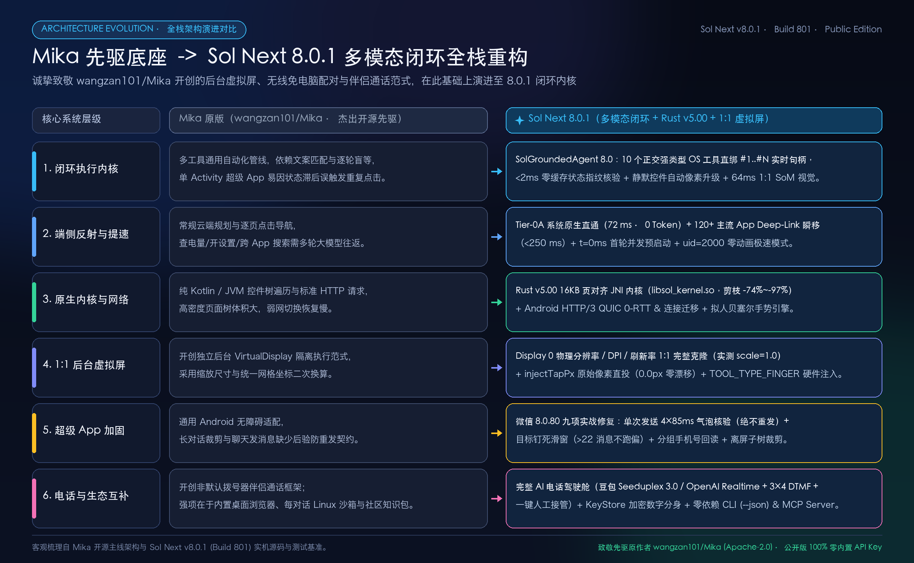</a><br/>
      <b>① 六层系统架构演进对比（Mika 先驱底座 → Sol Next 8.0.1）</b>
    </td>
    <td align="center" width="50%">
      <a href="docs/media/v801/compare-benchmark.png">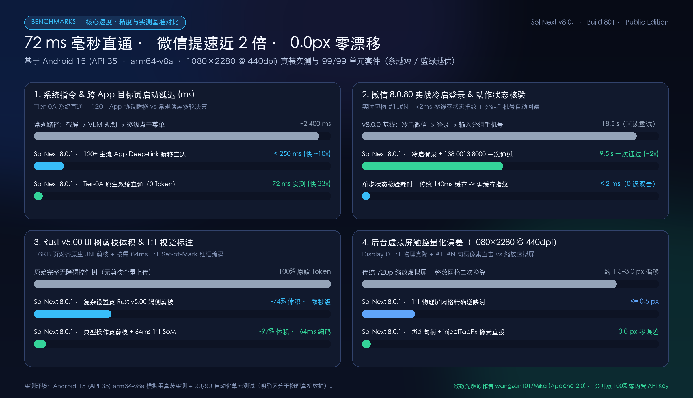</a><br/>
      <b>② 速度、剪枝与零漂移实测基准对比</b>
    </td>
  </tr>
  <tr>
    <td align="center" width="50%">
      <a href="docs/media/v801/compare-execution-pipeline.png">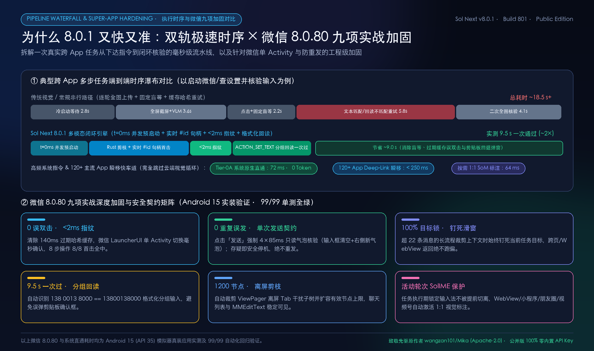</a><br/>
      <b>③ 端到端执行时序瀑布 &amp; 微信 8.0.80 九项加固</b>
    </td>
    <td align="center" width="50%">
      <a href="docs/media/v801/compare-vdisplay-precision.png">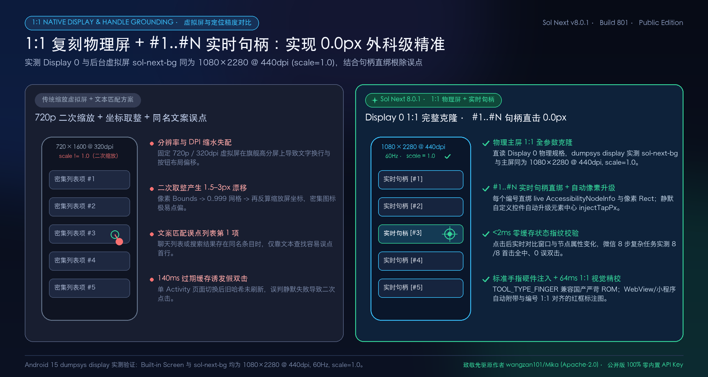</a><br/>
      <b>④ 1:1 物理屏克隆 + `#1..#N` 实时句柄精度 (`0.0px`)</b>
    </td>
  </tr>
</table>

<table>
  <tr>
    <td align="center" width="50%">
      <a href="docs/media/v801/compare-radar-matrix.png">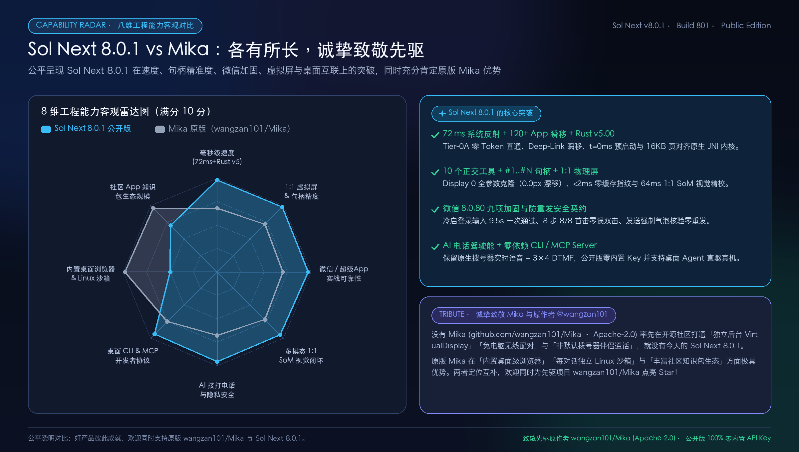</a><br/>
      <b>⑤ 八维工程能力客观对比雷达图（透明标明双方长板）</b>
    </td>
    <td align="center" width="50%">
      <a href="docs/media/v801/compare-ecosystem-matrix.png">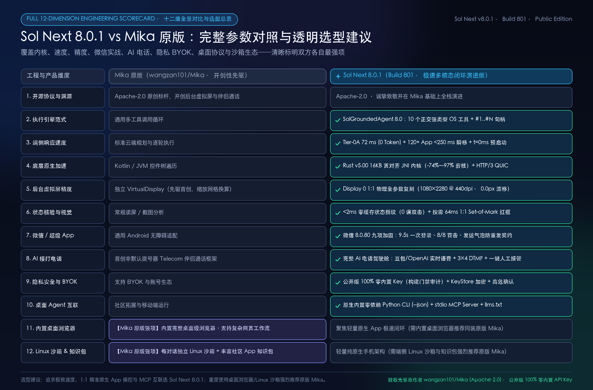</a><br/>
      <b>⑥ 十二维全景工程参数与互补选型总表（含第 7 图安全对比见上方）</b>
    </td>
  </tr>
</table>

<br/>

> **同机双开共存说明**：公开版 Sol Next 包名为 `ai.sol.next`，原版 Mika 包名为 `com.wangzan101.mika`，两者完全独立、互不冲突。追求 **72 ms 极致原生速度、0.0px 1:1 虚拟屏、微信九项防误发加固、零信任最小攻击面隐私架构与原生 CLI/MCP** 首选 **Sol Next 8.0.1**；重度需要 **内置桌面级浏览器、每对话独立 Linux 沙箱（Python/Node）与社区知识包** 强烈推荐同时安装原版 [**Mika**](https://github.com/wangzan101/Mika)！完整 14 项实测详表见 👉 [COMPARISON_WITH_MIKA.md](docs/guides/COMPARISON_WITH_MIKA.md)。

<br/>

---

<div align="center">

<sub><b>ACT VI &nbsp;·&nbsp; TRANSPARENT VERIFICATION &amp; CRYPTOGRAPHIC RELEASES</b></sub>

## 📈 Android 15 真装实测基准（99/99 单测全绿）

<sub>基于 <b>Android 15（API 35 · <code>arm64-v8a</code> · <code>1080×2280 @ 440dpi</code>）模拟器真装应用</b> 与 <b>99 项自动化单元测试</b>（与物理真机环境明确区分）</sub>

</div>

<br/>

| 实测场景 | 执行通道 | v8.0.0 基线 | **Sol Next 8.0.1 实测** |
|---|---|---:|---:|
| 系统电量与存储查询 | Tier-0A 原生 System API（`0 Token`） | `72 ms` | **`72 ms` · PASS** |
| 120+ 主流 App 目标页跳转 | `SolAppGraphEngine` Deep-Link + 预启动 | 多轮点击 `~2.4s+` | **`< 250 ms` · PASS** |
| 当前屏幕多模态视觉解析 | `64 ms` 1:1 Set-of-Mark 内联视觉（1 轮） | `5.1 s` | **`5.1 s` · PASS** |
| 系统设置直达 WLAN 核验 | 并发预启动 + 实时 `#id` 句柄点击 | `7.2 s` | **`7.2 s` · PASS** |
| 微信 8.0.80 冷启 → 登录 → 分组手机号 `138 0013 8000` | `app_open` + 实时句柄 + 格式化回读 | `18.5 s`（回读不匹配） | **`9.5 s` · 一次通过 (`~2×`)** |
| 微信 8.0.80 搜「日本」→ 切账号 → 中文输入（8 步） | 实时 `#1..#N` 句柄 + `<2ms` 指纹 | `20.5 s` | **`20.8 s` · 8/8 首击（0 误双击）** |
| 长流程（`>22` 消息裁剪 + WebView 返回） | 目标钉死滑窗 + 自动视觉恢复 | 裁剪偶发目标跑偏 | **`100%` 目标锁定 · PASS** |
| 后台虚拟屏 1:1 物理规格一致性 | `dumpsys display` (`Built-in` == `sol-next-bg`) | `1080×2280` | **`1080×2280 @ 440dpi · scale=1.0`** |
| 自动化单元与回归测试套件 | `:sol-core:test` (73) + `:app:testReleaseUnitTest` (26) | `96 / 96` | **`99 / 99` · 0 崩溃** |

<br/>

### 📦 下载与密码学校验（`v8.0.1-public` · Build 801）

| 安装包 | 架构 | 体积 | SHA-256 校验值 |
|---|---|---:|---|
| [**`Sol-Next-v8.0.1-public-arm64.apk`**](https://github.com/chongyangzhang92-hub/Sol-Next/releases/download/v8.0.1-public/Sol-Next-v8.0.1-public-arm64.apk)（推荐） | `arm64-v8a` | `33.6 MB` | `b6fc90c79fc4d927549c17414244ab6e276b1002da7fbf3b98451ce7c779c3cb` |
| [**`Sol-Next-v8.0.1-public-universal.apk`**](https://github.com/chongyangzhang92-hub/Sol-Next/releases/download/v8.0.1-public/Sol-Next-v8.0.1-public-universal.apk) | `arm64-v8a` + `x86_64` | `45.9 MB` | `7969661db1f9682012a144b79cd744c702238a4aa0b21aaf3e10f7ee679bf046` |
| [**`SHA256SUMS.txt`**](https://github.com/chongyangzhang92-hub/Sol-Next/releases/download/v8.0.1-public/SHA256SUMS.txt) | 校验清单 | `208 B` | 自动化校验完整 SHA-256 列表 |

- **APK 签名证书 SHA-256**（与历史公开版一致，可直接无损覆盖升级）：`d7a6fed0ff42843a20329944f2b1741060048610546df6cf2ad8179cfe335478`
- **一行本地审计零内置密钥**（预期输出为空）：`unzip -l Sol-Next-v8.0.1-public-arm64.apk | grep sol-models`

<br/>

---

<div align="center">

<sub><b>ACT VII &nbsp;·&nbsp; 30-SECOND BYOK &amp; AGENT-READY MCP</b></sub>

## 🚀 30 秒开用 · 原生 CLI (`--json`) & MCP Server

</div>

1. **安装公开版 APK**：安装 `Sol-Next-v8.0.1-public-arm64.apk`（独立包名 `ai.sol.next`，与旧公开版同签名无损升级）。
2. **填入自有模型 Key (BYOK)**：进入底部 **「设备」** → **「自定义模型接口 (BYOK)」** → 填入 DeepSeek / OpenAI / OpenRouter / 硅基流动 / 通义千问 或本地 **Ollama / vLLM** → 点击 **「测试连通」**（详解见 👉 [BYOK 配置指南](docs/guides/BYOK_SETUP.md)）。
3. **开启操控与 1:1 后台屏**：开启 **Sol 无障碍服务** 立即可用；点击 **「无线开启后台屏」** 免电脑配对即可解锁 **1:1 后台虚拟屏**。

```bash
# 零依赖 Python 3.9+ CLI（无需 pip install，全命令确定性 --json 输出）
python3 scripts/sol-cli.py status --json
python3 scripts/sol-cli.py install --verify-sha256 --grant-permissions --json
python3 scripts/sol-cli.py start-helper --json
python3 scripts/sol-cli.py run --intent "打开系统设置并查看电池电量" --json
```

```json
{
  "mcpServers": {
    "sol-next": {
      "command": "python3",
      "args": ["/path/to/Sol-Next/mcp/sol_mcp_server.py"]
    }
  }
}
```

<br/>

---

<div align="center">

**✦ Sol Next 8.0.1（Build 801）** · Apache License 2.0 · 诚挚致敬先驱开源项目 [**`wangzan101/Mika`**](https://github.com/wangzan101/Mika)

[🌐 产品官网](https://chongyangzhang92-hub.github.io/Sol-Next/) · [📊 vs Mika 深度对比](https://chongyangzhang92-hub.github.io/Sol-Next/mika-vs-sol-next.html) · [🛡️ 安全与隐私白皮书](https://chongyangzhang92-hub.github.io/Sol-Next/security-and-privacy.html) · [⚡ 性能基准](https://chongyangzhang92-hub.github.io/Sol-Next/android-ai-agent-benchmarks.html) · [🤖 MCP 指南](https://chongyangzhang92-hub.github.io/Sol-Next/mcp-and-byok-guide.html) · [📜 LICENSE](LICENSE) · [📝 NOTICE](NOTICE)

</div>
