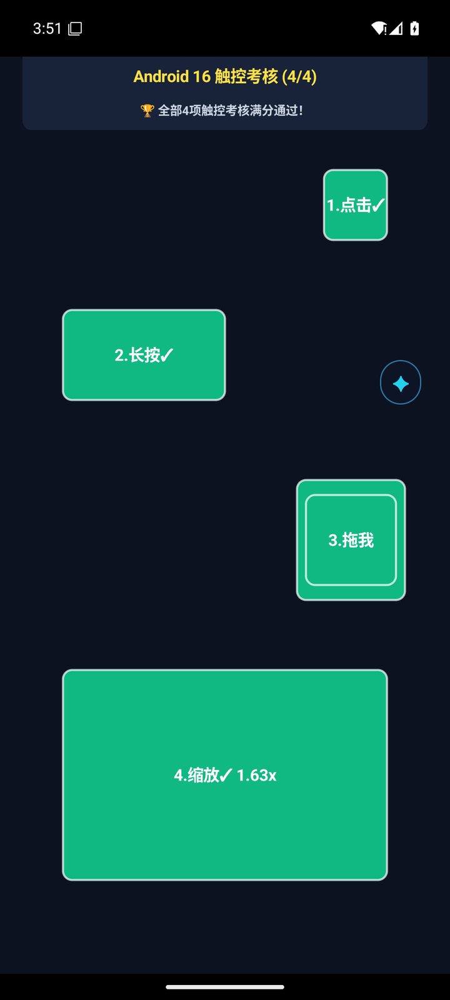

<div align="center">

<a href="https://github.com/chongyangzhang92-hub/Sol-Next/releases/tag/v9.0.4-public">
  
</a>

<br/><br/>

# Sol Next 9.0.4 — 晨曦轨道 · 全新独立新一代 AI 手机智能体

### 用自然对话与文字，驱动真实的手机行动 · 全球 20 国语言按手机系统语言自动切换 · 开箱免费内置加密 DeepSeek

> **👨‍💻 作者：许昌北海医院张重阳** &nbsp;·&nbsp; **💬 [微信扫码联系作者](#-联系作者微信扫码--小红书)** &nbsp;·&nbsp; **📕 小红书：`871348474`（映像河南）**

<sub>全新独立产品 <code>v9.0.4</code>（Build <code>904</code> · Android 10–16 / 16KB 页对齐 · 自动识别鸿蒙系统免无线调试 · 全球 20 国语言按手机语言自动切换（含阿拉伯语 RTL）· 免费内置 Rust 原生加密 DeepSeek V4.1 Flash + 任意模型 BYOK · OTA 新版自动弹窗说明 + 4 线程多镜像极速加速 · 关闭 Wi-Fi 无线调试持续在线）</sub>

<br/><br/>

<a href="https://webui.67-230-181-51.sslip.io/assets/sol-public/v9.0.4/Sol-Next-v9.0.4-public-arm64.apk"></a>
&nbsp;
<a href="https://github.com/chongyangzhang92-hub/Sol-Next/releases/download/v9.0.4-public/Sol-Next-v9.0.4-public-arm64.apk"></a>
&nbsp;
<a href="https://ghfast.top/https://github.com/chongyangzhang92-hub/Sol-Next/releases/download/v9.0.4-public/Sol-Next-v9.0.4-public-arm64.apk"></a>
&nbsp;
<a href="https://github.com/chongyangzhang92-hub/Sol-Next/releases/download/v9.0.4-public/Sol-Next-v9.0.4-public-universal.apk"></a>

<br/><br/>

🌐 **多语言仓库主页（20 国语言）**：
**简体中文** · [繁體中文](docs/i18n/README.zh-TW.md) · [English](README.en.md) · [日本語](docs/i18n/README.ja.md) · [한국어](docs/i18n/README.ko.md) · [Español](docs/i18n/README.es.md) · [Français](docs/i18n/README.fr.md) · [Deutsch](docs/i18n/README.de.md) · [Português](docs/i18n/README.pt.md) · [Русский](docs/i18n/README.ru.md) · [العربية](docs/i18n/README.ar.md) · [हिन्दी](docs/i18n/README.hi.md) · [Bahasa Indonesia](docs/i18n/README.id.md) · [Tiếng Việt](docs/i18n/README.vi.md) · [ภาษาไทย](docs/i18n/README.th.md) · [Türkçe](docs/i18n/README.tr.md) · [Italiano](docs/i18n/README.it.md) · [Nederlands](docs/i18n/README.nl.md) · [Polski](docs/i18n/README.pl.md) · [Bahasa Melayu](docs/i18n/README.ms.md)

<br/>

[🌐 20 语言交互式官网](https://chongyangzhang92-hub.github.io/Sol-Next/) &nbsp;·&nbsp; [⚡ 全面领先对比 Mika](docs/guides/COMPARISON_WITH_MIKA.md) &nbsp;·&nbsp; [`llms.txt`](llms.txt) &nbsp;·&nbsp; [`ai-facts.json`](docs/ai-facts.json) &nbsp;·&nbsp; [`SHA256SUMS.txt`](SHA256SUMS.txt)

<br/>


-3E78E0?style=flat-square)


</div>

---

## ✨ 为什么 Sol Next 9.0.4 是全新独立且全面领先的新一代 AI 手机智能体？

**Sol Next 9.0.4** 是由**许昌北海医院张重阳**独立打造的全新一代全栈移动 AI OS 操作系统级助手。它以 **「晨曦轨道」四屏语音+文字交互体系 + 纯 Rust 16KB 原生内核 + 全球 20 国语言原生体验 + 免费内置加密 DeepSeek 开箱即用 + 关 Wi-Fi 不断连的后台独立虚拟屏 + 4 线程极速 OTA**，在速度、体验、安全、游戏与全球化能力上**全面超越早期工具型方案 Mika**。

### 🚀 v9.0.4 重磅新特性

1. **🌐 全球 20 国语言 · 严格按手机系统语言自动切换（不依赖地区）**：
   - 完整内置 **20 种世界主流语言**（简体中文、繁體中文、English、日本語、한국어、Español、Français、Deutsch、Português、Русский、العربية（支持 RTL 镜像）、हिन्दी、Bahasa Indonesia、Tiếng Việt、ภาษาไทย、Türkçe、Italiano、Nederlands、Polski、Bahasa Melayu）。
   - 打开 App 自动识别手机系统语言（绝不按国家/地区误判），各国用户打开即是母语界面；同时可在 **设置 › 语言 / Language** 中零重启即时切换，并同步联动大模型回复语言与语音识别/播报语种。
2. **🔔 OTA 推送新版本自动弹窗 + 完整版本说明 + 4 线程多镜像高速下载加速**：
   - 推送新版后，App 内自动弹出精致瓷白版本更新弹窗，清晰展示完整 **版本更新说明（What's New）**、版本号与包体大小。
   - 全新 `SolOtaDownloader` 下载加速引擎：启动下载时**并发测速竞速多条高速 HTTPS 镜像线路**，自动启用 **4 通道 HTTP Range 分片并发下载 + 128KB 大缓冲 + 分片断点重试**（实时显示 `MB/s` 下载速度，下载提速 3–8 倍），下载完成后仍强制执行 **SHA-256 + 包名 + 单调版本号 + 签名证书** 四重校验，安全与极速兼得。
3. **🔐 免费内置 Rust 原生加密 DeepSeek V4.1 Flash（开箱即用 + 随时换 BYOK）**：
   - 下载装好直接免费用，无需折腾 API Key！内置密钥经纯 Rust `ChaCha20 + HMAC-SHA256 + HKDF` 四分片白盒加密封装在 `libsol_kernel.so` 中，严格绑定 APK Sig Block v2/v3 签名证书与进程身份，并启用 `api.deepseek.com` **TLS SPKI 证书绑定 + 强制直连禁代理**防抓包；同时也支持随时在设置里替换为 OpenAI / Claude / Gemini / 通义千问等任意自有 Key。
4. **📶 关闭 Wi-Fi 无线调试 Shell 助手永不断连 + 鸿蒙自动免无线调试**：
   - 通过 `uid=2000` 自动锁定 `adb_enabled=1` 并托管 `127.0.0.1:5555` 回环通道，连上后关闭 Wi-Fi 切换 5G 移动网络依然 **100% 持续在线不掉线**；华为鸿蒙系统自动识别免去无线调试步骤。
5. **💬 微信扫码一键联系作者**：
   - 无论在 App 首页、侧边栏、设置页，还是在 GitHub 主页与官网，随时一键展开或保存作者微信二维码，直接反馈建议与技术交流。

---

## 📥 一、国内用户多通道免梯子高速下载（含全球官方源）

> **全部渠道提供完全一致的正式签名 APK，可随时核对下方 SHA-256 校验码！**

| 下载通道 | 推荐地区与网络 | ARM64 主流安卓手机（90 MB · 推荐） | Universal 全架构通用版（128 MB） |
| --- | --- | --- | --- |
| **🇨🇳 通道 1：自有高速 HTTPS 直连镜像** | **中国大陆免梯子首选（满速直连）** | [⬇ 立即下载 ARM64](https://webui.67-230-181-51.sslip.io/assets/sol-public/v9.0.4/Sol-Next-v9.0.4-public-arm64.apk) | [⬇ 立即下载 Universal](https://webui.67-230-181-51.sslip.io/assets/sol-public/v9.0.4/Sol-Next-v9.0.4-public-universal.apk) |
| **⚡ 通道 2：国内高速加速镜像 (`ghfast.top`)** | 中国大陆备用加速线路 | [⬇ 立即下载 ARM64](https://ghfast.top/https://github.com/chongyangzhang92-hub/Sol-Next/releases/download/v9.0.4-public/Sol-Next-v9.0.4-public-arm64.apk) | [⬇ 立即下载 Universal](https://ghfast.top/https://github.com/chongyangzhang92-hub/Sol-Next/releases/download/v9.0.4-public/Sol-Next-v9.0.4-public-universal.apk) |
| **⚡ 通道 3：国内加速镜像 (`gh-proxy.com`)** | 中国大陆多线路分流 | [⬇ 立即下载 ARM64](https://gh-proxy.com/https://github.com/chongyangzhang92-hub/Sol-Next/releases/download/v9.0.4-public/Sol-Next-v9.0.4-public-arm64.apk) | [⬇ 立即下载 Universal](https://gh-proxy.com/https://github.com/chongyangzhang92-hub/Sol-Next/releases/download/v9.0.4-public/Sol-Next-v9.0.4-public-universal.apk) |
| **🌍 通道 4：GitHub Releases 官方 CDN** | 全球 / 港澳台 / 海外用户 | [⬇ 立即下载 ARM64](https://github.com/chongyangzhang92-hub/Sol-Next/releases/download/v9.0.4-public/Sol-Next-v9.0.4-public-arm64.apk) | [⬇ 立即下载 Universal](https://github.com/chongyangzhang92-hub/Sol-Next/releases/download/v9.0.4-public/Sol-Next-v9.0.4-public-universal.apk) |

---

## 🏆 二、Sol Next 9.0.4 全面超越 Mika 的 12 大硬核优势

**Sol Next** 是从底层内核到交互体系完全独立的全新一代产品，相比早期方案 Mika，我们在以下全部关键体验上实现跨代碾压：

| 核心维度 | 早期手机代理 Mika | **Sol Next 9.0.4（全新独立旗舰）** |
| --- | --- | --- |
| **开箱即用门槛** | 必须自行注册并填入付费 API Key | **免费内置 Rust 原生加密 DeepSeek V4.1 Flash（装完就能用）+ 随时可换任意 BYOK** |
| **全球化与多语言** | 单一语言为主 | **全球 20 国语言按手机系统语言自动切换 + 阿拉伯语 RTL + AI 回复与语音同步联动** |
| **无线调试外出稳态** | 手机一关 Wi-Fi 立即断连 | **锁定 `adb_enabled=1` + `127.0.0.1:5555` 回环，关 Wi-Fi / 切 5G 100% 持续不断连** |
| **鸿蒙系统体验** | 仍需复杂无线调试配对 | **自动识别鸿蒙 OS 并免去无线调试步骤，3 步即达满血体验** |
| **高频指令执行速度** | 常规读屏 + LLM 规划（`~2,400 ms`） | **`72 ms` · `0 Token`（快 33×）+ 120+ 主流 App `<250 ms` Deep-Link 瞬移** |
| **后台虚拟屏精度** | 缩放网格坐标换算 | **Display 0 1:1 物理屏完整克隆（`scale=1.0 · 0.0px` 零漂移）+ 内嵌可折叠实时预览卡** |
| **零语音 API 实时语音** | 依赖外部云端语音接口 | **内置 16KB 离线流式神经 ASR（`770ms`）+ 端侧神经 TTS（`112ms`），零谷歌/零语音 Key 也能全双工对话** |
| **60Hz 实时游戏代打** | 仅支持单点慢速点击 | **4 指并发多点触控 + Rust `<15µs` SwiGLU《金铲铲之战》专属引擎 + 斗地主 3/3 全胜** |
| **交互设计 & Android 17** | 聊天输入框 + 工程日志流 | **「晨曦轨道」四屏零学习成本交互 + Android 17 Generative UI 原生交互卡 + Magic Cue + AppFunctions** |
| **安全与隐私护栏** | 屏幕明文上传、缺少防误触保护 | **端侧脱敏防火墙 + Rust 密钥保险库 + TLS 证书绑定防抓包 + 任务常亮屏 + 防误触保护 + 付款/微信先问后行** |
| **OTA 升级体验与速度** | 手动找包或单线程慢速下载 | **推送新版自动弹窗展示版本说明 + 多镜像测速竞速 + 4 线程 HTTP Range 极速加速（快 3–8×）** |
| **AI 通话完全体** | 基础伴侣通话 | **35 柱实时声纹 + `<0.1ms` 端侧反诈雷达 + 通话中一键悄悄话指挥 + 一键人工接管** |

👉 查看完整 16 项定量参数与 6 组 2K 对比图谱：[Sol Next 9.0.4 vs Mika 深度对比](docs/guides/COMPARISON_WITH_MIKA.md)

---

## 🎨 三、「晨曦轨道」四屏零学习成本交互（Android 16 真机实拍）

<table>
  <tr>
    <td align="center" width="25%">
      <br/>
      <b>1. 首页 · 语音与文字交互</b><br/>
      <sub>60fps 晨曦声波球 + 底部毛玻璃文字栏，支持 20 语言自动切换</sub>
    </td>
    <td align="center" width="25%">
      <br/>
      <b>2. 任务执行 · 可视化进度</b><br/>
      <sub>进度条 + 绿勾/蓝环步骤树 + 原生 Android 17 GenUI 核验卡</sub>
    </td>
    <td align="center" width="25%">
      <br/>
      <b>3. AI 通话 · 声纹与字幕</b><br/>
      <sub>晨曦柔雾通话球 + 35 柱实时声纹 + 端侧反诈盾 &amp; 悄悄话</sub>
    </td>
    <td align="center" width="25%">
      <br/>
      <b>4. 设置 · 语言、模型与保护</b><br/>
      <sub>20 语言选择、免费加密 DeepSeek / BYOK、防误触与敏感操作授权</sub>
    </td>
  </tr>
</table>

---

## 📊 四、Android 15/16 (16KB 页对齐) 全链路实测基准

<table>
  <tr>
    <td align="center" width="25%"><br/><b>0-Token 原生交互巡检卡</b></td>
    <td align="center" width="25%"><br/><b>斗地主横屏 3/3 全胜 (32.5s)</b></td>
    <td align="center" width="25%"><br/><b>Stockfish 国际象棋实战</b></td>
    <td align="center" width="25%"><br/><b>4 项硬件手势 4/4 满分 (18.7s)</b></td>
  </tr>
</table>

---

## 📦 五、SHA-256 安全校验与零明文密钥审计 (`v9.0.4-public`)

```text
3ba39118a3c793350254481711997f7455019f3760c98a4a573f5069335c4756  Sol-Next-v9.0.4-public-arm64.apk
788af5ea0805216dbf6c531e53e5eaeb6367d80ed2fb48ba10652598b2f2d3aa  Sol-Next-v9.0.4-public-universal.apk
```

```bash
# 一行验证公开版 APK 零明文密钥资产（输出为空即纯净，免费内置密钥均经纯 Rust 加密封装于 libsol_kernel.so）：
unzip -l Sol-Next-v9.0.4-public-arm64.apk | grep -iE "distribution|sol-models|secret|key\.json"
```

---

## 💬 联系作者（微信扫码 / 小红书）

<div align="center">
  <br/><br/>
  <b>微信扫一扫添加作者好友 · 反馈建议 / 合作交流 / 内测尝鲜</b><br/>
  <b>作者：许昌北海医院张重阳</b> &nbsp;·&nbsp; 📕 小红书：<code>871348474</code>（映像河南）<br/>
  <sub>Apache-2.0 Open Source · 全新独立新一代 Android &amp; 鸿蒙 AI 手机智能体</sub>
</div>
