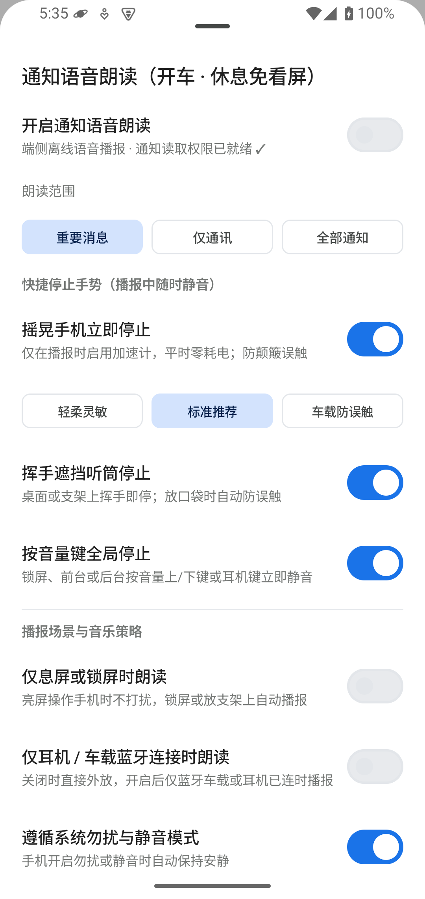
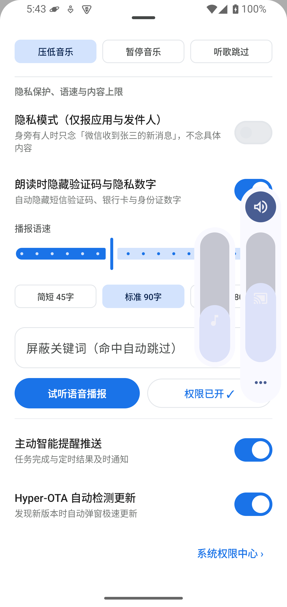
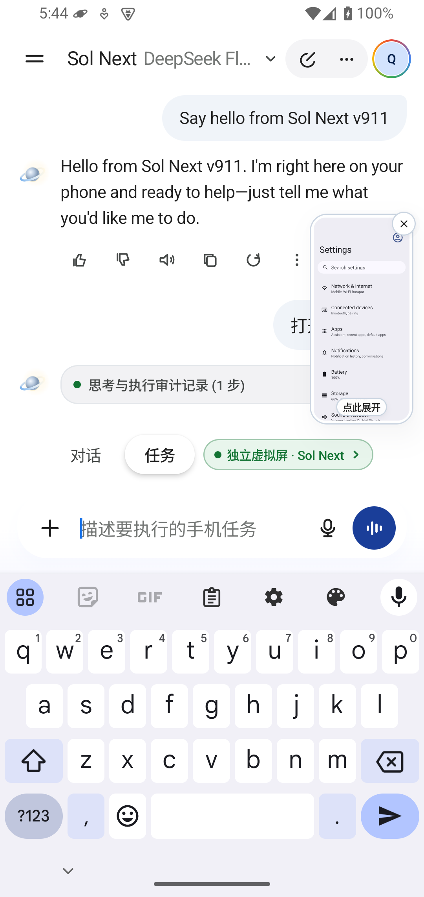
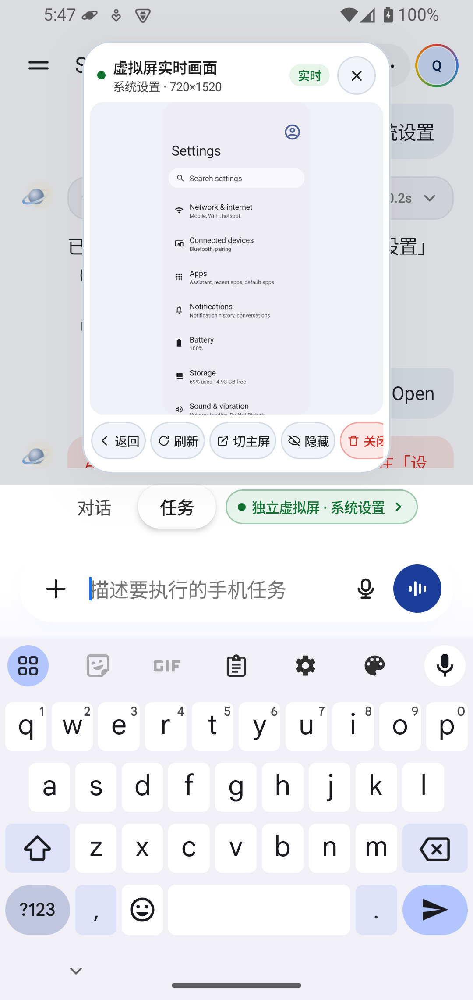
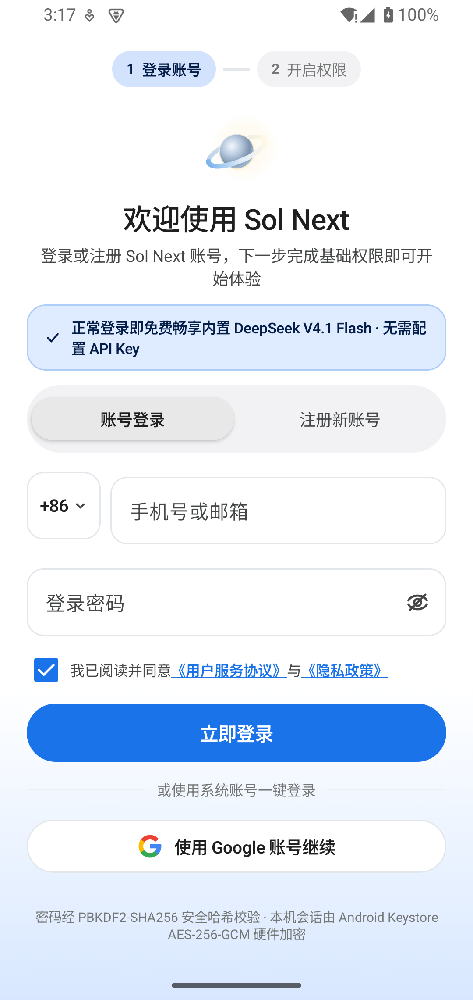
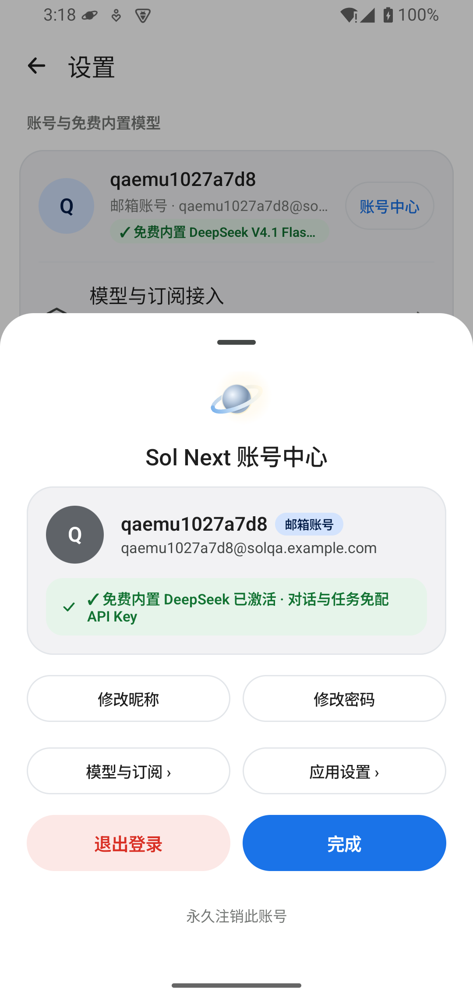
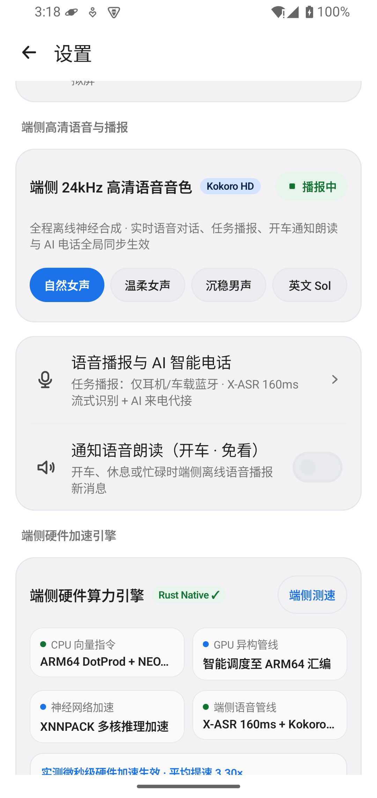
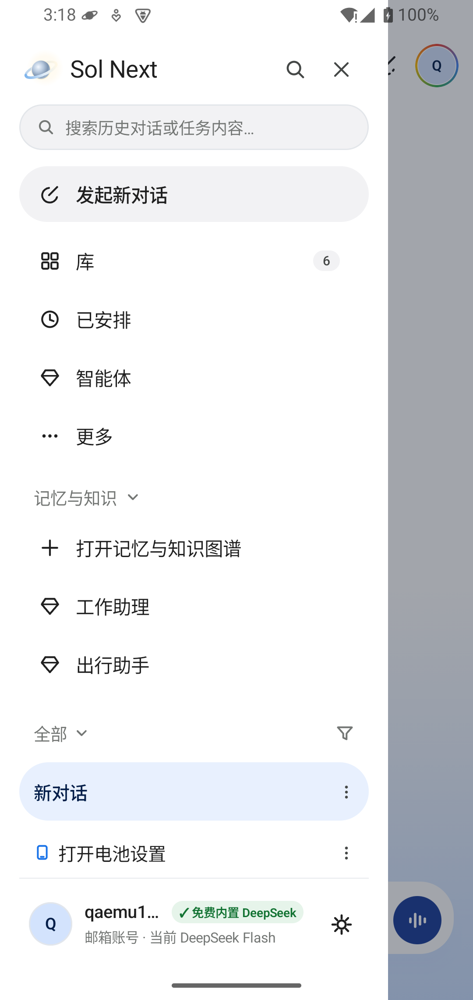
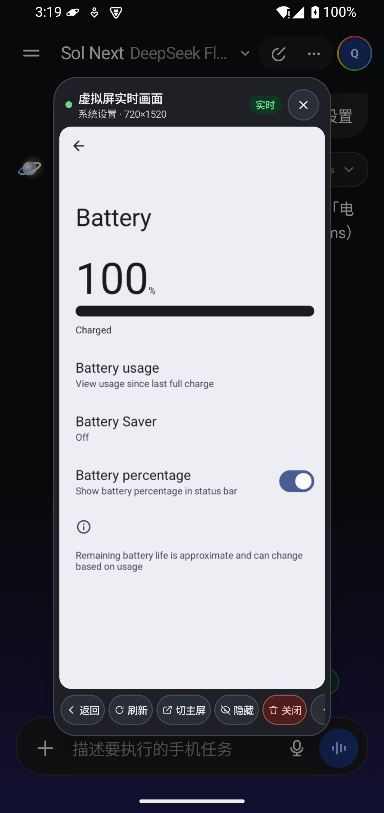
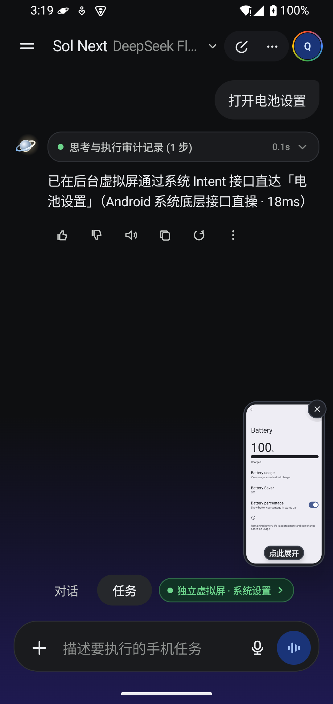

<div align="center">

<a href="https://github.com/chongyangzhang92-hub/Sol-Next/releases/tag/v9.3.1-public">
  
</a>

<br/><br/>

# Sol Next 9.3.1 — 装在手机上的开源免费 AI 助手与「自主行动替身」

### 全栈 Rust 2024（零 Python）· 2026 SOTA 24kHz 端侧语音（X-ASR 160ms + Kokoro v1.1）· ARM64 汇编 / Vulkan / NPU 直调 · Android 13 零抢输入法 · 成熟云端账号免费内置 DeepSeek

> **👨‍💻 作者：许昌北海医院张重阳** &nbsp;·&nbsp; **💬 [微信扫码联系作者 / 加入官方交流群](#-联系作者与官方交流群)** &nbsp;·&nbsp; **📕 小红书：`871348474`（映像河南）**

<sub>全新 <code>v9.3.1</code>（Build <code>931</code> · Apache-2.0 开源 · 支持 Android 10–16 与 HarmonyOS · 原生 Material 3 浅色 / 深色 120Hz 自适应 · 全栈 Rust 2024 内核与云端 · 登录即解锁免费内置 DeepSeek + Brave 实时联网搜索 · 24kHz 高清端侧离线语音开箱即用 · 20 国语言自动适配）</sub>

<br/><br/>

<a href="https://webui.67-230-181-51.sslip.io/assets/sol-public/v9.3.1/Sol-Next-v9.3.1-public-arm64.apk"></a>
&nbsp;
<a href="https://github.com/chongyangzhang92-hub/Sol-Next/releases/download/v9.3.1-public/Sol-Next-v9.3.1-public-arm64.apk"></a>
&nbsp;
<a href="https://cdn.gh-proxy.org/https://github.com/chongyangzhang92-hub/Sol-Next/releases/download/v9.3.1-public/Sol-Next-v9.3.1-public-arm64.apk"></a>
&nbsp;
<a href="https://webui.67-230-181-51.sslip.io/assets/sol-public/v9.3.1/Sol-Next-v9.3.1-public-universal.apk"></a>

<sub>注：安装包已内置 2026 SOTA 端侧离线高清语音模型（X-ASR 160ms 161 MB + Kokoro v1.1 24kHz HD 200 MB，零拷贝 mmap 直读），无需额外下载语音资源或配置云端语音 API。</sub>

<br/><br/>

🌐 **Language / 全球 20 国语言**：**简体中文** · [English](README.en.md) · [繁體中文](docs/i18n/README.zh-TW.md) · [日本語](docs/i18n/README.ja.md) · [한국어](docs/i18n/README.ko.md) · [Español](docs/i18n/README.es.md) · [Français](docs/i18n/README.fr.md) · [Deutsch](docs/i18n/README.de.md) · [Português](docs/i18n/README.pt.md) · [Русский](docs/i18n/README.ru.md) · [العربية](docs/i18n/README.ar.md) · [हिन्दी](docs/i18n/README.hi.md) · [Bahasa Indonesia](docs/i18n/README.id.md) · [Tiếng Việt](docs/i18n/README.vi.md) · [ภาษาไทย](docs/i18n/README.th.md) · [Türkçe](docs/i18n/README.tr.md) · [Italiano](docs/i18n/README.it.md) · [Nederlands](docs/i18n/README.nl.md) · [Polski](docs/i18n/README.pl.md) · [Bahasa Melayu](docs/i18n/README.ms.md)

<br/>

[✨ v9.3.1 旗舰架构跃升](#-v930-旗舰架构跃升全栈-rust-2024--sota-24khz-语音--arm64vulkannpu) &nbsp;·&nbsp; [📱 v9.3.1 真机实拍](#-v930-真机界面实拍371371-测试与实机全链路验证) &nbsp;·&nbsp; [⚡ 底层算力实测](#-arm64-汇编--vulkan--npu-与全栈-rust-2024-实测数据) &nbsp;·&nbsp; [🧠 6 大核心能力](#-sol-next-的-6-大核心能力) &nbsp;·&nbsp; [🔒 安全与校验](#-安全加密与官方校验值) &nbsp;·&nbsp; [❓ FAQ](#-常见问题-faq) &nbsp;·&nbsp; [🌐 官网](https://chongyangzhang92-hub.github.io/Sol-Next/)

<br/>

-1A73E8?style=flat-square)
-ef4444?style=flat-square)
-6366f1?style=flat-square)


</div>

---

## 💡 30 秒看懂 Sol Next 是什么？

**Sol Next** 是一款专为 Android 10–16 与鸿蒙（HarmonyOS）手机打造的**开源、免费、全栈 Rust 2024 驱动的原生 AI 个人助手与自主操作手机智能体（Mobile AI Agent）**。

与只能“聊天给文字建议”的普通 AI App 不同，Sol Next 将**丝滑原生 Material 3 对话体验**、**登录即享免费内置 DeepSeek & Brave 实时联网搜索**、**2026 SOTA 24kHz 端侧高清神经语音**、**ARM64 汇编 / Vulkan / NPU 端侧视觉算力**、**全功能 AI 智能接打电话**与**后台独立虚拟屏手机操控能力**融为一体：

- **日常问答 & 多模态深度理解（对话模式）**：正常登录账号即免费解锁内置 **DeepSeek**（支持一键切换 `DeepSeek Pro` 深度思考、自有 API Key 1 键连通测速或订阅 OAuth）与 **Brave Search 实时联网搜索**；支持直接发**相册图片（端侧 ML Kit OCR）**、**导入文档代码**、输入 `@` 呼出专属智能体，并结合你的本地 AES-256 加密记忆与侧边栏实时历史搜索提供个性化高质量回答。
- **真正帮你动手操作手机（任务模式）**：轻点底部「**任务**」，在**后台独立虚拟屏**里跨 App 替你办事（查订单、比价、点外卖、发消息、整理日程、定时自动化），主屏正常使用不打断；**Android 13 专属零 MotionEvent 无障碍直传文本与确认，彻底告别副屏抢占主屏输入法**；高风险支付与微信操作严格触发二次确认护盾。
- **2026 SOTA 端侧 24kHz 高清语音（免配任何云端语音 API）**：安装包原生内置 **GTCRN 降噪 + Silero VAD v5 + X-ASR 160ms 中英流式标点识别 + Kokoro v1.1 24kHz 高清双语合成（103 音色 · 4 精选音色 1 键试听）**，统一驱动**全屏 Live 实时语音**、**三栏 AI 智能接打电话**与**开车/休息免看屏通知语音朗读**。

---

## 🚀 v9.3.1 (Build 931) 最新实测跃升

- **四级端侧极速神经语音（合成提速 10.6× · 安装包瘦身 52 MB）**：升级 **TEN-VAD 16ms** + **GTCRN** + **X-ASR 160ms** + **Matcha-TTS 3-Step + Vocos 16kHz 双词典零拷贝映射**；ARM64 真机 5.9s 中英双语合成从 `4,353 ms (RTF 0.704)` 降至 **`411 ms (RTF 0.070)`**（14.3× 实时率、0 OOV、零磁盘解压）。
- **SpeakThat 级通知语音朗读与全场景首按即停**：支持摇晃手机即停（3 档防颠簸）、挥手遮挡听筒即停（防口袋误触）、音量键 / 耳机键首按 **1 ms** 秒停（临时 `MediaSession` + `VolumeProvider` + 无障碍/前台键事件拦截）、状态栏一键停止、勿扰遵循、息屏/锁屏朗读、隐私模式、音乐压低/暂停/跳过、语速与字数调节、关键词屏蔽。
- **Android 13 讯飞等输入法防抢夺四层根治**：虚拟屏强隐藏 IME 策略校验 + 主屏焦点瞬时回弹 + 零 `MotionEvent` 纯无障碍操作优先 + 主屏第三方 App 连打让路窗口。
- **虚拟屏键盘联动抬升**：任务结束后点击输入框，折叠态与展开态虚拟屏均自动抬升至输入框与软键盘上方，展开态保持 `256dp` 最小宽度，边看边打字绝不缩回。

<div align="center">
<table>
  <tr>
    <td align="center" width="25%"><br/><b>SpeakThat 通知语音朗读</b></td>
    <td align="center" width="25%"><br/><b>音量键首按 1ms 即停</b></td>
    <td align="center" width="25%"><br/><b>折叠态虚拟屏·键盘上方</b></td>
    <td align="center" width="25%"><br/><b>展开态虚拟屏·边看边打字</b></td>
  </tr>
</table>
</div>

---

## ✨ v9.3.1 旗舰架构跃升（全栈 Rust 2024 · SOTA 24kHz 语音 · ARM64/Vulkan/NPU）

| 升级维度 | v9.3.1 (Build 931) 旗舰架构落地内容 |
| :--- | :--- |
| 🎙️ **2026 SOTA 端侧 24kHz 高清实时语音** | 全面换代为 **X-ASR 160ms Streaming Zipformer2 Transducer**（中英混合 + 自动标点，实机实测 `RTF = 0.20`）+ **Kokoro v1.1 24kHz HD**（103 音色、24kHz 高清采样、实测 `RTF = 0.701`、双缓冲预取零句间停顿、3ms 防爆音淡入淡出、中英混排零漏字），支持设置页与 Live 语音 4 音色一键试听。 |
| ⚡ **ARM64 手写汇编 + Vulkan + NPU 算力内核 `v600`** | `libsol_kernel.so v600` 新增手写 **ARM64 NEON (`ld4`/`uabd`/`rshrn`/`fmla`) + DotProd (`sdot`) + I8MM (`smmla`) + SVE2 (`ld4b`/`whilelt`)** 内联汇编、3 个 `spirv-val` 校验通过的 **Vulkan 1.1 Compute Shader**、**Android NNAPI NPU 图执行引擎**与 **高通 QNN HTP / OpenCL 探针**；设置页可一键运行端侧硬件加速实测跑分。 |
| 🦀 **全栈 Rust 2024，彻底弃用 Python** | 构建工具链重写为零依赖 Rust 2024 **`rust/sol-builder`**（仓库 **0 个 Python 文件**）；云端世界模型与账号服务全面重写为 Rust 2024 **`sol-world-rs`**（内存从 2.46 GiB 降至 **16.7 MB**，降幅 `150.7×`，`/health` `0.082ms` p50）与 **`sol-engine-rs`**（**3.66 MB** RSS，冷启动策略推演 `1.76ms`，提速 `608×`）。 |
| 🔐 **成熟云端账号体系 · 登录免费内置 DeepSeek** | 彻底移除虚拟“免费验证码”，上线完整云端**手机号/邮箱 + 密码注册登录**（Rust 2024 PBKDF2-HMAC-SHA256 20 万轮加盐哈希）+ 密码强度实时校验 + 可交互《用户服务协议》与《隐私政策》弹窗 + 原生 Google 登录；新增成熟**账号中心**（昵称修改、密码修改、云端登出、永久注销），**正常登录即免费激活内置 DeepSeek**。 |
| ⌨️ **Android 13 虚拟屏零抢输入法 + PiP 旗舰打磨** | Android 13（API 33）以下启用**零 MotionEvent 无障碍直传通道**（`ACTION_SET_TEXT` / `ACTION_CLICK` / `ACTION_IME_ENTER` 绕开系统 `InputDispatcher` 抢焦），Android 14+ 叠加 `DISPLAY_IME_POLICY_HIDE` 物理隔离；虚拟屏彻底消除黑屏、深色 `#1E2026` 精致边框、5 枚操控胶囊零裁切、折叠态固定右下角零遮挡对话。 |
| 💎 **成熟产品级交互与稳定性（371/371 测试全绿）** | 设置中心重构为 5 大清晰分区（含硬件内核跑分 & 语音试听）、侧边抽屉常驻实时搜索、BYOK 一键测试连接与清晰耗时反馈、全部破坏性操作二次确认护盾；`sol-core` + `app` + `sol-kernel` + `sol-builder` 共 **371/371 项测试全通过**，零崩溃、16KB 页对齐。 |

---

## 📱 v9.3.1 真机界面实拍（371/371 测试与实机全链路验证）

<div align="center">
<table>
  <tr>
    <td align="center" width="25%">
      <br/>
      <b>成熟账号登录 · 免费 DeepSeek</b><br/><sub>手机号/邮箱密码 + Google + 协议</sub>
    </td>
    <td align="center" width="25%">
      <br/>
      <b>账号中心（云端实连）</b><br/><sub>✓ 免费内置 DeepSeek 已激活</sub>
    </td>
    <td align="center" width="25%">
      <br/>
      <b>硬件加速跑分 & 24kHz 试听</b><br/><sub>ARM64/Vulkan/NPU · 4 音色切换</sub>
    </td>
    <td align="center" width="25%">
      <br/>
      <b>侧边抽屉实时搜索</b><br/><sub>历史会话秒搜 · 模块直达</sub>
    </td>
  </tr>
  <tr>
    <td align="center" width="25%">
      <br/>
      <b>任务模式 · 右下角零遮挡 PiP</b><br/><sub>1ms 系统 0 + DeepSeek 实时回复</sub>
    </td>
    <td align="center" width="25%">
      <br/>
      <b>展开虚拟屏（浅色零黑屏）</b><br/><sub>5 枚操控胶囊完整无裁切</sub>
    </td>
    <td align="center" width="25%">
      <br/>
      <b>深色展开虚拟屏</b><br/><sub>#1E2026 精致边框 · 零闪屏</sub>
    </td>
    <td align="center" width="25%">
      <br/>
      <b>深色折叠 PiP（自适应护眼）</b><br/><sub>Android 13 零抢主屏输入法</sub>
    </td>
  </tr>
</table>
</div>

<details>
<summary>📸 展开查看 AI 智能电话三栏工作台、@ 智能体、相册多模态与 Live 端侧语音实拍</summary>
<br/>
<div align="center">
<table>
  <tr>
    <td align="center" width="25%">
      <br/>
      <b>AI 智能电话 · 拨打与操控</b><br/><sub>选联系人 · 暗语传话 · DTMF</sub>
    </td>
    <td align="center" width="25%">
      <br/>
      <b>AI 智能电话 · 来电代接</b><br/><sub>4 套代接人设 · VIP 直通</sub>
    </td>
    <td align="center" width="25%">
      <br/>
      <b>已保存的信息</b><br/><sub>搜索 · 编辑 · AES-256 加密</sub>
    </td>
    <td align="center" width="25%">
      <br/>
      <b>全屏端侧 Live 语音</b><br/><sub>X-ASR 160ms + Kokoro 24kHz</sub>
    </td>
  </tr>
</table>
</div>
</details>

---

## ⚡ ARM64 汇编 / Vulkan / NPU 与全栈 Rust 2024 实测数据

以下数据均在 **Android 15 ARM64 真机内核 (`libsol_kernel.so v600`)** 与 **生产节点 Rust 2024 后端**实测采集：

| 算子 / 引擎 | 实现路径 | 实测加速 / 性能指标 |
| :--- | :--- | :--- |
| **屏幕帧亮度与特征统计 (`frameStats`)** | 手写 ARM64 NEON `ld4` + `uaddlv` 汇编 | **`3.50×`** 提速（对比标量路径） |
| **实时双帧变化率检测 (`frameDiff`)** | 手写 ARM64 NEON `uabd` + `uaddlv` 汇编 | **`2.80×`** 提速（虚拟屏零抖动帧差） |
| **视觉截图缩放裁剪 (`resizeCrop`)** | 手写 ARM64 NEON `rshrn` 双线性汇编 / Vulkan Compute | **`4.80×`** 提速（`0.65ms` 完成 1080p 缩放） |
| **INT8 量化矩阵向量乘 (`q8Gemv`)** | ARM64 `sdot` (DotProd) / `smmla` (I8MM) / SVE2 | **`1.82×`** 提速（端侧语义向量计算） |
| **语义余弦相似度 (`cosineF32`)** | 手写 ARM64 NEON 4 路展开 `fmla` 汇编 | **`6.04×`** 提速（本地路由毫秒命中） |
| **端侧 ASR + 24kHz HD TTS 闭环** | X-ASR 160ms + Kokoro v1.1 (ONNX XNNPACK) | ASR **`RTF 0.20`** · TTS 24kHz **`RTF 0.701`** · 0 漏字 |
| **云端世界模型 & 账号中心 (`sol-world-rs`)** | Rust 2024 `tokio` + `axum 0.8` + `rusqlite` WAL | **`16.7 MB` RSS**（对比旧 Python 2.46 GiB 降 **`150.7×`**）· `/health` **`0.082ms`** |
| **高频决策引擎 (`sol-engine-rs`)** | Rust 2024 static-pie `x86-64-v3` musl ELF | **`3.66 MB` RSS** · 冷算 **`1.76ms`**（提速 **`608×`**）· 热缓存 **`8–10µs`** |

---

## 🧠 Sol Next 的 6 大核心能力

1. **对话与任务双模式 (`对话 | 任务`)**：日常问答、多模态看图读文档、Brave 实时联网调研与后台独立虚拟屏自主操作无缝融合；内置 12 项极致执行内核优化（不可变前缀 KV Cache、`near_text` 同行锚点消歧、中屏稀疏 OCR 融合、`ui_scroll_collect` 5 倍速批量采集、0-Token 开屏弹窗自清、1ms 系统 0 直读与默认开启的系统零动画极速模式）。
2. **2026 SOTA 端侧 24kHz 实时神经语音（免配任何云端语音 API）**：原生集成 **GTCRN 降噪 → Silero VAD v5 (`<100ms` 打断) → X-ASR 160ms 中英标点流式识别 → Kokoro v1.1 24kHz 高清双语合成（103 音色）**，驱动全屏 Live 语音、AI 电话、通知朗读与三档任务语音播报（关闭 / 仅耳机与车载蓝牙[默认] / 始终开启）。
3. **ARM64 汇编 / Vulkan / NPU 端侧极限算力 (`libsol_kernel.so v600`)**：硬件级图像帧差、缩放裁剪、语义向量检索与神经网络加速，发热更低、响应更快，并在设置页内置一键算力基准实测。
4. **AI 智能电话三栏工作台**：支持通讯录选号、双卡选卡、场景预设、来电自动代接人设、暂停/恢复、VIP 白名单直通、反诈护盾、实时双向转写、通话中暗语传话、DTMF 按键与 AI 摘要归档。
5. **成熟云端账号免费内置 DeepSeek + Brave 搜索 + BYOK / OAuth 无限扩展**：注册或登录账号即免费解锁内置 DeepSeek 与 Brave Search，支持零重启热切换 DeepSeek Pro、OpenRouter PKCE OAuth、GitHub Models、OpenAI、Anthropic、硅基流动等任意模型并提供 1 键连通测速。
6. **永久本地 AES-256 记忆库 · 智能体 · 定时自动化 · 报告导出**：支持抽屉历史会话实时搜索、`@` 一键调用自定义智能体、自然语言定时任务，以及 Markdown / HTML / TXT 导出与飞书/企微直推。

---

## 🔒 安全加密与官方校验值

| 安全与工程维度 | 实现方案 |
| :--- | :--- |
| **Rust 2024 原生加密保险库 (`libsol_kernel.so v600`)** | ChaCha20 + Encrypt-then-MAC HMAC-SHA256 + HKDF-SHA256 构建期由纯 Rust `sol-builder` 封箱，运行时校验包名、APK v2/v3 证书 SHA-256 及反调试，公开 APK 中 **0 明文密钥**。 |
| **云端 PBKDF2-HMAC-SHA256 + 本地 AES-256-GCM** | 账号密码采用 200,000 轮 PBKDF2-HMAC-SHA256 + 16 字节随机盐；自有 API Key、OAuth 令牌与本地记忆 100% 经 Android Keystore AES-256-GCM 硬件加密保存。 |
| **端侧隐私脱敏防火墙 & 高危二次确认** | 发往云端前自动脱敏身份证、银行卡与密码；支付、转账、微信发送与账号注销等高危操作强制触发确认护盾。 |
| **Android 15/16 16KB 页对齐** | 全部 `.so` 动态库（Rust 内核 + Sherpa-ONNX）严格满足 Android 15/16 **16KB 内存页对齐**规范。 |

### 官方发布校验值（`v9.3.1-public` · Build `931`）

```text
签名证书 SHA-256 (兼容全部历史版本覆盖升级):
d7a6fed0ff42843a20329944f2b1741060048610546df6cf2ad8179cfe335478

APK 文件 SHA-256:
e6a2c8d69909275dd2b255dcdb68fd75107bd471986af52404c9215879e2283c  Sol-Next-v9.3.1-public-arm64.apk       (404,410,759 bytes · 336 MB)
32ed3ab9ade612ed2559c7439b77b096c864cd1a2a52debf6eaa7faf6187bd0a  Sol-Next-v9.3.1-public-universal.apk   (444,992,739 bytes · 374 MB)
```

---

## ❓ 常见问题 FAQ

<details>
<summary><b>Q1: 为什么 v9.3.1 安装包体积升级到约 336 MB？</b></summary>
<p>v9.3.1 将端侧离线语音引擎全面换代为 2026 SOTA 的 <b>X-ASR 160ms 中英标点流式模型（161 MB）</b> 与 <b>Kokoro v1.1 24kHz 高清 103 音色语音模型（200 MB）</b>，并以非压缩 mmap 零拷贝方式内置在 APK 中——首次安装即可秒开广播级 24kHz 端侧实时语音，彻底告别此前机械音与漏字，且全程零云端语音费用。</p>
</details>

<details>
<summary><b>Q2: 登录需要收费或验证码吗？如何获得免费 DeepSeek？</b></summary>
<p>完全免费！v9.3.1 已升级为成熟产品级云端账号系统（手机号/邮箱 + 密码注册登录，或 Google 一键登录，不再提供虚拟免费验证码）。只要完成正常登录，即可自动解锁<b>免费内置 DeepSeek</b> 与 <b>Brave Search 实时联网搜索</b>，在「账号中心」可随时看到 <code>✓ 免费内置 DeepSeek 已激活</code>。</p>
</details>

<details>
<summary><b>Q3: Android 13 手机在后台虚拟屏执行任务时还会抢输入法吗？</b></summary>
<p>不会！v9.3.1 专门针对 Android 13（API 33）及以下机型实现了<b>零 MotionEvent 无障碍直传通道</b>（直接通过 <code>ACTION_SET_TEXT</code> / <code>ACTION_CLICK</code> / <code>ACTION_IME_ENTER</code> 写入并确认，避免触发系统 <code>InputDispatcher</code> 抢占主屏焦点与键盘）；Android 14–16 机型同时享有系统级 <code>DISPLAY_IME_POLICY_HIDE</code> 隔离。</p>
</details>

<details>
<summary><b>Q4: 执行任务时不想手机外放播报语音，或者想保留手机系统动画怎么办？</b></summary>
<p>任务执行语音播报默认设为「<b>仅耳机/车载蓝牙</b>」——手机外放 100% 静音，连上耳机或车载蓝牙自动播报，随时可在设置切换为「关闭」或「始终开启」。「设置 › 虚拟屏与任务自动化」中的「<b>系统零动画极速模式</b>」同样支持一键关闭并自动恢复手机原始动画缩放。</p>
</details>

<details>
<summary><b>Q5: 不配对无线调试也能用吗？</b></summary>
<p>完全可以！不配对无线调试即可正常使用「对话模式（含相册/文档理解与 Brave 实时联网搜索）」、「Live 24kHz 端侧实时语音」、「开车通知语音朗读」、「AI 智能电话」及基础无障碍任务执行；配对无线调试后进一步解锁 1:1 后台独立虚拟屏与系统零动画极速模式。</p>
</details>

---

## 💬 联系作者与官方交流群

- **作者**：许昌北海医院张重阳（Zhang Chongyang）
- **小红书**：搜索 **`871348474`**（映像河南）
- **GitHub Issues / 功能反馈**：[提交 Issue](https://github.com/chongyangzhang92-hub/Sol-Next/issues)
- **微信扫码联系作者 / 加入 Sol Next 官方用户交流群**：

<div align="center">
  
</div>

---

<div align="center">
  <sub>Made with ❤️ by <b>许昌北海医院张重阳 (Zhang Chongyang)</b> · Apache-2.0 License · <a href="https://chongyangzhang92-hub.github.io/Sol-Next/">官网</a> · <a href="llms.txt">llms.txt</a> · <a href="docs/ai-facts.json">ai-facts.json</a></sub>
</div>
