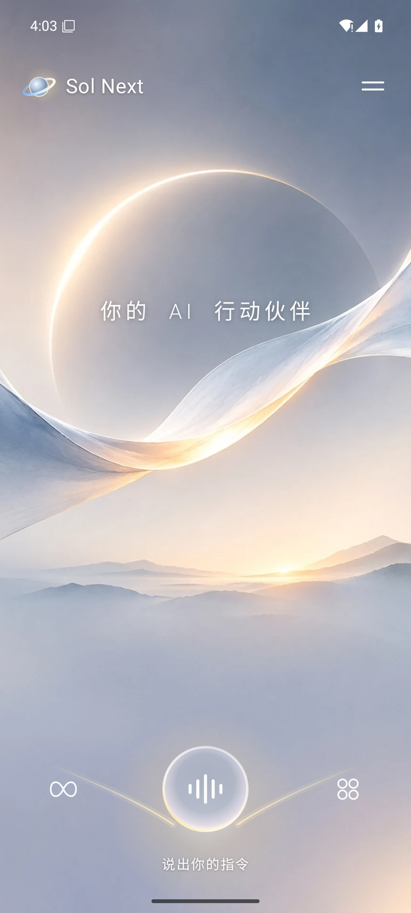
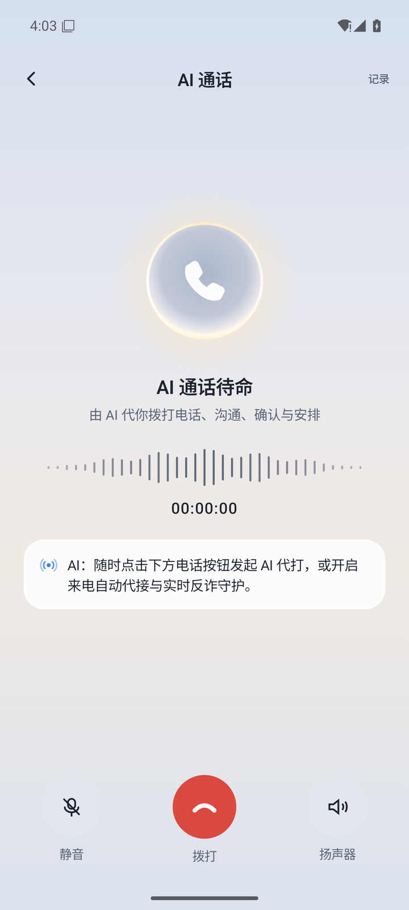
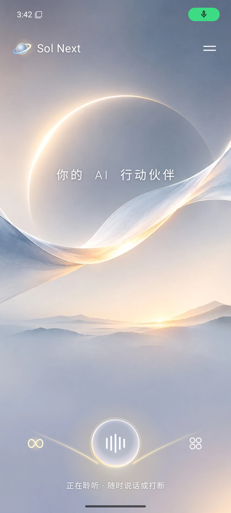
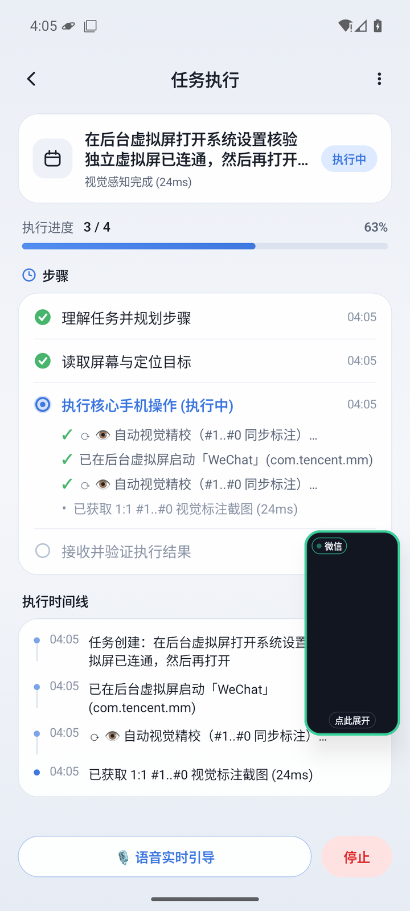
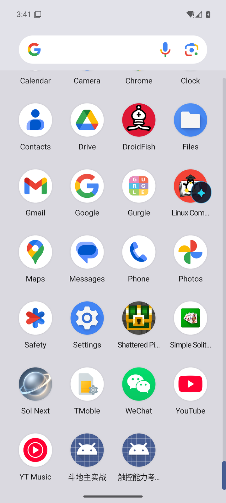
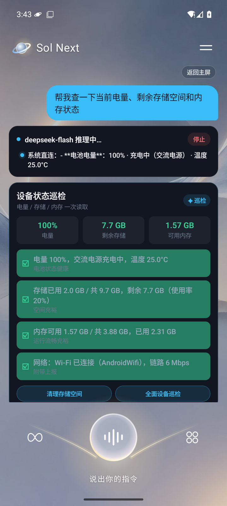

<div align="center">

<a href="https://github.com/chongyangzhang92-hub/Sol-Next/releases/tag/v9.0.1-public">
  
</a>

<br/><br/>

# Sol Next 9.0.1 — 晨曦轨道 · 你的 AI 行动伙伴

### 用自然对话，驱动真实的手机行动 · 率先落地 Android 16/17 智能 OS 架构

<sub>全新 <code>9.0.1</code> 跨代架构（Build <code>901</code> · Android 10–16 / 16KB 页对齐 · 100% 零内置密钥 / 任意云端模型 BYOK · 致敬先驱 <code>wangzan101/Mika</code>）</sub>

<br/><br/>

<a href="https://github.com/chongyangzhang92-hub/Sol-Next/releases/download/v9.0.1-public/Sol-Next-v9.0.1-public-arm64.apk"></a>
&nbsp;
<a href="https://github.com/chongyangzhang92-hub/Sol-Next/releases/download/v9.0.1-public/Sol-Next-v9.0.1-public-universal.apk"></a>
&nbsp;
<a href="https://github.com/chongyangzhang92-hub/Sol-Next/releases/tag/v9.0.1-public"></a>
&nbsp;
<a href="https://github.com/wangzan101/Mika"></a>

<br/><br/>

**简体中文** &nbsp;·&nbsp; [English](README.en.md) &nbsp;·&nbsp; [🌐 产品官网](https://chongyangzhang92-hub.github.io/Sol-Next/) &nbsp;·&nbsp; [`llms.txt`](llms.txt) &nbsp;·&nbsp; [`ai-facts.json`](docs/ai-facts.json) &nbsp;·&nbsp; [`SHA256SUMS.txt`](SHA256SUMS.txt)

<br/>

-3E78E0?style=flat-square)


</div>

<br/>

---

## ✨ 为什么 Sol Next 9.0.1 是一次彻底的跨代进化？

**Sol Next 9.0.1** 彻底重构了移动 AI 助手的产品形态与底层大脑——**弃用繁琐的文字输入框与满屏工程参数**，以 **「晨曦轨道」极简四屏语音体系 + Google Android 16/17 前沿智能 OS 规划实装 + 真人级全游戏实时操控 + 任意云端模型零配置引擎**，把“能聊天但干不了活、能干活但难用得像开发者工具”的旧时代彻底翻篇。

> **零学习成本，拿来即用**：打开即见晨曦轨道语音主场，张口说话即可驱动整台手机；闲聊毫秒级语音秒回，复杂行动自动切入清晰可视化的步骤进度与时间线。

---

## 🎨 一、全新「晨曦轨道」四屏零学习成本交互（Android 16 真机实拍）

全新的 **3D 环形轨道星球 Logo** 与统一的晨曦光影设计语言贯穿四大核心屏，拒绝一切晦涩技术黑话（无元素编号、无包名、无坐标弹窗）：

<table>
  <tr>
    <td align="center" width="25%">
      <br/>
      <b>1. 首页 · 语音交互</b><br/>
      <sub>零文字输入框 · 点击声波球或 <code>∞</code> 全双工实时对话，张口即执行</sub>
    </td>
    <td align="center" width="25%">
      <br/>
      <b>2. 任务执行 · 可视化进度</b><br/>
      <sub>进度条 + 绿勾/蓝环步骤树 + 自然语言子步骤 + 原生交互核验卡</sub>
    </td>
    <td align="center" width="25%">
      <br/>
      <b>3. AI 通话 · 声纹与字幕</b><br/>
      <sub>晨曦柔雾通话球 + 35 柱实时声纹 + 字幕泡 + 实时反诈 & 悄悄话</sub>
    </td>
    <td align="center" width="25%">
      <br/>
      <b>4. 设置 · 模型与隐私 (BYOK)</b><br/>
      <sub>三行极简配置任意云端模型，本地隐私防火墙与自动 OTA 一目了然</sub>
    </td>
  </tr>
</table>

<details>
<summary><b>👀 展开查看更多真机细节（全双工实时收音状态 · 全新 3D 轨道桌面图标 · 后台独立虚拟屏画中画）</b></summary>
<br/>
<table>
  <tr>
    <td align="center" width="33%">
      <br/>
      <sub><b>实时全双工语音对话中</b>（Android 16 麦克风激活 · <code>&lt;20ms</code> 随时语音打断）</sub>
    </td>
    <td align="center" width="33%">
      <br/>
      <sub><b>Android 16 后台独立虚拟屏 PiP</b>（<code>24ms</code> 截帧 · 不打扰主屏）</sub>
    </td>
    <td align="center" width="33%">
      <br/>
      <sub><b>全新 3D 环形轨道星球图标</b>（自适应圆/方图标 + 状态栏剪影全量焕新）</sub>
    </td>
  </tr>
</table>
</details>

---

## 🚀 二、Sol Next 9.0.1 六大跨代王牌能力

### 1. 🎙️ 全双工实时语音对话处理任务（Voice-First Live Agent）
- **硬件级语音前处理**：直连 Android `VOICE_COMMUNICATION` 16kHz PCM16 麦克风管线，自动挂载硬件级 `AcousticEchoCanceler`（回声消除）+ `NoiseSuppressor`（环境降噪）+ `AutomaticGainControl`（自动增益），嘈杂环境依然识别精准。
- **双轨实时分流**：
  - 闲聊、问答、头脑风暴：经全双工语音流 **&lt;400ms** 拟人自然应答，支持 **&lt;20ms 随时插话打断**。
  - 手机操作、查状态、发消息、打游戏、设闹钟：高精度中文同音纠偏后即时派发行动引擎，自动切入「任务执行」屏可视化展示，并在完成后通过语音实时向你口头汇报核验结果。
- **任务中随时语音改口**：执行到一半直接说「停」「别点了，改成打开闹钟」，立刻实时转向或熔断。

### 2. 🧠 率先实装 Google Android 16 / 17 AI OS 前沿规划与论文智慧
不是停留在概念里，而是每一项都在 Android 16 (API 36) 真机实装可运行：

| 前沿能力 | 对应 Google / 学术界方向 | Sol Next 9.0.1 端侧实装效果 |
| --- | --- | --- |
| **原生 120Hz Generative UI 交互卡片** | Android 17 Generative UI | `0-Token` 瞬间生成设备巡检 KPI 仪表盘 + Agent 自主调用 `ui_render_card` 渲染带勾选、状态标签与一键续跑按钮的原生 Compose 卡片 |
| **端侧 Magic Cue 主动微提示** | Android 16/17 Magic Cue | `< 0.1 ms` 全端侧提取通知验证码一键复制、快递单号追踪、客服电话直拨、地址导航与低电量省电提示 |
| **AppFunctions 端侧能力发现** | Android 16 `AppFunctionManager` (On-Device MCP) | 自动发现已安装 App 暴露的原生能力与 `LauncherApps` 动态快捷入口，配合 `120+` 主流 App Deep-Link 瞬移 |
| **Live Updates 实时状态胶囊** | Android 16 `Notification.ProgressStyle` | 任务后台执行期间在锁屏与状态栏呈现推广态实时进度胶囊，附带一键「停止任务」 |
| **端侧 Private Compute 隐私防火墙** | Android Private Compute Core | 请求发往任何云端大模型前，在手机本地毫秒级自动脱敏 **18 位身份证号、Luhn 校验银行卡号、API 密钥与密码字段**，零云端明文泄露 |
| **动态测试时算力缩放 & 长任务情节记忆** | Test-Time Compute Scaling / Grounded Episodic Memory | 顺畅步骤保持极速低延迟；检测到页面振荡（`A→B→A→B`）、触底或异常时自动升档深度推理并压缩保留 `[任务长期记忆]`，支持 56–120 轮超长任务不丢目标 |

### 3. 🎮 真人级全游戏实时操控（任何游戏都能像人一样实时操作）
- **4 指并发多点触控 (`multi_touch`)**：支持同时按下并滑动多达 4 根手指（例如左手持续拖动虚拟摇杆移动 + 右手连点普攻/释放技能/滑动调视角），在 60Hz 后台虚拟屏与免 ADB 前台双通路均原生生效。
- **单回合高速连点 (`ui_tap_sequence`) + 自动并行融合**：一次规划出牌选多张牌或棋盘起止落子，毫秒级连续精准触控，杜绝多轮往返延迟。
- **零无障碍游戏专用视觉增强**：针对纯画布/横屏游戏内置底排手牌精细 OCR、按钮定位 OCR 与 60Hz `realtime_play` 实时闭环控制。

### 4. 🌐 任意云端大模型零配置直连（纯云端 + 端侧引擎，零自建本地模型依赖）
- **彻底告别本地部署负担**：无需电脑、无需局域网 GPU、无需自建推理服务器，只要有一个云端 API Key（**OpenAI GPT-4o/4.1/5、DeepSeek、Claude、Gemini 2.5、通义千问 Qwen-VL、Kimi、GLM、OpenRouter 或任意 OpenAI 兼容中转**），3 秒填入即满血。
- **端点能力自学习 + 纯文本模型满血视觉加速**：自动归一化误粘贴的 `/chat/completions` URL；遇到不支持 Vision/Reasoning/ToolChoice 的模型自动学习一次并永久降级，零重复 HTTP 400；遇到纯文本云端模型自动开启端侧 Google ML Kit 高精度 OCR + UI 树融合，同样流畅看屏操控。

### 5. 📞 AI 实时通话前沿完全体（Pixel Call Screen 级体验）
- **不替换系统默认拨号器**：基于 Telecom 非 UI 伴随架构与 `uid=2000` 全双工音频桥，原生通话界面与来电体验丝毫无损。
- **端侧 `<0.1ms` 实时反诈雷达 (`SolCallScamShield`)**：本地实时监听对方话术，一旦命中「屏幕共享/远程控制」「索要验证码/密码」「公检法安全账户」「百万保障扣费」「刷单退款」等高危话术，立即亮红预警并让 AI 自动拒答。
- **通话中「悄悄话」实时指挥 (`injectLiveWhisper`)**：通话进行中可随时一键向 AI 下达隐形指示（「改约时间」「问一下价格」「礼貌婉拒」），或一键「我自己接」无感接管通话；支持通讯录人名直接拨号。

### 6. 🔄 全自动内置 OTA 远程升级
- 应用启动与后台每 6 小时自动静默检测新版本，发现新版本即推送系统更新通知并在首屏显示极简升级横幅。
- Wi-Fi 环境下自动完成 `.part → .apk` 原子静默预下载，点一下直接拉起系统安装器无缝升级。

---

## 📊 三、Android 16 (API 36 · 16KB) 真机全链路验收实测

以下所有数据与画面均来自 **Android 16 (`sdk_gphone16k_arm64`, API 36, 1080×2400 @ 420dpi)** 真实运行环境实拍与自动化校验，**零造假、零剪辑**：

<table>
  <tr>
    <td align="center" width="25%">
      <br/>
      <b>0-Token 原生交互巡检卡</b><br/>
      <sub>秒出电量/存储/内存/Wi-Fi KPI 卡片 + 一键可执行操作</sub>
    </td>
    <td align="center" width="25%">
      <br/>
      <b>斗地主横屏零无障碍 3/3 全胜</b><br/>
      <sub><b>10 步 / 32.5s</b> · 顺子/对子/单牌全部合法压制通关</sub>
    </td>
    <td align="center" width="25%">
      <br/>
      <b>DroidFish 国际象棋实战</b><br/>
      <sub>自动同意 Android 16 权限弹窗 + 对阵 Stockfish 合法开局</sub>
    </td>
    <td align="center" width="25%">
      <br/>
      <b>4 项硬件手势 4/4 一次满分</b><br/>
      <sub><b>18.7s</b> · 点击/长按(0px漂移)/拖动/双指缩放(1.63x)全一次过</sub>
    </td>
  </tr>
</table>

| 实机验收套件 | Android 16 (API 36 / 16KB) 实测结果 | 关键亮点 |
| --- | --- | --- |
| **Suite 1 · Android 17 Generative UI 系统巡检** | **秒级 0-Token 原生卡片渲染** | 自动聚合电量、存储、内存、网络状态与一键动作 |
| **Suite 2 · 复杂多步操作 + 状态读回核验 + 还原** | **9.3 s · 4/4 步骤全绿完成** | 深色主题 `OFF → ON` 真实读回核验 → `ON → OFF` 还原 + 生成原生核验报告卡 |
| **Suite 3 · 斗地主实战三局（横屏无无障碍）** | **32.5 s · 10 步 · 3/3 全部获胜** | 5-6-7-8-9 顺子 / 对 J / 单 2 全部一次连点合法压制 |
| **Suite 4 · DroidFish 国际象棋 + 未授权权限弹窗** | **自动授权 + 合法西西里防御开局** | 自动通过 Android 16 `PermissionController` 弹窗并对阵 Stockfish |
| **Suite 5 · 4 项硬件触控手势考场** | **18.7 s · 4/4 首次尝试满分** | 点击 ✓ · 长按 `823ms / 0px 漂移` ✓ · 精准拖拽 ✓ · 双指放大 `1.63x` ✓ |
| **Suite 6 · Android 16 `uid=2000` 后台独立虚拟屏** | **`24 ms` 虚拟屏截帧 · 画中画实时渲染** | 无线调试/USB 启动独立后台屏并发运行应用，不抢占主屏 |
| **工程质量 & 安全性** | **100+ 单元测试全通过 · 零 Fatal 崩溃** | `:sol-core:test` + `:app:testReleaseUnitTest` + `:app:lintVitalRelease` + 零密钥审计全绿 |

---

## ⚖️ 四、Sol Next 9.0.1 vs 传统手机 AI 助手（含致敬先驱 Mika）

Sol Next 衷心致敬开源先驱 [wangzan101/Mika](https://github.com/wangzan101/Mika) 在后台虚拟屏与伴随通话范式上的开创性探索（公开版独立包名 `ai.sol.next`，与 Mika `com.wangzan101.mika` 完美共存）。在 9.0.1 中，Sol Next 带来了以下独有体验：

| 核心维度 | 传统手机 AI 助手 / 早期方案 | **Sol Next 9.0.1（晨曦轨道）** |
| --- | --- | --- |
| **主交互方式** | 文字聊天框 + 复杂技术日志列表 | **全双工实时语音主屏（零输入框）+ 四屏可视化进度/时间线** |
| **步骤可读性** | 暴露包名、元素编号、像素坐标 | **100% 人类自然语言可视化步骤与进度条，零学习成本** |
| **游戏操控能力** | 仅支持单点慢速点击，难玩实时游戏 | **4 指并发多点触控 + 单回合连点 + 60Hz 实时操控 + 游戏专用 OCR** |
| **Android 16/17 新特性** | 未适配 | **Generative UI 卡片 + Magic Cue + AppFunctions + Live Updates + 16KB 对齐** |
| **隐私安全** | 屏幕内容直接明文发给云端 | **端侧 Private Compute 隐私防火墙，身份证/银行卡/密钥本地脱敏** |
| **AI 通话体验** | 基础拨打或需替换默认电话 | **晨曦声纹通话屏 + 实时反诈雷达 + 通话中一键悄悄话 + 一键本人接管** |
| **模型兼容与更新** | 绑定特定模型 / 手动找包更新 | **任意云端模型 BYOK 自适应（纯文本也能端侧 OCR 看屏）+ 全自动 OTA 升级** |

---

## 📦 五、下载安装与安全校验（零内置密钥公开版）

1. **下载安装**：
   - 📱 **绝大多数现代安卓手机（推荐）**：[Sol-Next-v9.0.1-public-arm64.apk](https://github.com/chongyangzhang92-hub/Sol-Next/releases/download/v9.0.1-public/Sol-Next-v9.0.1-public-arm64.apk)（34 MB，Android 10–16 / 16KB 页对齐）
   - 💻 **通用全架构（含 x86_64 模拟器）**：[Sol-Next-v9.0.1-public-universal.apk](https://github.com/chongyangzhang92-hub/Sol-Next/releases/download/v9.0.1-public/Sol-Next-v9.0.1-public-universal.apk)（47 MB）
2. **30 秒极简上手**：
   - 安装并授予**无障碍服务**与**麦克风权限**；
   - 点击右下角 `○○/○○` → **设置** → 填入你自己的任意云端模型 API Key（OpenAI / DeepSeek / Claude / Gemini / 通义千问 / OpenRouter 等）；
   - 回到晨曦首页，轻点发光声波球，直接说出你想让手机做的任何事！
3. **SHA-256 校验与零内置密钥审计**：

```text
e3e877e011907c8a8a92f88271252cb4c4ac653eba898395306367548fa1631b  Sol-Next-v9.0.1-public-arm64.apk
a6bc9791d5717c08e3077bb406af8ce557c8157c28298f6f1285e7cb7359f689  Sol-Next-v9.0.1-public-universal.apk
```

```bash
# 任何人均可一行验证公开版 APK 不含任何内置 API 密钥资产（输出为空即纯净）：
unzip -l Sol-Next-v9.0.1-public-arm64.apk | grep -iE "distribution|sol-models|secret|key\.json"
```

---

<div align="center">
<sub>Apache-2.0 Open Source · Built with love for the Android AI OS future · Tribute to <a href="https://github.com/wangzan101/Mika">wangzan101/Mika</a></sub>
</div>
