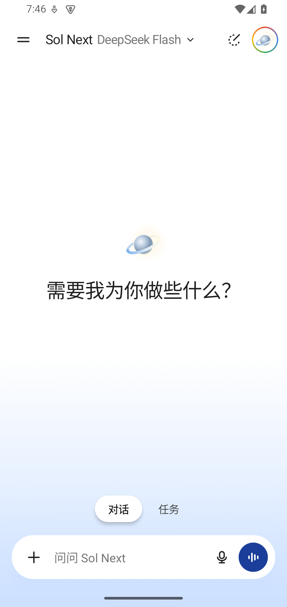
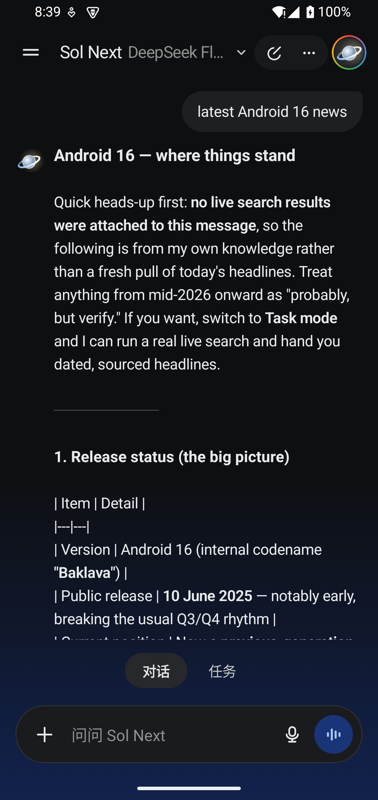
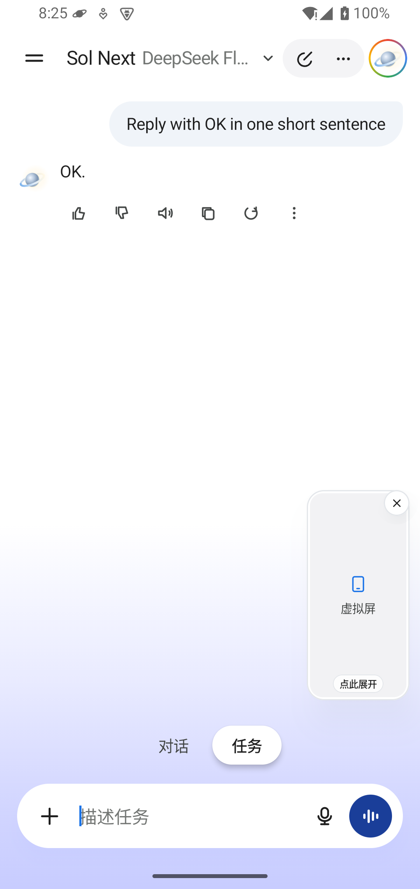
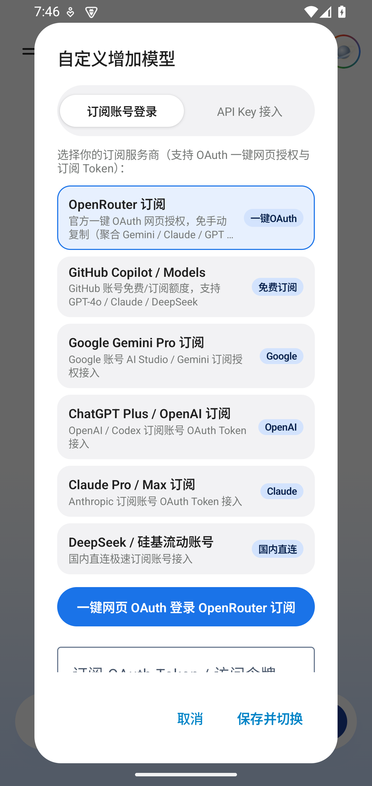
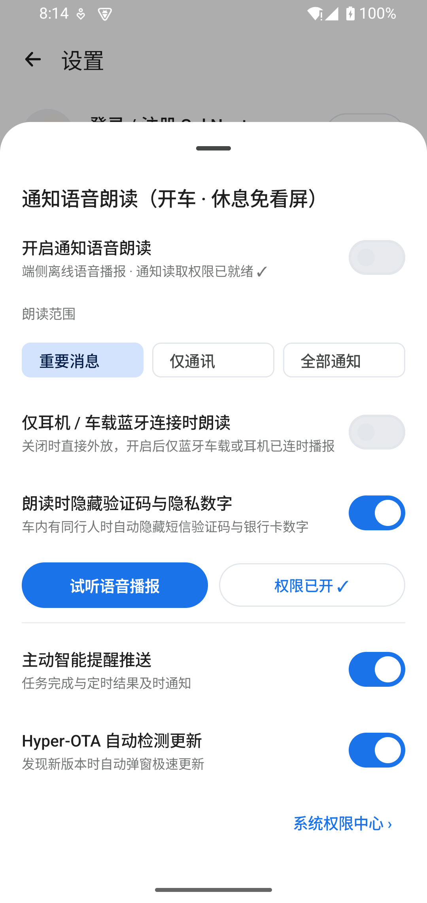
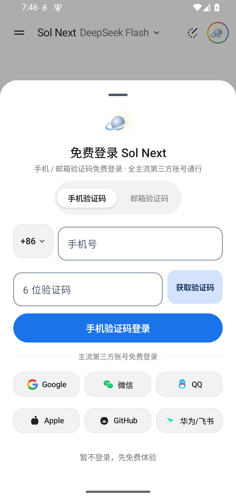
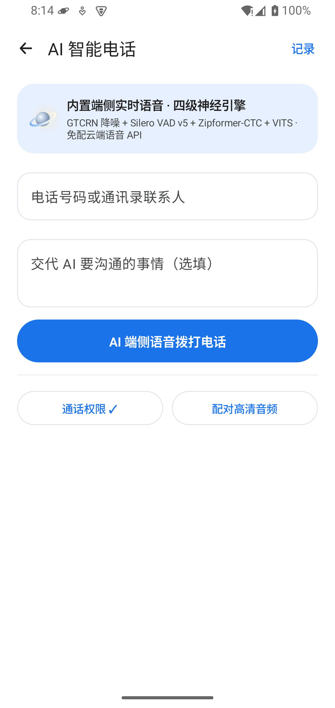
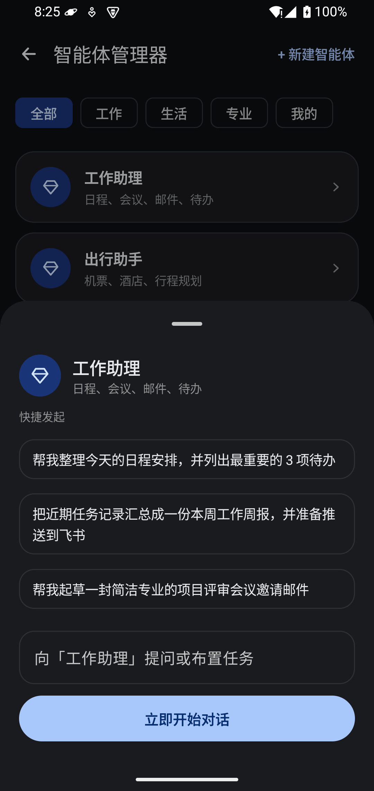

<div align="center">

<a href="https://github.com/chongyangzhang92-hub/Sol-Next/releases/tag/v9.1.1-public">
  
</a>

<br/><br/>

# Sol Next 9.1.1 — 装在手机上的开源免费 AI 助手与「自主行动替身」

### 极简 Material 3「对话 | 任务」双模式 · 内置免费 DeepSeek Flash & Brave 联网搜索 · 四级端侧实时语音免配 API · 后台独立虚拟屏替你办事 · 开车免看屏通知语音朗读

> **👨‍💻 作者：许昌北海医院张重阳** &nbsp;·&nbsp; **💬 [微信扫码联系作者 / 加入官方交流群](#-联系作者与官方交流群)** &nbsp;·&nbsp; **📕 小红书：`871348474`（映像河南）**

<sub>全新 <code>v9.1.1</code>（Build <code>911</code> · Apache-2.0 开源 · 支持 Android 10–16 与 HarmonyOS · 100% 原生 Material 3 浅色 / 深色 120Hz 自适应界面 · Rust 硬件级加密内置 DeepSeek Flash + Brave 实时联网搜索 · 四级端侧神经语音零配置即用 · 20 国语言自动适配）</sub>

<br/><br/>

<a href="https://webui.67-230-181-51.sslip.io/assets/sol-public/v9.1.1/Sol-Next-v9.1.1-public-arm64.apk"></a>
&nbsp;
<a href="https://github.com/chongyangzhang92-hub/Sol-Next/releases/download/v9.1.1-public/Sol-Next-v9.1.1-public-arm64.apk"></a>
&nbsp;
<a href="https://cdn.gh-proxy.org/https://github.com/chongyangzhang92-hub/Sol-Next/releases/download/v9.1.1-public/Sol-Next-v9.1.1-public-arm64.apk"></a>
&nbsp;
<a href="https://webui.67-230-181-51.sslip.io/assets/sol-public/v9.1.1/Sol-Next-v9.1.1-public-universal.apk"></a>

<br/><br/>

🌐 **Language / 全球 20 国语言**：**简体中文** · [English](README.en.md) · [繁體中文](docs/i18n/README.zh-TW.md) · [日本語](docs/i18n/README.ja.md) · [한국어](docs/i18n/README.ko.md) · [Español](docs/i18n/README.es.md) · [Français](docs/i18n/README.fr.md) · [Deutsch](docs/i18n/README.de.md) · [Português](docs/i18n/README.pt.md) · [Русский](docs/i18n/README.ru.md) · [العربية](docs/i18n/README.ar.md) · [हिन्दी](docs/i18n/README.hi.md) · [Bahasa Indonesia](docs/i18n/README.id.md) · [Tiếng Việt](docs/i18n/README.vi.md) · [ภาษาไทย](docs/i18n/README.th.md) · [Türkçe](docs/i18n/README.tr.md) · [Italiano](docs/i18n/README.it.md) · [Nederlands](docs/i18n/README.nl.md) · [Polski](docs/i18n/README.pl.md) · [Bahasa Melayu](docs/i18n/README.ms.md)

<br/>

[✨ v9.1.1 新特性](#-v911-重磅升级一览) &nbsp;·&nbsp; [📱 真机界面实拍](#-真机界面实拍浅色--深色全屏原生-material-3) &nbsp;·&nbsp; [🧠 6 大核心能力](#-sol-next-的-6-大核心能力) &nbsp;·&nbsp; [⚡ 3 分钟上手](#-3-分钟快速上手指南) &nbsp;·&nbsp; [🔒 安全与架构](#-安全加密与技术架构) &nbsp;·&nbsp; [❓ 常见问题 FAQ](#-常见问题-faq) &nbsp;·&nbsp; [🌐 官网](https://chongyangzhang92-hub.github.io/Sol-Next/)

<br/>

-1A73E8?style=flat-square)


</div>

---

## 💡 30 秒看懂 Sol Next 是什么？

**Sol Next** 是一款专为 Android 10–16 与鸿蒙（HarmonyOS）手机打造的**开源、免费、开箱即用的原生 AI 个人助手与自主操作手机智能体（Mobile AI Agent）**。

与只能「聊天给文字建议」的普通 AI App 不同，Sol Next 将**极简流畅的原生对话体验**、**端侧四级神经实时语音**、**实时联网搜索**与**后台独立虚拟屏手机操控能力**融为一体：

- **日常问答 & 深度研究（对话模式）**：打开即聊，免费内置 **DeepSeek Flash**（默认最低思考等级极速响应，可一键切换 `DeepSeek Pro` 深度思考或自有模型/订阅），并内置 **Brave Search 实时联网搜索**（含国内直连智能兜底），随时获取今日新闻、天气、行情与多跳深度研报。
- **真正帮你操作手机办事（任务模式）**：轻点底部「**任务**」，应用内自动拉起**后台独立虚拟屏**——你继续在主屏正常看新闻、回微信、打字（副屏已做 `DISPLAY_IME_POLICY_HIDE` 输入法隔离，绝不收起你的键盘），Sol Next 在独立虚拟屏里替你跨 App 比价、订餐、发消息、领券、整理日程、执行每日定时自动化。
- **开车 / 休息免看屏语音体验**：安装包内置完整四级端侧神经语音引擎（无需任何云端语音 API Key），同时驱动**全屏 Live 实时语音对话**、**AI 智能接打电话**与**开车 / 休息通知语音朗读**（自动压低音乐音量、默认隐藏验证码与银行卡隐私数字）。

---

## ✨ v9.1.1 重磅升级一览

| 模块 | v9.1.1 全新升级内容 |
| :--- | :--- |
| 🎨 **全新 Material 3 流体双模式架构** | 全站 100% 原生 Android Material 3 极简设计（浅色 `#FFFFFF` / 深色 `#0E0F11` 自适应），底部「**对话 \| 任务**」悬浮胶囊无缝切换，配天蓝 / 靛紫呼吸光晕与 120Hz 高刷动效；覆盖首页、抽屉、设置、智能体、已保存信息、已安排任务、扩展工具、权限中心、AI 电话与全部弹窗。 |
| 🧠 **免费福利模型 + 订阅 OAuth 自由切换** | 左上角单行模型下拉菜单支持零重启热切：`DeepSeek Flash`（免费福利内置、默认最低思考等级极速响应）、`DeepSeek Pro`（深度思考）、自定义 **API Key** 与 **订阅账号 OAuth 登录**（支持 OpenRouter OAuth 2.0 PKCE 一键网页回调、GitHub Models、DeepSeek、硅基流动、OpenAI、Anthropic 等）。 |
| 🌐 **内置 Brave Search 实时联网搜索** | 通过 Rust 硬件加密保险库内置 **Brave Search API**，对话模式询问实时资讯、天气、价格、最新动态或多跳深度研究时自动联网检索并附带参考来源；国内直连网络环境自动 2.5s 秒切 CN Bing 兜底，全网不断流。 |
| 🎙️ **四级端侧实时神经语音（免配语音 API）** | APK 内置完整端侧神经语音链路：**GTCRN 降噪 → Silero VAD v5 (`<100ms` 打断) → Zipformer-CTC 实时语音识别 → AISHELL-3 VITS 端侧语音合成**，同时驱动全屏 Live 实时语音、边语音边执行任务与 AI 智能接打电话。 |
| 🚗 **开车 / 休息通知语音朗读** | 端侧离线自动播报微信、短信与重要通知；支持 **Audio Ducking（短暂压低音乐/导航音量）**、通话与 Live 语音期自动静音避让、**默认隐藏短信验证码与银行卡隐私数字**、仅蓝牙车载/耳机模式及一键试听。 |
| 🔐 **免费全渠道账号登录组件** | 内置免费**手机验证码登录**（`+86` 及主流国际区号、60s 冷却、加密校验与系统通知一键填入）、**邮箱验证码登录**，以及 **Google、微信、QQ、Apple ID、GitHub、华为 / 飞书** 主流第三方登录，本地 Android Keystore AES-256-GCM 硬件加密存储。 |
| 🖥️ **任务模式虚拟屏 & 防无障碍反复弹窗** | 完整保留 **v9.0.9 100% 精准点击执行内核**与副屏输入法隔离（`DISPLAY_IME_POLICY_HIDE`），切入任务模式留在应用内直接拉起独立虚拟屏、支持运行中实时插话引导；**彻底优化国产 ROM 退出 App 后无障碍被杀反复弹窗拦截的问题**，首次引导持久化且 Shell 助手在线 200ms 静默自愈。 |

---

## 📱 真机界面实拍（浅色 / 深色全屏原生 Material 3）

<div align="center">
<table>
  <tr>
    <td align="center" width="25%">
      <br/>
      <b>极简浅色主页</b><br/><sub>对话 | 任务 双模式胶囊</sub>
    </td>
    <td align="center" width="25%">
      <br/>
      <b>深色模式 & 富文本对话</b><br/><sub>#0E0F11 纯黑自适应护眼</sub>
    </td>
    <td align="center" width="25%">
      <br/>
      <b>任务模式 · 后台独立虚拟屏</b><br/><sub>副屏自主执行 · 主屏不收键盘</sub>
    </td>
    <td align="center" width="25%">
      <br/>
      <b>Live 实时语音（端侧免配）</b><br/><sub>GTCRN + Silero + Zipformer + VITS</sub>
    </td>
  </tr>
  <tr>
    <td align="center" width="25%">
      <br/>
      <b>左上角模型与思考等级</b><br/><sub>Flash / Pro / 自定义热切换</sub>
    </td>
    <td align="center" width="25%">
      <br/>
      <b>订阅 OAuth / API Key</b><br/><sub>OpenRouter PKCE 一键回调</sub>
    </td>
    <td align="center" width="25%">
      <br/>
      <b>开车 / 休息通知语音朗读</b><br/><sub>压低音乐 · 隐藏验证码</sub>
    </td>
    <td align="center" width="25%">
      <br/>
      <b>免费全渠道登录</b><br/><sub>手机/邮箱 OTP · 谷歌/微信/QQ</sub>
    </td>
  </tr>
</table>
</div>

<details>
<summary>📸 展开查看更多界面：AI 智能电话控制台 & 深色智能体管理器</summary>
<br/>
<div align="center">
<table>
  <tr>
    <td align="center" width="50%">
      <br/>
      <b>AI 智能接打电话控制台</b><br/><sub>四级端侧实时语音 + 防诈骗护盾 + 随时真人接管</sub>
    </td>
    <td align="center" width="50%">
      <br/>
      <b>智能体管理器（深色模式）</b><br/><sub>工作助理 / 出行 / 健康 / 投资 / 学习 + 自定义智能体</sub>
    </td>
  </tr>
</table>
</div>
</details>

---

## 🧠 Sol Next 的 6 大核心能力

### 1. 对话与任务双模式：既是最顺手的 AI 对话助手，也是能动手的手机代理
- **对话模式 (`对话`)**：纯净零干扰问答、长文撰写、代码分析、多跳深度研究与内置 Brave 实时联网搜索，支持赞/踩偏好记忆、语音朗读、复制、重试、一键推送飞书/微信及导出 Markdown / HTML / TXT 文档。
- **任务模式 (`任务`)**：自动在应用内拉起**后台独立虚拟屏**，由 v9.0.9 精准零误触执行内核驱动跨 App 自主操作；执行中可随时输入文字或开启麦克风**实时插话引导（Live Steer）**，支持展开高达 30 步的执行审计记录与敏感操作（支付 / 微信 / 系统设置）安全确认护盾。

### 2. 四级端侧实时神经语音系统（免配任何云端语音 API）
APK 原生打包 4 个 Apache-2.0 端侧 ONNX 模型与 `libsherpa-onnx-jni.so`：
```text
麦克风 / 通话下行
   │
   ▼ 1. GTCRN 神经降噪 (gtcrn_simple.onnx · 535 KB) — 过滤车内胎噪、风噪与环境人声
   ▼ 2. Silero VAD v5 (silero_vad_v5.onnx · 2.3 MB) — <100ms 语音活动检测与毫秒级插话打断
   ▼ 3. Zipformer-CTC 端侧 ASR (model.int8.onnx · 26.3 MB) — 离线低延迟中英流式语音识别
   ▼ 4. DeepSeek Flash / On-Device Brain — 极速意图理解、对话或任务指令路由
   ▼ 5. AISHELL-3 VITS 端侧 TTS (model.onnx · 30.5 MB) — 自然中文端侧神经语音合成播报
```
这套端侧语音底座**统一驱动全屏 Live 实时语音、主界面同屏语音控制条、AI 智能接打电话以及通知语音朗读**。

### 3. 开车 / 休息免看屏通知语音朗读
- 面向**自驾通勤、午休、做饭、健身或开会腾不开手**场景设计。
- **Audio Ducking 音频避让**：播报通知时自动申请 `AUDIOFOCUS_GAIN_TRANSIENT_MAY_DUCK`，短暂压低音乐/播客/导航音量，播完丝滑恢复；接打电话或使用 Live 实时语音期间自动静默绝不抢麦。
- **隐私数字自动脱敏（默认开启）**：自动识别并隐藏短信验证码、银行卡尾号、取件码敏感数字，车内有同行人也安心。
- **精细范围与外设控制**：支持「重要消息 / 仅通讯 / 全部通知」三档，支持「仅连接车载蓝牙或耳机时播报」，在 `+` 面板、侧边抽屉「更多」、设置页及语音口令（"开启通知朗读"）均可一键开关。

### 4. 内置免费模型 + 内置 Brave 搜索 + 订阅 OAuth / BYOK 无限扩展
- **开箱即用零门槛**：内置福利模型 **DeepSeek Flash**（默认 `low` 最低思考等级极速秒回）与 **Brave Search 实时联网搜索**，安装完点开就能用。
- **全模型自由切换**：左上角模型下拉菜单一键切换 `DeepSeek Pro`（深度思考）或自定义添加任意 OpenAI 兼容模型；支持 **订阅账号 OAuth 登录**（如 OpenRouter OAuth 2.0 PKCE 网页一键回调 `solnext://auth/model-openrouter`、GitHub Models 免费额度、DeepSeek、硅基流动等）与硬件加密 **API Key 接入**。

### 5. AI 智能接打电话（端侧语音 + 防诈骗护盾）
- 输入电话号码或通讯录联系人 + 交代沟通事项（如预约餐厅、快递改派、核对账单、拒接推销），AI 全程通过端侧四级神经语音代为沟通并实时转写字幕。
- 通话中内置实时防诈骗关键词预警，用户随时一键「本人接管」或「让 AI 接管」。

### 6. 永久本地 AES-256 记忆库 · 智能体 · 定时自动化 · 前沿工具箱
- **已保存的信息与记忆库**：Android Keystore AES-256-GCM 端侧加密存储个人偏好与工作习惯，支持随时增删。
- **智能体管理器**：内置工作助理、出行助手、健康管家、投资助手、学习助手，支持快捷发起卡片与自定义专属智能体。
- **已安排与每日定时自动化**：支持自然语言创建定时任务（如「每天早上 8:30 汇总今日科技新闻并推送飞书」），后台准时执行并归档永久报告库。

---

## ⚡ 3 分钟快速上手指南

1. **下载安装 APK**
   - 现代主流安卓 / 鸿蒙手机优先下载 **`Sol-Next-v9.1.1-public-arm64.apk`**（93 MB，16KB 页对齐适配 Android 15/16）。
   - 如设备为 x86_64 模拟器或特殊架构，下载 **`Sol-Next-v9.1.1-public-universal.apk`**（131 MB）。
2. **首次权限引导（仅需一次，绝不反复弹窗）**
   - 按引导授予麦克风、通知与通话权限，以及辅助操控（无障碍）权限；点击底部「开始使用」或「先进入首页」即刻进入主界面。
   - **针对小米 HyperOS / OPPO ColorOS / vivo OriginOS / 华为鸿蒙用户**：已彻底优化系统后台清理无障碍后的体验，**退出 App 重新打开绝不会再把你拦在无障碍引导页**；配对一次无线调试后 Shell 助手还可在 200ms 内静默自愈无障碍。
3. **立即体验**
   - **直接提问或联网搜索**：在「对话」模式直接输入问题（如「查一下今天最新的科技新闻」），内置 DeepSeek Flash + Brave Search 秒级回复。
   - **语音对话**：点击输入栏右侧蓝色声波按钮进入全屏 Live 实时语音，或点麦克风图标边看屏边说。
   - **手机自主办事**：点击底部「**任务**」胶囊，应用内拉起虚拟屏，直接描述你想办的事（如「打开地图查从这里到高铁站打车多久」）。
   - **开启开车通知朗读**：点输入框左侧 `+` →「通知朗读」，或前往「设置 → 通知语音朗读」。

---

## 🔒 安全加密与技术架构

| 安全与工程维度 | 实现方案 |
| :--- | :--- |
| **Rust 2024 原生安全内核 (`libsol_kernel.so`)** | ChaCha20 + Encrypt-then-MAC HMAC-SHA256 + HKDF-SHA256 构建期加密保险库，运行时独立校验 `procfs` 包名、APK v2/v3 签名证书 SHA-256 及反调试/反注入，APK 中零明文密钥。 |
| **本地硬件级数据加密** | 用户自有 API Key、OAuth 令牌、账号会话及个人长期记忆均使用 Android Keystore **AES-256-GCM** 加密保存于设备本地，绝不上传第三方服务器。 |
| **端侧隐私脱敏防火墙** | 发往云端大模型前本地自动识别脱敏身份证号、银行卡号、密码与密钥；通知语音朗读默认自动隐藏短信验证码与银行卡数字。 |
| **敏感操作人工二次确认** | 涉及支付、转账、微信发送、系统关键设置修改默认触发原生 Material 3 确认弹窗，用户拥有最终决定权。 |
| **Android 15/16 现代规范** | 全部 `.so` 动态库（Rust 内核 + Sherpa-ONNX）严格满足 **16KB 内存页对齐**，支持 120Hz 高刷新率与 ADPF 性能调度。 |

### 官方发布校验值（v9.1.1-public · Build 911）

```text
签名证书 SHA-256 (兼容全部历史版本覆盖升级):
d7a6fed0ff42843a20329944f2b1741060048610546df6cf2ad8179cfe335478

APK 文件 SHA-256:
bc852a20672ca76f144cc6227b79716e2ba7484f59b1a2b2cc0386b1247f01d7  Sol-Next-v9.1.1-public-arm64.apk
29ea3b14c2bb5a1b2d808eb22f3246948b198a2acd5a82353ca3d22be328e02d  Sol-Next-v9.1.1-public-universal.apk
```

---

## ❓ 常见问题 FAQ

<details>
<summary><b>Q1: Sol Next 完全免费吗？需要自己买 API Key 或配置语音服务吗？</b></summary>
<p>完全免费、Apache-2.0 开源、无广告无订阅墙。安装包已免费内置 <b>DeepSeek Flash</b> 对话/任务模型、<b>Brave Search 实时联网搜索</b>以及<b>四级端侧实时神经语音系统</b>，下载安装打开即可直接使用全部核心功能。如果你拥有 OpenRouter、GitHub Models、OpenAI、Anthropic、DeepSeek、硅基流动等自有 API Key 或订阅账号，也可在顶部左上角模型下拉菜单随时添加并零重启切换。</p>
</details>

<details>
<summary><b>Q2: 为什么有些国产手机（小米/OPPO/vivo/华为）退出 App 后容易把无障碍关掉？v9.1.1 怎么解决的？</b></summary>
<p>部分国产 ROM 在划掉后台卡片时会主动回收无障碍服务。Sol Next v9.1.1 做了双重优化：① 完成首次权限引导后状态持久化，下次打开直接进入主界面，<b>绝不再反复弹窗拦截提示开启无障碍</b>；② 在「权限与无线调试」配对无线调试后，Shell 助手会在恢复前台时于 200ms 内静默自愈无障碍服务；同时建议授予「忽略电池优化」进一步提高后台保活稳定性。</p>
</details>

<details>
<summary><b>Q3: 不配对无线调试也能用「任务」模式和「对话」模式吗？</b></summary>
<p>完全可以！不配对无线调试即可直接使用「对话模式（含 Brave 实时联网搜索）」、「Live 端侧实时语音」、「开车通知语音朗读」、「AI 智能电话」以及基础无障碍任务执行。配对一次无线调试后，可进一步解锁满血 1:1 后台独立虚拟屏（输入法隔离 <code>DISPLAY_IME_POLICY_HIDE</code>）与无障碍自动自愈。</p>
</details>

<details>
<summary><b>Q4: 开车时使用「通知语音朗读」会读出我的短信验证码或银行卡号吗？</b></summary>
<p>不会。通知语音朗读默认开启「<b>朗读时隐藏验证码与隐私数字</b>」，自动脱敏 4–8 位验证码与长串敏感数字，播报时自动短暂压低音乐/导航音量，且完全使用端侧离线神经语音本地合成，通知内容不经过任何第三方 TTS 服务器。</p>
</details>

<details>
<summary><b>Q5: 免费手机号验证码登录和微信 / QQ / Google 登录安全吗？</b></summary>
<p>安全。验证码采用加密哈希 + 5 分钟有效期 + 60 秒频控 + 最多 5 次尝试保护，Google 登录优先调用系统原生账号选择器，所有账号会话凭证全部通过 Android Keystore AES-256-GCM 硬件加密存储在本机。</p>
</details>

---

## 💬 联系作者与官方交流群

- **作者**：许昌北海医院张重阳（Zhang Chongyang）
- **小红书**：搜索 **`871348474`**（映像河南）
- **GitHub Issues / 功能反馈**：[提交 Issue](https://github.com/chongyangzhang92-hub/Sol-Next/issues)
- **微信扫码联系作者 / 加入 Sol Next 官方用户交流群**：

<div align="center">
  
</div>

---

<div align="center">
  <sub>Made with ❤️ by <b>许昌北海医院张重阳 (Zhang Chongyang)</b> · Apache-2.0 License · <a href="https://chongyangzhang92-hub.github.io/Sol-Next/">官网</a> · <a href="llms.txt">llms.txt</a> · <a href="docs/ai-facts.json">ai-facts.json</a></sub>
</div>
