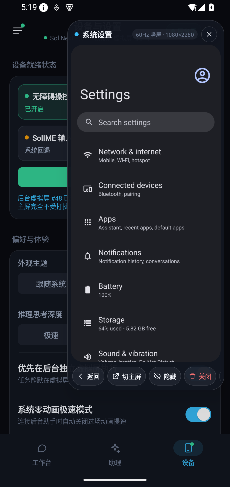
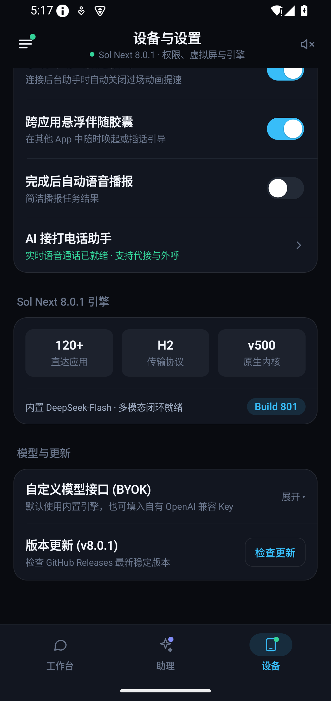
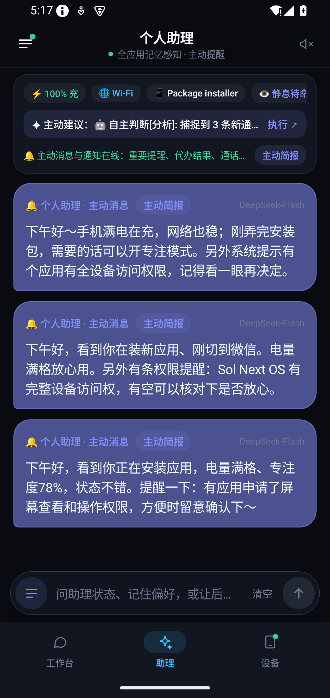
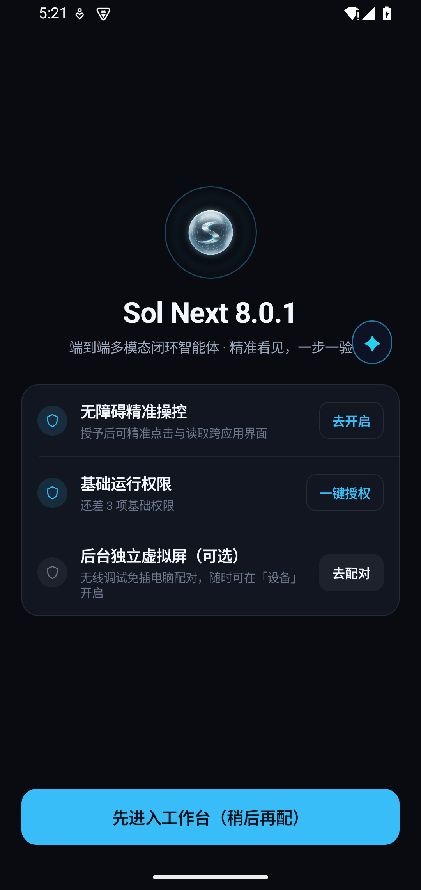
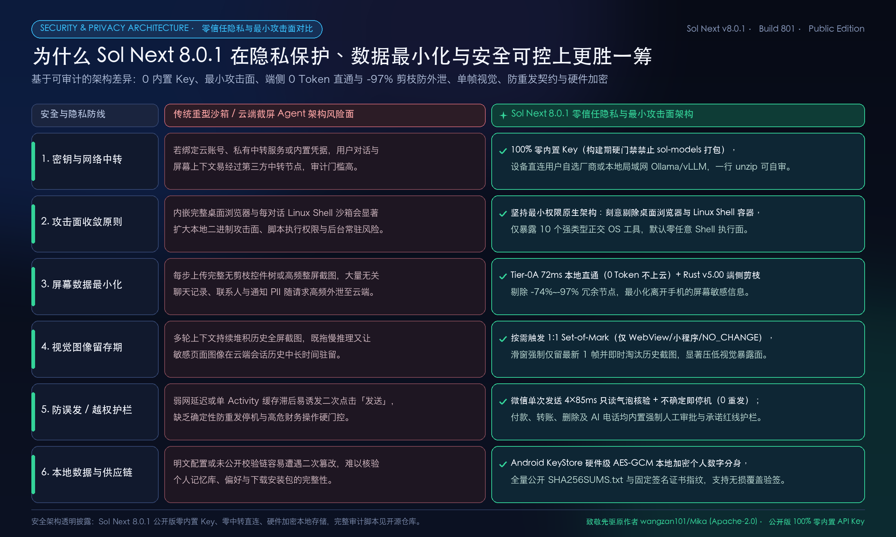

<div align="center">

<a href="https://chongyangzhang92-hub.github.io/Sol-Next/">
  
</a>

# Sol Next 8.0.1 — Grounded Multimodal Android OS Agent

### 快到像系统原生 · 强到接管整台手机 · 致敬并演进自 Mika (`@wangzan101`)

**简体中文** · [English](README.en.md) · [🌐 产品官网](https://chongyangzhang92-hub.github.io/Sol-Next/) · [📊 Sol Next vs Mika 深度对比](https://chongyangzhang92-hub.github.io/Sol-Next/mika-vs-sol-next.html) · [🛡️ 安全与隐私白皮书](https://chongyangzhang92-hub.github.io/Sol-Next/security-and-privacy.html) · [⚡ Android 15 性能基准](https://chongyangzhang92-hub.github.io/Sol-Next/android-ai-agent-benchmarks.html) · [🤖 MCP & BYOK](https://chongyangzhang92-hub.github.io/Sol-Next/mcp-and-byok-guide.html) · [📦 下载 v8.0.1](https://github.com/chongyangzhang92-hub/Sol-Next/releases/tag/v8.0.1-public) · [`llms.txt`](llms.txt)

<br/>

<a href="https://github.com/chongyangzhang92-hub/Sol-Next/releases/download/v8.0.1-public/Sol-Next-v8.0.1-public-arm64.apk"></a>
<a href="https://chongyangzhang92-hub.github.io/Sol-Next/#demo"></a>
<a href="https://github.com/wangzan101/Mika"></a>

<br/>

-0ea5e9)
-10b981)
-8b5cf6)


<br/>

> **核心定位**：**Sol Next 8.0.1 (`ai.sol.next`, Build 801)** 是一款面向 Android 10–16 的开源、**100% 零内置密钥 (BYOK)** 多模态闭环操作系统智能体。项目诚挚致敬并基于杰出开源先驱 [**`wangzan101/Mika`**](https://github.com/wangzan101/Mika)（Apache-2.0）从第一性原理重构演进至 8.0 时代：集成了 **`72 ms` 端侧系统反射**、**10 个正交原子 OS 工具 (`SolGroundedAgent`)**、**实时句柄绑定 `#1..#N` + `<2ms` 零缓存指纹**、**`64 ms` 1:1 Set-of-Mark 多模态视觉**、**Rust v5.00 16KB 页对齐原生内核**、**1:1 物理屏后台隐形虚拟手机**、**运营商级 AI 接打电话驾驶舱** 与 **零依赖 CLI (`--json`) + 原生 stdio MCP Server**。

</div>

---

## 🎬 实机动态演示 & 1080p 高清视频影院 (Live Demos)

<div align="center">

<a href="https://chongyangzhang92-hub.github.io/Sol-Next/#demo">
  
</a>

<br/>

**⬆️ 实机录屏动图：1:1 物理屏后台虚拟手机静默执行 + 实时多模态闭环轨迹 + AI 电话与 Studio 界面联动**

<br/>

<a href="https://chongyangzhang92-hub.github.io/Sol-Next/#demo"></a>
<a href="https://chongyangzhang92-hub.github.io/Sol-Next/media/sol-next-demo.mp4"></a>

<sub>提示：GitHub README 静态页不直接内联仓库 MP4 播放器，点击上方蓝色按钮即可在 <b>Sol Next 交互式产品发布官网</b> 原生流畅播放完整 1080p H.264 视频，或直接查看仓库内视频文件 <a href="docs/media/sol-next-demo.mp4"><code>docs/media/sol-next-demo.mp4</code></a>。</sub>

</div>

### 🎯 六大端到端真实场景 Demo 拆解

| Demo 场景 | 示例自然语言指令 | 底层执行路径与关键技术 | 实测表现 |
|---|---|---|---|
| **Demo 01 · 毫秒级系统反射** | `查一下电量、剩余存储，并打开勿扰模式` | Tier-0A 原生 Android System API 直通，零云端往返 | **`72 ms` · `0 Token`** |
| **Demo 02 · 微信 8.0.80 实战闭环** | `打开微信登录，搜索日本区号并切换账号输入中文` | `app_open` 预启动 + 实时 `#1..#N` 句柄 + `<2ms` 零缓存指纹 + 单次发送气泡契约 | **登录 `9.5 s` 一次通过 · 8 步 `8/8` 首击命中（0 误双击）** |
| **Demo 03 · 26 步超长后台静默跑任务** | `在后台虚拟屏完成跨页面筛选、比对与信息汇总` | 1:1 物理屏后台 VirtualDisplay + 目标钉死滑窗 (`>22` 消息不跑偏) | **前景刷手机零打扰 · `0.0px` 零漂移** |
| **Demo 04 · 120+ 主流 App 瞬移直达** | `打开高德导航去机场 / 在小红书搜攻略 / 淘宝搜降噪耳机` | `SolAppGraphEngine` 120+ Deep-Link 协议直达 + `t=0ms` 首轮并发预启动 | **`< 250 ms` 空降目标功能页** |
| **Demo 05 · 运营商级 AI 接打电话** | `帮我致电客服查询账单，遇到语音菜单自动按键转人工` | 非默认拨号器 Telecom 伴侣架构 + 实时语音引擎 + 3×4 IVR DTMF 按键 + 一键人工接管 | **不抢占原生拨号器 · 全程可控可听** |
| **Demo 06 · 1:1 多模态视觉看屏精校** | `看看当前屏幕上的商品参数与隐蔽图标并帮我点进去` | 自动 1:1 Set-of-Mark 红框标注 (`64 ms` 编码) + 224px 局部放大裁切 | **单轮看屏 `5.1 s` · WebView / 小程序精准直击** |

---

## ⚡ 为什么 Sol Next 8.0.1 又快又强？

> 传统手机 Agent 把每一步简单操作都扔给云端“截全屏 → 等 VLM 猜坐标 → 盲点 → 死等 1.5 秒”，既慢又容易误点。**Sol Next 8.0.1 采用「端侧确定性反射 + 多模态实时句柄闭环」双轨架构**，把一切能毫秒完成的留在端侧，把真正需要推理的做到外科手术级精准。

### ⚡ 极致速度（快到像系统原生功能）

| 加速层级 | 实测速度 | 核心工程原理 |
|---|---:|---|
| **Tier-0A 端侧系统直通** | **`72 ms`** (`0 Token`) | 查电量/存储/内存/网络、开关 Wi-Fi/蓝牙/手电筒/勿扰、调亮度音量、设闹钟计时器、查联系人/日程/验证码与通知栏直回，全程绕过云端。 |
| **120+ App 协议瞬移 + `t=0ms` 预启动** | **`< 250 ms`** | 覆盖微信、淘宝、京东、美团、抖音、小红书、B 站、高德、支付宝等 120+ 主流应用 Deep-Link；复杂任务在模型首轮思考的同时提前拉起目标 App。 |
| **零缓存实时状态指纹校验** | **`< 2 ms`** | 抛弃传统 140ms 过期哈希与固定盲等，动作后毫秒级比对 `text / checked / selected / focus` 变化，杜绝单 Activity 页面二次误双击。 |
| **1:1 Set-of-Mark 视觉编码** | **`64 ms`** | 仅在 WebView、小程序、无标签图标密集页或 `NO_CHANGE` 时按需附带 1:1 `#1..#N` 标注图，滑窗仅留最新 1 帧图像，避免 Token 爆炸。 |
| **Rust v5.00 原生内核 + QUIC 0-RTT** | **微信冷启提速 `~2×`** | 16KB 页对齐 `libsol_kernel.so` 微秒级 UI 树剪枝、HTTP/3 QUIC 0-RTT 传输与后台 `uid=2000` 零动画加速，微信冷启登录输入从 `18.5 s` 降至 **`9.5 s`**。 |

### 🔥 全面强大（真正操作系统级全能手机代理）

- **🎯 10 个正交强类型 OS 工具 + 实时句柄绑定 (`#1..#N`)**：收敛所有碎片动作至 `ui_click`、`ui_type`、`ui_scroll`、`ui_navigate`、`app_open`、`sys_action`、`ui_inspect`、`ui_gesture`、`task_note`、`task_finish`。每个 `#id` 直接绑定实时 `AccessibilityNodeInfo` 与像素 `Rect`，遇自定义控件静默无响应自动升级元素中心原生像素点击。
- **🖥️ 1:1 隐形后台虚拟手机（`0.0px` 坐标零漂移）**：基于无线调试免电脑配对，后台完整复刻 Display 0 物理分辨率与 DPI；多步复杂任务在第二块“隐形屏幕”静默跑完，前景继续刷视频、聊微信互不打扰。
- **💬 微信 8.0.80 九项专项实战加固**：单次发送强制 4×85ms 气泡核验与防重发停机（绝不连发消息）、长任务目标钉死滑窗（`>22` 消息绝不跑偏）、自动分组手机号回读（`138 0013 8000` == `13800138000`）、离屏 `ViewPager` 子树裁剪、活动期 `SolIME` 保护与微信视觉页自动看屏。
- **📞 运营商级 AI 接打电话驾驶舱**：不取代系统默认拨号器，保留原生来电体验；支持 Volcengine Seeduplex 3.0 / OpenAI Realtime BYOK 实时语音对话、3×4 IVR 按键拨号盘、免提切换与随时一键人工接管。
- **🛡️ 硬件级隐私安全与红线护栏**：Android KeyStore 硬件加密本地个人记忆与数字分身，高危操作（付款、转账、删除、外发确认）强制弹窗人工审批；公开版零内置 Key，请求直连用户自选模型厂商。
- **🤖 Agent-Ready 桌面互联生态**：原生内置零依赖 Python CLI（`--json`）与标准 **stdio MCP Server**，让 Claude / Cursor / Antigravity 等桌面 AI 助手直接安全操控真机。

---

## 📱 全景实机截图画廊（全部 10 张实拍直出 · 零折叠）

### 1. Sol Next 8.0.1 Studio 全新极简界面（Android 15 实时捕获）

<table>
  <tr>
    <td align="center" width="33.3%">
      <br/>
      <b>Studio 极简工作台</b><br/>
      <sub>零冗余浮层，聚焦自然语言指令、快捷场景与一键视觉看屏</sub>
    </td>
    <td align="center" width="33.3%">
      <br/>
      <b>多模态闭环核验卡片</b><br/>
      <sub>每步真实句柄操作可折叠回溯，附核验徽章与耗时遥测</sub>
    </td>
    <td align="center" width="33.3%">
      <br/>
      <b>设备就绪矩阵 · BYOK 引擎</b><br/>
      <sub>2×2 权限矩阵、1:1 无线虚拟屏配对、自带 Key 与 OTA 状态</sub>
    </td>
  </tr>
</table>

### 2. 1:1 后台隐形虚拟屏 · 26 步长任务 · 运营商级 AI 电话驾驶舱

<table>
  <tr>
    <td align="center" width="33.3%">
      <br/>
      <b>1:1 物理屏克隆后台虚拟屏</b><br/>
      <sub>后台独立运行不抢前景，小窗实时可看可随时接管</sub>
    </td>
    <td align="center" width="33.3%">
      <br/>
      <b>26 步长任务零中断一气呵成</b><br/>
      <sub>目标钉死滑窗与实时核验，跨页多步执行不跑偏</sub>
    </td>
    <td align="center" width="33.3%">
      <br/>
      <b>AI 电话驾驶舱 + 3×4 IVR 按键</b><br/>
      <sub>不抢占原生拨号器，实时转写、DTMF 菜单与一键人工接管</sub>
    </td>
  </tr>
</table>

### 3. 大脑诊断舱 · 硬件加密个人分身 · 零内置 Key 公开版引导

<table>
  <tr>
    <td align="center" width="25%">
      <br/>
      <b>内核与模型路由舱</b><br/>
      <sub>端云多通道路由与耗时遥测</sub>
    </td>
    <td align="center" width="25%">
      <br/>
      <b>本地加密数字分身</b><br/>
      <sub>Android KeyStore 私有记忆库</sub>
    </td>
    <td align="center" width="25%">
      <br/>
      <b>零内置 Key 欢迎页</b><br/>
      <sub>100% 透明声明，拒绝密钥黑盒</sub>
    </td>
    <td align="center" width="25%">
      <br/>
      <b>30 秒 BYOK 模型配置</b><br/>
      <sub>一键接入主流官方或本地模型</sub>
    </td>
  </tr>
</table>

---

## 💜 致敬 Mika 与原作者 (`@wangzan101`)

> ### 站在先驱的肩膀上：没有 Mika 的开创性探索，就没有今天的 Sol Next
>
> **Sol Next** 源自、立足并怀着最深的敬意致敬杰出的开源 Android AI 助理项目 [**Mika (`github.com/wangzan101/Mika`)**](https://github.com/wangzan101/Mika)（Apache License 2.0）及其原创作者 [**`@wangzan101`**](https://github.com/wangzan101)。
>
> 当行业大多数方案仍在用 ADB 连接电脑、粗暴霸占手机前台或强行替换系统拨号器时，**`@wangzan101` 率先在开源社区打通并验证了三项极具远见的手机 OS Agent 基石架构**：
>
> 1. **🖥️ 独立后台 VirtualDisplay 虚拟屏范式**：开创性地将 Android 后台虚拟显示器引入个人 AI 助理，首次让普通用户真正体验到“AI 在隐形副屏默默干活、主人继续正常玩手机”的未来交互。
> 2. **📡 零电脑（Zero-PC）无线调试引导体验**：把高门槛的 `uid=2000` 授权流程做成手机端本地配对引导，大幅降低了普通人上手系统级智能体的门槛。
> 3. **📞 非默认拨号器（Non-Default-Dialer）伴侣通话思路**：在完全保留用户原有手机原生拨号器与日常通话稳定性的前提下，开辟了 AI 实时语音通话与伴侣代接的新路径。
>
> **🌟 也请务必了解原版 Mika 的独特强项**：原版 [**`wangzan101/Mika`**](https://github.com/wangzan101/Mika) 拥有极其丰富的**内置桌面级浏览器**、**每对话独立 Linux 沙箱环境**与活跃的**社区知识包生态**。Sol Next 则沿着“极致毫秒速度 + 1:1 像素精准操控 + Rust 原生内核 + 轻量化纯原生 App 闭环”的方向独立演进。两者定位互补，**如果您看重桌面浏览器与 Linux 沙箱开发能力，我们由衷推荐同时安装并体验原版 Mika！**
>
> **🙏 欢迎为开创这一切的先驱点亮 Star**：👉 [**`⭐ Star wangzan101/Mika`**](https://github.com/wangzan101/Mika) · 完整开源传承声明见 [NOTICE](NOTICE) 与 [LICENSE](LICENSE)。

---

## 🛡️ 六重零信任安全、隐私与最小攻击面防线（可审计对比）

> 当你把手机操作权限交给 AI 智能体时，**更快的端侧处理与更小的攻击面，本身就是最强的隐私保护**。完整白皮书见 👉 [**安全与隐私架构白皮书**](https://chongyangzhang92-hub.github.io/Sol-Next/security-and-privacy.html)。

1. **🔓 100% 零内置 Key & 零私服中转（支持本地离线 Ollama）**：公开版 `ai.sol.next` 通过构建期硬门禁禁止打包任何模型密钥与中转服地址，无需云账号登录；一行 `unzip -l Sol-Next-v8.0.1-public-arm64.apk | grep sol-models` 即可本地验证输出为空。
2. **🧱 最小攻击面原生架构**：刻意剔除嵌入式桌面浏览器引擎与每对话 Linux Shell 沙箱容器，收敛本地二进制与脚本命令攻击面，严格收口为 10 个强类型正交 OS 工具。
3. **🔒 端侧数据最小化防屏幕 PII 外泄**：`72 ms` Tier-0A 原生系统直通 100% 本地完成（`0 Token` 不离机）；复杂页面先经 **Rust v5.00 端侧剪枝剔除 `-74% ~ -97%` 无关节点** 再发往模型，大幅压低无关聊天记录与屏幕敏感信息外传。
4. **🖼️ 单帧按需视觉滑窗（绝不持续录屏上云）**：仅在 WebView / 小程序 / `NO_CHANGE` 时按需附带 1:1 红框帧并强制滑窗仅留最新 1 帧，杜绝历史敏感截图长期堆积。
5. **💬 单次发送防重发契约 + 财务红线审批**：点击微信「发送」强制 4×85ms 只读气泡核验，存疑即停机（0 重发）；付款、转账、删除与 AI 电话均内置不可绕过的人工确认护栏。
6. **🔐 Android KeyStore 硬件加密 + 密码学供应链**：个人数字分身与私有记忆基于硬件 KeyStore AES-GCM 本地加密，每次发布公开完整 `SHA256SUMS.txt` 与固定签名证书指纹。

---

## 📊 架构演进与 Mika 全景视觉对比（全部 7 组 2K 高清图表直出）

> 完整图文与 14 项实测参数对照见独立专页 👉 [**Sol Next 8.0.1 vs Mika 深度对比专页**](https://chongyangzhang92-hub.github.io/Sol-Next/mika-vs-sol-next.html) · [Markdown 深度报告](docs/guides/COMPARISON_WITH_MIKA.md)

<table>
  <tr>
    <td align="center" width="50%">
      <br/>
      <b>① 六层系统架构演进对比（Mika 先驱底座 → Sol Next 8.0.1）</b>
    </td>
    <td align="center" width="50%">
      <br/>
      <b>② 速度、剪枝与零漂移实测基准对比</b>
    </td>
  </tr>
  <tr>
    <td align="center" width="50%">
      <br/>
      <b>③ 端到端执行时序瀑布 &amp; 微信 8.0.80 九项加固</b>
    </td>
    <td align="center" width="50%">
      <br/>
      <b>④ 1:1 物理屏克隆 + `#1..#N` 实时句柄精度 (`0.0px`)</b>
    </td>
  </tr>
  <tr>
    <td align="center" width="50%">
      <br/>
      <b>⑤ 零信任安全、隐私与最小攻击面六重防线对比</b>
    </td>
    <td align="center" width="50%">
      <br/>
      <b>⑥ 八维工程能力客观对比雷达图（诚挚致敬 Mika）</b>
    </td>
  </tr>
</table>

<div align="center">
  <br/>
  <b>⑦ 十二维全景工程参数与互补选型总表（Sol Next 8.0.1 vs 原版 Mika）</b>
</div>
<br/>

| 对比维度 | 原版 Mika (`wangzan101/Mika`) | **Sol Next 公开版 (`v8.0.1-public`)** |
|---|---|---|
| **开源协议与传承** | Apache-2.0 原创开创者 | Apache-2.0 · 诚挚致敬并基于 Mika 深度重构演进 |
| **执行内核与工具集** | 通用多工具自动化管线 | **8.0 多模态闭环内核 (`SolGroundedAgent`)**：10 个正交强类型工具、实时 `#1..#N` 句柄绑定、`<2ms` 零缓存指纹与 1:1 Set-of-Mark 自动视觉 |
| **端侧反射与极速直通** | 标准云端规划流程 | **`72 ms` Tier-0A 系统原生直通（0 Token）** + **120+ App `<250ms` Deep-Link 瞬移** + **`t=0ms` 并发预启动** |
| **端侧底层加速** | Kotlin / JVM 控件处理 | **Rust v5.00 16KB 页对齐 JNI 内核 (`libsol_kernel.so`)**：微秒级 UI 树剪枝、HTTP/3 QUIC 0-RTT 与拟人贝塞尔手势 |
| **后台虚拟屏精度** | 独立后台 VirtualDisplay（先驱开创） | **Display 0 物理参数 1:1 完整复刻** + `injectTapPx` 原始像素直击（`0.0px` 偏移） |
| **微信 / 超级 App 加固** | 通用 Android 适配 | 微信 8.0.80 九项实战修复：单次发送气泡契约、防重发停机、目标钉死滑窗、分组数字回读、离屏子树裁剪 |
| **模型接入与透明度** | BYOK / 账号服务 | **100% 零内置 Key（公开 BYOK）**，直连用户自选官方或本地 vLLM/Ollama 服务 |
| **桌面互联协议** | 移动端独立运行 | 内置零依赖 **Python CLI (`--json`)** + 原生 **stdio MCP Server** + `llms.txt` |
| **内置桌面浏览器 & Linux 沙箱** | ✅ **Mika 原版核心强项**：内置桌面浏览器、每对话 Linux 沙箱与社区知识包 | 专注手机原生 App 极速闭环与轻量化（需要 Linux 沙箱/桌面浏览器强烈推荐同时使用原版 [**Mika**](https://github.com/wangzan101/Mika)） |

---

## 🧠 8.0.1 第一性原理架构与微信九项实战加固

1. **🎯 10 个正交原子 OS 工具 (`SolGroundedAgent`)**：淘汰碎片化遗留动作，收敛为 `ui_click`、`ui_type`、`ui_scroll`、`ui_navigate`、`app_open`、`sys_action`、`ui_inspect`、`ui_gesture`、`task_note`、`task_finish`。每个 `#id` 绑定实时 `AccessibilityNodeInfo` 句柄与精确像素 `Rect`。
2. **⚡ `<2ms` 零缓存状态指纹 + 像素自动升级**：消除 140ms 过期缓存引发的微信 `LauncherUI` 单 Activity 假双击；仅在真静默无响应时升级至元素中心原生像素点击。
3. **💬 微信 8.0.80 九项专项加固**：
   - **单次发送后验契约**：按 `#id` 点击绿色「发送」强制执行 4×85ms 只读气泡核验（输入框清空 + 右侧新气泡出现），未确认立即安全停机，绝不重发。
   - **目标钉死滑窗 (`buildBoundedMultimodalWindow`)**：长流程超过 22 条消息裁剪上下文时始终钉死当前任务目标，杜绝目标漂移。
   - **分组数字回读 + 离屏子树裁剪 + `SolIME` 保护**：完美兼容 `138 0013 8000` == `13800138000` 自动分组输入，裁剪离屏 `ViewPager` 子树、遍历扩容至 1200 节点，并在活动轮次保护 `SolIME` 不被提前切离。
   - **微信视觉页自动开启 1:1 SoM**：进入 WebView、小程序、朋友圈、视频号或扫一扫时自动附带 1:1 红框标注图。
4. **🦀 Rust v5.00 16KB 页对齐原生内核**：全面兼容 Android 15–16 16KB 内存页新规范，提供微秒级 UI 剪枝与拟人贝塞尔手势合成。

---

## 📈 透明实测验证矩阵（Android 15 模拟器 · 99/99 单测全绿）

> 以下实测数据均来自 **Android 15（API 35 · `arm64-v8a`）模拟器真装应用跑测** 与 **99 项自动化单元测试**（`73 :sol-core:test + 26 :app:testReleaseUnitTest`），与物理真机环境明确区分，拒绝任何虚标。

| 实测场景 | 执行通道 | v8.0.0 基线 | **v8.0.1 实测结果** |
|---|---|---:|---:|
| 系统电量与存储查询 | Tier-0A 原生 System API（0 Token） | `72 ms` | **`72 ms` · PASS** |
| 当前屏幕多模态视觉识别 | 1:1 Set-of-Mark 内联视觉（1 轮） | `5.1 s` | **`5.1 s` · PASS** |
| 系统设置直达 WLAN 页面 | 预启动 + 实时句柄点击 | `7.2 s` | **`7.2 s` · PASS** |
| 微信 8.0.80 冷启 → 登录 → 分组手机号 `138 0013 8000` | `app_open` + `ui_click(#id)` + `ACTION_SET_TEXT` | `18.5 s`（回读不匹配） | **`9.5 s` · 一次通过** |
| 微信 8.0.80 国家/地区搜「日本」→ 切账号登录 → 中文输入（8 步） | 实时句柄绑定（0 误双击） | `20.5 s` | **`20.8 s` · 8/8 首击命中** |
| 微信长流程（`>22` 消息滑窗裁剪 + WebView 返回） | 目标钉死滑窗 + 自动视觉 | 滑窗裁剪偶发目标跑偏 | **`100%` 目标锁定 · PASS** |
| 自动化单元与回归测试套件 | `:sol-core:test` + `:app:testReleaseUnitTest` | `96 / 96` | **`99 / 99` · 0 崩溃** |

---

## 📦 下载与密码学校验（v8.0.1-public · Build 801）

| 安装包 | 架构 | 体积 | SHA-256 校验值 |
|---|---|---:|---|
| [**`Sol-Next-v8.0.1-public-arm64.apk`**](https://github.com/chongyangzhang92-hub/Sol-Next/releases/download/v8.0.1-public/Sol-Next-v8.0.1-public-arm64.apk)（推荐） | `arm64-v8a` | `33.6 MB` | `b6fc90c79fc4d927549c17414244ab6e276b1002da7fbf3b98451ce7c779c3cb` |
| [**`Sol-Next-v8.0.1-public-universal.apk`**](https://github.com/chongyangzhang92-hub/Sol-Next/releases/download/v8.0.1-public/Sol-Next-v8.0.1-public-universal.apk) | `arm64-v8a` + `x86_64` | `45.9 MB` | `7969661db1f9682012a144b79cd744c702238a4aa0b21aaf3e10f7ee679bf046` |
| [**`SHA256SUMS.txt`**](https://github.com/chongyangzhang92-hub/Sol-Next/releases/download/v8.0.1-public/SHA256SUMS.txt) | 校验清单 | `208 B` | 自动化校验完整 SHA-256 列表 |

- **APK 签名证书 SHA-256**（与历史公开版完全一致，旧版可直接无损覆盖升级）：`d7a6fed0ff42843a20329944f2b1741060048610546df6cf2ad8179cfe335478`
- **一行本地审计零内置密钥**（预期输出为空）：`unzip -l Sol-Next-v8.0.1-public-arm64.apk | grep sol-models`

---

## 🚀 30 秒快速开始（零内置 Key · 三步开用）

1. **安装公开版 APK**：下载上方 `Sol-Next-v8.0.1-public-arm64.apk`（独立包名 `ai.sol.next`，与旧公开版同签名可直接无损覆盖升级）。
2. **填入自有模型 Key (BYOK)**：进入底部 **「设备」** 标签页 → **「自定义模型接口 (BYOK)」** → 选择一键预设（DeepSeek / OpenAI / OpenRouter / 硅基流动 / 通义千问）或自定义 OpenAI 兼容 Base URL（含本地 Ollama / vLLM）→ 粘贴 `sk-...` Key → 点击 **「保存并测试连通」**。详细图文教程见 👉 [BYOK 配置指南](docs/guides/BYOK_SETUP.md)。
3. **开启操控能力**：开启 **Sol 无障碍服务** 即可立即体验多模态闭环操控；如需后台独立运行不打断前景浏览，点击 **「无线开启后台屏」** 免电脑一键配对解锁 **1:1 后台虚拟屏**。

---

## 🤖 Agent-Ready：零依赖 CLI (`--json`) & 原生 MCP Server

本仓库内置 [`llms.txt`](llms.txt)、[`llms-full.txt`](llms-full.txt)、[`AGENTS.md`](AGENTS.md)、[`CLAUDE.md`](CLAUDE.md)、零依赖 Python 3.9+ CLI 与标准 stdio MCP Server，让外部 AI 智能体直接驱动你的 Android 设备：

```bash
python3 scripts/sol-cli.py status --json
python3 scripts/sol-cli.py install --verify-sha256 --grant-permissions --json
python3 scripts/sol-cli.py start-helper --json
python3 scripts/sol-cli.py run --intent "打开系统设置并查看电池电量" --json
```

```json
{
  "mcpServers": {
    "sol-next": {
      "command": "python3",
      "args": ["/path/to/Sol-Next/mcp/sol_mcp_server.py"]
    }
  }
}
```

---

<div align="center">

**Sol Next 8.0.1** · Apache License 2.0 · 诚挚致敬先驱开源项目 [**`wangzan101/Mika`**](https://github.com/wangzan101/Mika)  
[🌐 国际产品发布官网](https://chongyangzhang92-hub.github.io/Sol-Next/) · [📦 GitHub Releases](https://github.com/chongyangzhang92-hub/Sol-Next/releases/tag/v8.0.1-public) · [📜 LICENSE](LICENSE) · [📝 NOTICE](NOTICE)

</div>
