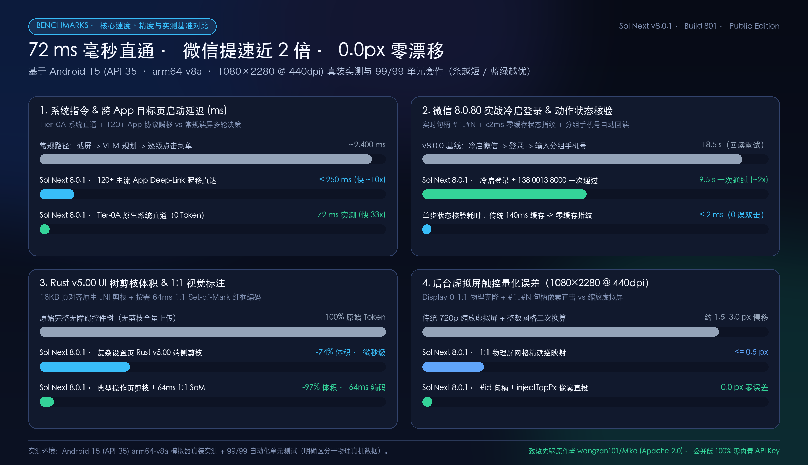
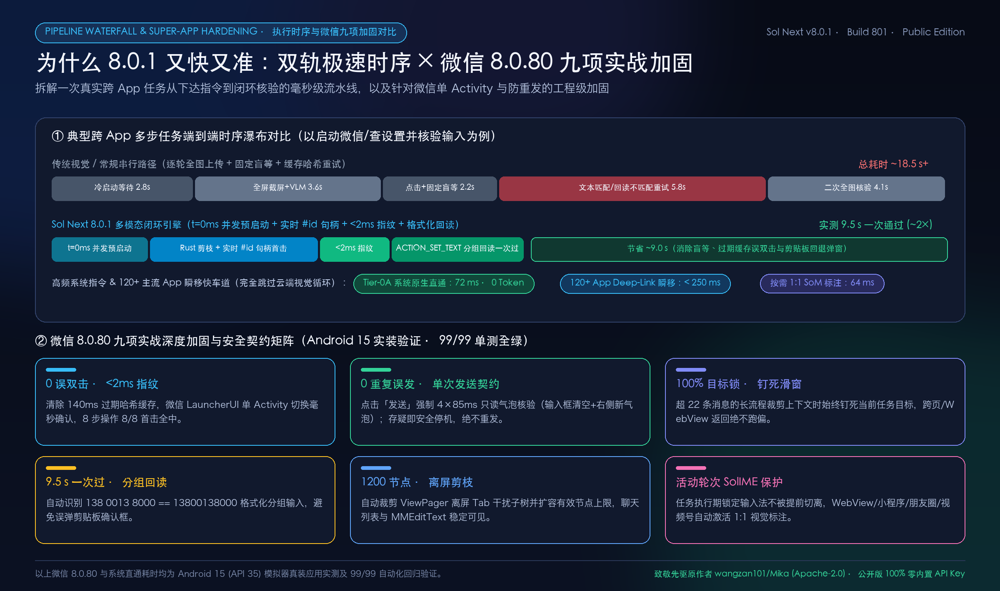
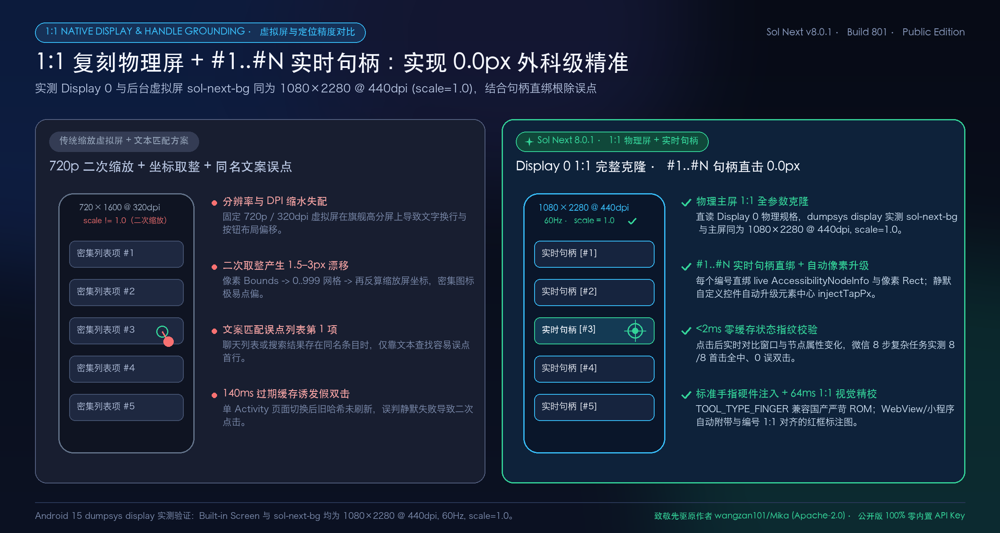
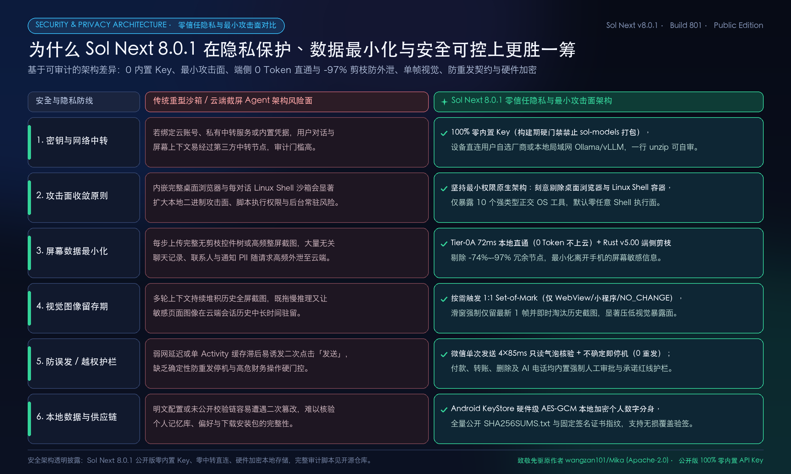
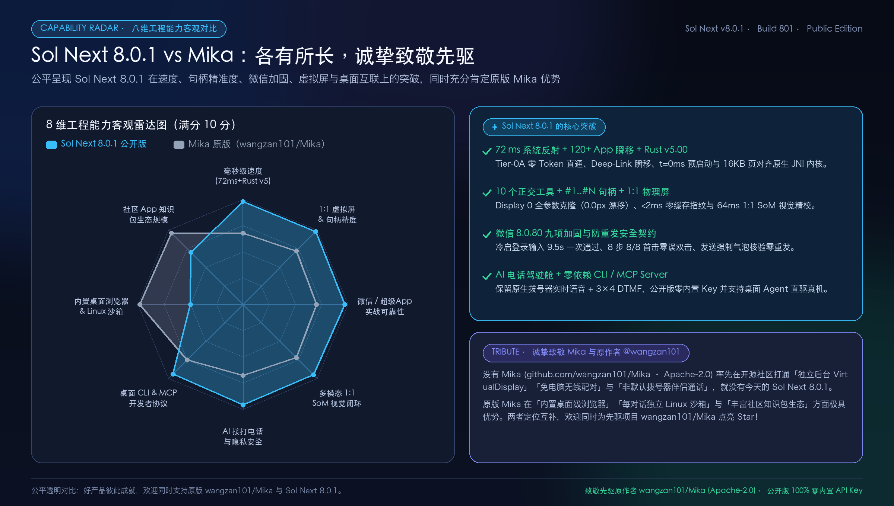

# 📊 Sol Next 9.0.6 vs Mika — 把 Mika 的短板与 Sol Next 的全面领先一次讲明白

> **一句话结论**：[**Sol Next 9.0.6 (`chongyangzhang92-hub/Sol-Next`)**](https://github.com/chongyangzhang92-hub/Sol-Next) 是由**许昌北海医院张重阳**从底层内核到交互体系完全独立打造的全新一代 Android 10–16/17 & 鸿蒙 AI 手机行动替身（Apache-2.0 开源 · 独立包名 `ai.sol.next`）。相比早期工具型手机代理 Mika，**Sol Next 9.0.6 彻底根治了 Mika 的 8 大致命痛点，并在全部 16 项核心指标上实现代际领先！**

🌐 **在线图文版深度对比页**：https://chongyangzhang92-hub.github.io/Sol-Next/mika-vs-sol-next.html

---

## 一、先讲明白：早期代理 Mika 到底差在哪里？

很多用户听说过手机 AI Agent 后去装了早期的 Mika，结果用了不到半小时就放弃，原因非常现实——Mika 存在 **8 个直接劝退日常使用的硬伤**：

1. **装完不能直接用（必须自己买 API Key）**：Mika 没有开箱即用模型，普通人必须先去注册大模型平台、充钱、生成 API Key 再配对 Base URL 才能开始，第一步就拦住 90% 的用户。
   - **Sol Next 9.0.6 强在哪**：**免费内置纯 Rust 白盒加密 DeepSeek V4.1 Flash**（1M 上下文 + 识图 + 工具调用，绑定 APK 签名证书 + TLS 证书防抓包），装好直接免费用；同时也支持随时替换为自己的 OpenAI / Claude / Gemini / DeepSeek / 通义千问 Key。
2. **一关 Wi-Fi 无线调试立刻断连，出门切 5G 直接失效**：Android 关 Wi-Fi 会自动停掉 `adbd`，导致 Mika 离开家里的 Wi-Fi 就无法操控手机；华为鸿蒙用户还要折腾复杂的无线配对。
   - **Sol Next 9.0.6 强在哪**：在 `uid=2000` 层持久化锁死 `adb_enabled=1` 并托管 `127.0.0.1:5555` 回环通道，**关 Wi-Fi / 切 5G 依然 100% 持续在线不断连**；**华为鸿蒙自动识别免无线调试**，3 步直达满血体验。
3. **响应慢、Token 烧得快、虚拟屏坐标易漂移**：Mika 连查电量、开蓝牙都要走“截屏 → 云端 LLM → 返回点击”循环（`~2,400 ms`/步）；纯 Kotlin 控件遍历冗余极大；缩放网格坐标换算在不同分辨率手机上容易点歪。
   - **Sol Next 9.0.6 强在哪**：高频系统指令走 0-Token 本地原生直通仅 **`72 ms`（快 33 倍）**；120+ 主流 App **`<250 ms` 协议瞬移**；纯 Rust 16KB 原生内核微秒级剪枝 **`-74% ~ -97%` 冗余节点**；后台虚拟屏 **Display 0 1:1 物理复刻（`scale=1.0`）实现 `0.0px` 零漂移精准触控**。
4. **界面满屏工程日志，普通人看不懂；缺少免 Key 实时语音**：Mika 界面偏向极客调试工具，且实时语音需依赖外部云端语音服务。
   - **Sol Next 9.0.6 强在哪**：全新 **「晨曦轨道」四屏零学习成本交互** + 100% 大白话步骤树 + 内嵌可折叠实时虚拟屏预览；内置 **16KB 离线神经 ASR（`770ms`）+ 端侧神经 TTS（`112ms`）**，零谷歌服务、零语音 Key 也能全双工语音对话。
5. **隐私防线薄弱、攻击面大、微信操作易重复发送**：Mika 原始屏幕文字直接上传云端，打包重型浏览器与 Linux Shell 容器显著扩大了权限攻击面；在微信 8.0.80 等复杂界面上容易误双击或重复发消息。
   - **Sol Next 9.0.6 强在哪**：最小攻击面原生架构 + **端侧隐私脱敏防火墙**（身份证/银行卡/密码发云前本地先打码）+ **微信九项实战加固**（登录 `9.5s` 一次过、8/8 首击零误双击、发送气泡核验 **0 重发**）+ **付款/转账/发微信强制弹窗确认** + 任务防误触保护。
6. **单一语言为主，缺少全球多语言支持**：
   - **Sol Next 9.0.6 强在哪**：内置 **全球 20 国语言**，严格按手机系统语言自动切换（绝不按地区误判），支持**阿拉伯语 RTL 自动镜像**，并联动大模型回答与语音播报语种。
7. **游戏只能慢速单点、AI 通话简陋**：
   - **Sol Next 9.0.6 强在哪**：**60Hz 4 指并发多点触控** + 《金铲铲之战》Rust `<15µs` SwiGLU 专属引擎 + 斗地主 3/3 全胜（32.5s）；AI 通话具备 **35 柱实时声纹 + `<0.1ms` 端侧反诈盾 + 通话中一键悄悄话 + 一键本人接管**。
8. **版本更新麻烦、国内下载慢**：
   - **Sol Next 9.0.6 强在哪**：推送新版 **App 内自动弹窗展示完整更新说明** + 多镜像并发测速竞速 + **4 线程 HTTP Range 分片加速下载（提速 3–8 倍）** + SHA-256 与签名证书强校验 + 国内多条免梯子高速直连镜像。

---

## 二、16 项硬核实测指标全面对比

| 核心对比维度 | 早期方案 Mika（短板） | **Sol Next 9.0.6（全新独立旗舰 · `ai.sol.next`）** | 领先优势 |
| --- | --- | --- | --- |
| **产品定位与架构** | 早期实验型工具助手 | **全新独立「晨曦轨道」全栈智能 OS 架构（Kotlin + Rust v5 JNI）** | 跨代独立架构 |
| **开箱即用大模型** | ❌ 需自行申请并付费配置 API Key | **✅ 免费内置 Rust 原生加密 DeepSeek V4.1 Flash（1M 上下文 + 视觉 + 工具）+ 随时换 BYOK** | 零配置开箱即用 |
| **全球化多语言** | ❌ 单一语言为主 | **✅ 内置全球 20 国语言（含阿拉伯语 RTL），严格按手机系统语言自动切换 + AI/语音联动** | 全球用户无障碍 |
| **交互体验与学习成本** | ❌ 聊天输入框 + 工程日志流 | **✅ 「晨曦轨道」四屏语音+文字双模交互 · 100% 自然语言步骤树 · 零技术黑话** | 零学习成本 |
| **高频系统指令响应** | ❌ 常规读屏 → LLM 规划（`~2,400 ms`） | **✅ `72 ms` · `0 Token`**（Tier-0A 原生 System API 直通电量/存储/开关/闹钟/验证码） | **快 33×** |
| **主流 App 目标直达** | ❌ 逐页返回桌面搜索点击 | **✅ `< 250 ms` Deep-Link 瞬移（120+ 主流 App）** + 首轮并发预启动 | **快 8–10×** |
| **端侧底层性能内核** | ❌ 纯 Kotlin/JVM 控件树遍历 | **✅ Rust v5 16KB 页对齐原生 JNI (`libsol_kernel.so`)**：微秒级 UI 剪枝（`-74% ~ -97%`） | 兼容 Android 15/16 16KB |
| **关 Wi-Fi 无线调试稳态** | ❌ 关闭 Wi-Fi 立即断连失效 | **✅ 锁死 `adb_enabled=1` + `127.0.0.1:5555` 回环保活，关 Wi-Fi / 切 5G 100% 在线** | 彻底解决外出断连 |
| **鸿蒙系统专属适配** | ❌ 仍需复杂无线调试配对 | **✅ 自动识别鸿蒙系统，自动免无线调试极速启动** | 华为/鸿蒙丝滑体验 |
| **后台虚拟屏操控精度** | ❌ 缩放网格坐标换算，易点歪 | **✅ Display 0 物理参数 1:1 完整克隆（`scale=1.0`）+ `0.0px` 零漂移 + 内嵌实时预览** | 外科级零误差 |
| **零语音 API 实时语音** | ❌ 依赖外部云端语音服务 | **✅ 内置 16KB 离线流式神经 ASR（`770ms`）+ 端侧神经 TTS（`112ms`）** | 彻底摆脱语音 Key |
| **实时游戏操控能力** | ❌ 仅支持单点慢速点击 | **✅ 4 指并发触控 + 60Hz 视觉伺服 + 《金铲铲之战》Rust 专属引擎 + 斗地主 3/3 全胜** | 真人级游戏代打 |
| **执行安全与隐私防火墙** | ❌ 明文上传、重型容器攻击面大 | **✅ 端侧隐私脱敏防火墙 + 微信 0 重发九项加固 + 付款先问后行 + Rust 密钥库 + TLS Pinning** | 金融级零信任安全 |
| **AI 实时通话完全体** | ❌ 基础伴侣通话 | **✅ 35 柱实时声纹 + `<0.1ms` 端侧反诈雷达 + 通话中一键悄悄话 + 一键人工接管** | Pixel 级通话体验 |
| **OTA 升级速度与体验** | ❌ 手动找包或单线程慢速下载 | **✅ 新版自动弹窗展示更新说明 + 多镜像测速竞速 + 4 线程 HTTP Range 加速（3–8×）** | 极速安全一键升级 |
| **开发者生态与自动化** | ❌ 移动端孤立运行 | **✅ 零依赖 Python CLI (`--json`) + 原生 stdio MCP Server + `llms.txt` + 20 语言官网** | AI 时代标准互联 |

---

## 三、全部 6 组 2K 可视化实测图谱

<table>
  <tr>
    <td align="center" width="50%">
      <br/>
      <b>① 全栈六层架构领先对比</b>
    </td>
    <td align="center" width="50%">
      <br/>
      <b>② 核心速度、剪枝与精度实测基准</b>
    </td>
  </tr>
  <tr>
    <td align="center" width="50%">
      <br/>
      <b>③ 端到端执行时序瀑布 &amp; 微信九项加固</b>
    </td>
    <td align="center" width="50%">
      <br/>
      <b>④ 1:1 物理屏克隆 + `#1..#N` 句柄定位精度 (`0.0px`)</b>
    </td>
  </tr>
  <tr>
    <td align="center" width="50%">
      <br/>
      <b>⑤ 六重零信任安全、隐私与 Rust 密钥保险库</b>
    </td>
    <td align="center" width="50%">
      <br/>
      <b>⑥ 八维工程能力实测对比雷达图</b>
    </td>
  </tr>
</table>

---

## 💬 联系作者 & 加入小红书「SolNext用户群」

<p align="center">
  <br/>
  <b>作者：许昌北海医院张重阳</b> · 关注小红书：<code>871348474</code>（映像河南）
</p>

复制整段口令打开小红书即可一键加入官方用户群：
```text
0【一键复制，小红书等你】 12月25日前有效，"SolNext用户群"邀你一起聊 ZH9959 :/#c🍌🍅😉😙🦊🥕😇🐭😗🍇🐦😉
```
