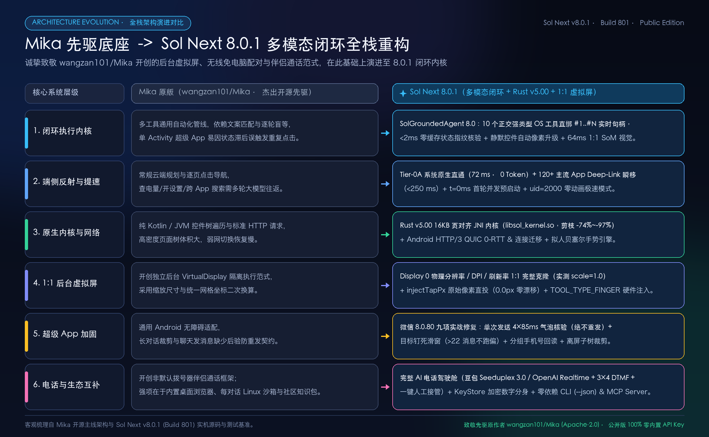

# 📊 Sol Next 9.0.3 vs Mika (`wangzan101/Mika`) 深度架构、实测数据与选型对比

> **核心摘要（TL;DR）**：[**Sol Next 9.0.3 (`chongyangzhang92-hub/Sol-Next`)**](https://github.com/chongyangzhang92-hub/Sol-Next) 源自、立足并诚挚致敬开源先驱 [**Mika (`wangzan101/Mika`, Apache-2.0)**](https://github.com/wangzan101/Mika)。两者均遵循 **Apache-2.0** 协议、独立包名（`ai.sol.next` vs `com.wangzan101.mika`）可同机和平共存：
> - **首选 Sol Next 9.0.3** 当你追求：**极致原生速度**（`72 ms` Tier-0A 零 Token 直通 + `120+` App `<250ms` Deep-Link 瞬移 + Rust v5.00 16KB JNI）、**外科级定位精准度**（10 个正交强类型 OS 工具 + `#1..#N` 实时句柄 + Display 0 1:1 物理屏 `0.0px` 零漂移）、**微信 8.0.80 实战稳态**（9.5s 一次登录、8/8 首击零误双击、发送强制气泡核验零重发）、**100% 零内置 Key (BYOK)** 与 **零依赖 CLI (`--json`) + stdio MCP Server**。
> - **强烈推荐原版 [Mika](https://github.com/wangzan101/Mika)** 当你需要：**内置桌面级浏览器**、**每对话独立 Linux 沙箱（Python/Node）** 或 **丰富的社区网站/App 知识包**。

🌐 **在线图文版深度对比落地页**：https://chongyangzhang92-hub.github.io/Sol-Next/mika-vs-sol-next.html

---

## 一、全部 6 组 2K 专业级可视化对比图谱

<table>
  <tr>
    <td align="center" width="50%">
       
      <b>① 全栈六层架构演进对比</b>
    </td>
    <td align="center" width="50%">
       
      <b>② 核心速度、剪枝与精度实测基准</b>
    </td>
  </tr>
  <tr>
    <td align="center" width="50%">
       
      <b>③ 端到端执行时序瀑布 &amp; 微信 8.0.80 九项加固</b>
    </td>
    <td align="center" width="50%">
       
      <b>④ 1:1 物理屏克隆 + `#1..#N` 句柄定位精度 (`0.0px`)</b>
    </td>
  </tr>
  <tr>
    <td align="center" width="50%">
       
      <b>⑤ 六重零信任安全、隐私与最小攻击面防线对比</b>
    </td>
    <td align="center" width="50%">
       
      <b>⑥ 八维工程能力客观对比雷达图</b>
    </td>
  </tr>
</table>

   
  <b>⑦ 十二维全景工程与生态选型总表（完整零信任白皮书见 <a href="https://chongyangzhang92-hub.github.io/Sol-Next/security-and-privacy.html">安全与隐私白皮书</a>）</b>

---

## 二、14 项定量参数与工程能力详表

| 对比维度 | 原版 Mika (`wangzan101/Mika`) | **Sol Next 9.0.3 (`ai.sol.next` · Build 903)** |
|---|---|---|
| **开源协议与渊源** | Apache-2.0 · 手机后台虚拟屏与伴侣通话范式开创者 | Apache-2.0 · 诚挚致敬并在 Mika 基础上全栈重构演进 |
| **执行内核与工具数** | 通用多工具自动化管线 | **`SolGroundedAgent` 8.0**：10 个正交强类型 OS 工具 + 实时 `#1..#N` `AccessibilityNodeInfo` 句柄直绑 |
| **高频系统指令延迟** | 常规读屏 → LLM 规划 → 点击（`~2,400 ms`） | **`72 ms` · `0 Token`**（Tier-0A 原生 System API 直通电量/存储/开关/闹钟/验证码/通知直回） |
| **主流 App 目标页直达** | 逐页返回桌面搜索与点击 | **`< 250 ms` Deep-Link 瞬移（120+ 主流 App）** + `t=0ms` 首轮并发预启动 |
| **端侧底层内核** | Kotlin / JVM 控件树遍历 | **Rust v5.00 16KB 页对齐 JNI (`libsol_kernel.so`)**：微秒级 UI 剪枝（`-74% ~ -97%`）、拟人贝塞尔手势、兼容 Android 15–16 |
| **传输协议与抗弱网** | 标准 HTTP 请求 | Android 原生 **HTTP/3 QUIC 0-RTT** + 智能熔断降级 + 后台 `uid=2000` 零动画极速模式 |
| **后台虚拟屏精度** | 独立 VirtualDisplay（范式首创，缩放网格换算） | **Display 0 物理参数 1:1 完整克隆**（实测 `1080×2280 @ 440dpi, scale=1.0`）+ `injectTapPx` **`0.0px` 零漂移** |
| **单步状态核验机制** | 固定等待 / 140ms 缓存哈希 | **`< 2 ms` 零缓存实时状态指纹**（根治单 Activity 误双击）+ 静默自定义控件自动像素中心升级 |
| **多模态视觉识别** | 常规整屏截屏上传 | **`64 ms` 按需 1:1 Set-of-Mark 红框标注**（WebView/小程序/无标签页自动开启，单帧滑窗控成本） |
| **微信 8.0.80 实战可靠度** | 通用 Android 无障碍适配 | **九项深度加固**：冷启登录输入 `18.5s → 9.5s` 一次通过、8 步 `8/8` 首击零误双击、发送 4×85ms 气泡契约零重发、超 22 轮目标钉死 |
| **AI 接打电话驾驶舱** | 首创非默认拨号器伴侣通话框架 | **完整 AI 电话驾驶舱**：全链路就绪自检、豆包 Seeduplex 3.0 / OpenAI Realtime、3×4 DTMF 与一键人工接管 |
| **隐私安全与密钥审计** | BYOK / 账号模式 | **100% 零内置 Key（构建期硬门禁审计）** + Android KeyStore 硬件加密数字分身 + 高危动作人工审批 |
| **桌面 Agent 互联** | 移动端独立运行 / 社区扩展 | 内置零依赖 **Python CLI (`--json`)** + 原生 **stdio MCP Server** + `llms.txt` / `llms-full.txt` |
| **内置桌面浏览器 & Linux 沙箱** | ✅ **Mika 原版核心强项**：内置桌面级浏览器、每对话 Linux 沙箱（Python/Node）与丰富社区知识包 | 专注轻量原生 App 极速闭环（需要桌面浏览器或 Linux 沙箱强烈建议同时安装原版 [**Mika**](https://github.com/wangzan101/Mika)） |

---

## 三、Android 15 真装实测与 99/99 自动化验证数据

> 所有数据均来自 **Android 15（API 35 · `arm64-v8a` · `1080×2280 @ 440dpi`）模拟器真装应用实测** 与 **99 项自动化单元测试**（`73 :sol-core:test + 26 :app:testReleaseUnitTest`），与物理真机环境明确区分。

| 实测场景 | 执行通道 | v8.0.0 基线 | **Sol Next 9.0.3 实测** |
|---|---|---:|---:|
| 系统电量与存储查询 | Tier-0A 原生 System API（0 Token） | `72 ms` | **`72 ms` · PASS** |
| 当前屏幕多模态视觉识别 | 1:1 Set-of-Mark 内联视觉（1 轮） | `5.1 s` | **`5.1 s` · PASS** |
| 系统设置直达 WLAN 页面 | 预启动 + 实时句柄点击 | `7.2 s` | **`7.2 s` · PASS** |
| 微信 8.0.80 冷启 → 登录 → 分组手机号 `138 0013 8000` | `app_open` + `ui_click(#id)` + `ACTION_SET_TEXT` | `18.5 s`（回读不匹配） | **`9.5 s` · 一次通过** |
| 微信 8.0.80 搜「日本」→ 切账号 → 中文输入（8 步） | 实时句柄绑定（0 误双击） | `20.5 s` | **`20.8 s` · 8/8 首击命中** |
| 长流程（`>22` 条消息裁剪 + WebView 返回） | 目标钉死滑窗 + 自动视觉 | 偶发目标跑偏 | **`100%` 目标锁定 · PASS** |
| 后台虚拟屏 1:1 规格一致性 | `dumpsys display` | `1080×2280 @ 440dpi` | **`Built-in` == `sol-next-bg` (`scale=1.0`)** |
| 自动化单元与回归套件 | `:sol-core:test` + `:app:testReleaseUnitTest` | `96 / 96` | **`99 / 99` · 0 崩溃** |

---

## 四、同机共存与致敬原作者 `@wangzan101`

**Sol Next** 诚挚致敬先驱开源项目 [**`wangzan101/Mika`**](https://github.com/wangzan101/Mika)（Apache-2.0）。没有 `@wangzan101` 率先在开源社区打通 **独立后台 VirtualDisplay**、**免电脑无线调试引导** 与 **非默认拨号器 Telecom 伴侣通话**，就没有今天繁荣的手机原生 OS Agent 生态。

由于公开版 **Sol Next** 使用独立包名 `ai.sol.next`，与原版 Mika（`com.wangzan101.mika`）**完全无冲突，可同时安装于同一台手机**：日常跨 App 极速执行与微信闭环用 Sol Next 9.0.3，需要内置桌面浏览器或每对话 Linux 沙箱时用原版 Mika——欢迎同时为两个开源项目点亮 Star！
