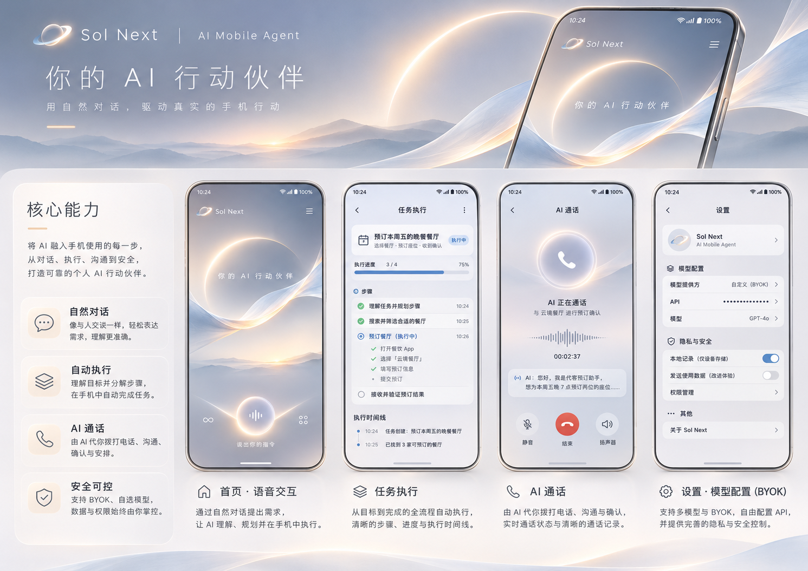

  

# Sol Next 9.0.4 — Dawn Orbit · شريكك الذكي لتنفيذ المهام

### تحكم بهاتف Android بالصوت والنص · يدعم 20 لغة عالمية مع تبديل تلقائي حسب لغة الهاتف ودعم كامل لـ RTL

> **👨‍💻 المؤلف: تشانغ تشونغيانغ (مستشفى شوتشانغ بيهاي) · RedNote 871348474 / رمز WeChat أدناه**

 

&nbsp;

&nbsp;

  

🌐 [简体中文](../../README.md) · [繁體中文](README.zh-TW.md) · [English](../../README.en.md) · [日本語](README.ja.md) · [한국어](README.ko.md) · [Español](README.es.md) · [Français](README.fr.md) · [Deutsch](README.de.md) · [Português](README.pt.md) · [Русский](README.ru.md) · **العربية** · [हिन्दी](README.hi.md) · [Bahasa Indonesia](README.id.md) · [Tiếng Việt](README.vi.md) · [ภาษาไทย](README.th.md) · [Türkçe](README.tr.md) · [Italiano](README.it.md) · [Nederlands](README.nl.md) · [Polski](README.pl.md) · [Bahasa Melayu](README.ms.md)

---

## ✨ أبرز مزايا الإصدار v9.0.4

- **دعم 20 لغة عالمية مع واجهة عربية كاملة من اليمين إلى اليسار (RTL)**: يعتمد حصراً على لغة نظام الهاتف (وليس المنطقة الجغرافية) مع إمكانية التبديل الفوري من الإعدادات.
- **نافذة تحديث OTA تلقائية + ملاحظات الإصدار + تسريع تنزيل متعدد المسارات**: تظهر نافذة تلقائية تعرض تفاصيل التحديث الجديد، مع تسريع التنزيل عبر 4 مسارات HTTP Range متوازية وأسرع خادم مرآة (مع تحقق صارم من SHA-256 والتوقيع).
- **نموذج DeepSeek V4.1 Flash مجاني مدمج ومشفر بلغة Rust**: جاهز للاستخدام فوراً بدون أي مفاتيح نصية مكشوفة، مع TLS Pinning ودعم كامل لمفاتيحك الخاصة BYOK.
- **مساعد Shell للتصحيح اللاسلكي يبقى متصلاً حتى عند إيقاف Wi-Fi**: شاشة افتراضية خلفية ومكالمات ذكاء اصطناعي عالية الدقة.
- **مزايا Android 16/17 الحقيقية**: Generative UI و Magic Cue و AppFunctions وتحكم ألعاب 60Hz وجدار حماية للخصوصية على الجهاز.

---

## 💬 التواصل مع المؤلف (امسح رمز WeChat QR)

امسح رمز WeChat QR أدناه للتواصل المباشر مع المؤلف (RedNote ID: `871348474`):

   
  <b>Sol Next 9.0.4</b> · Apache-2.0 · <a href="https://chongyangzhang92-hub.github.io/Sol-Next/">Official Multi-Language Website</a> · <a href="../../SHA256SUMS.txt">SHA256SUMS.txt</a>

