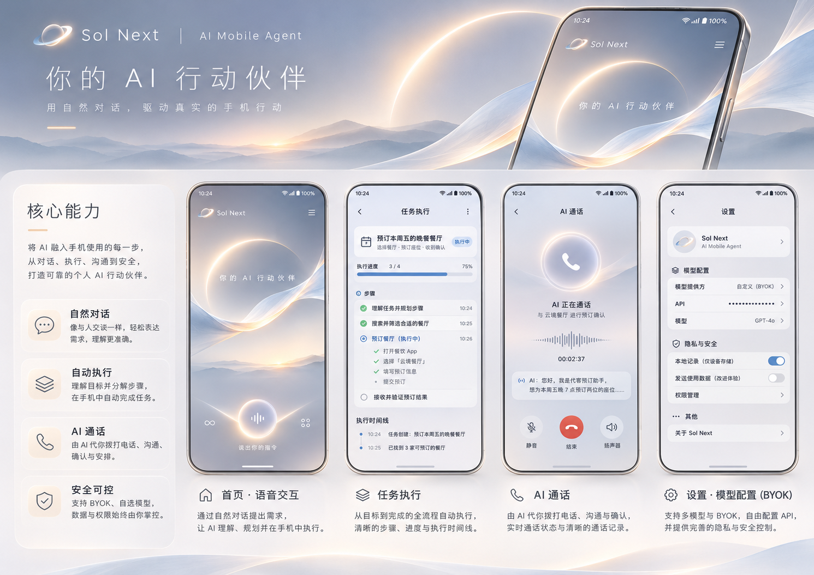

  

# Sol Next 9.0.4 — Dawn Orbit · Dein KI-Aktionspartner

### Steuere dein Android per Sprache oder Text · 20 Sprachen (automatisch nach Telefonsprache)

> **👨‍💻 Autor: Zhang Chongyang (Xuchang Beihai Hospital) · RedNote 871348474 / WeChat QR unten**

 

&nbsp;

&nbsp;

  

🌐 [简体中文](../../README.md) · [繁體中文](README.zh-TW.md) · [English](../../README.en.md) · [日本語](README.ja.md) · [한국어](README.ko.md) · [Español](README.es.md) · [Français](README.fr.md) · **Deutsch** · [Português](README.pt.md) · [Русский](README.ru.md) · [العربية](README.ar.md) · [हिन्दी](README.hi.md) · [Bahasa Indonesia](README.id.md) · [Tiếng Việt](README.vi.md) · [ภาษาไทย](README.th.md) · [Türkçe](README.tr.md) · [Italiano](README.it.md) · [Nederlands](README.nl.md) · [Polski](README.pl.md) · [Bahasa Melayu](README.ms.md)

---

## ✨ Neu in v9.0.4

- **20 Weltsprachen + automatische Erkennung nach Systemsprache**: Folgt ausschließlich der eingestellten Telefonsprache (unabhängig von der Region) mit sofortigem Wechsel in den Einstellungen.
- **Automatisches OTA-Update-Popup + Versionshinweise + Multi-Stream-Download**: Zeigt bei neuen Versionen automatisch ein Popup mit Changelog und lädt über schnelle Spiegelserver + 4 parallele HTTP-Range-Streams (inkl. SHA-256- & Signaturprüfung).
- **Kostenloses DeepSeek V4.1 Flash im Rust-Tresor**: Sofort einsatzbereit, null Klartext-Schlüssel, TLS-Pinning und BYOK für beliebige Cloud-Modelle.
- **Persistenter Wireless-Debugging-Shell-Helfer ohne WLAN**: Stabiler virtueller Hintergrundbildschirm und HD-KI-Anrufe.
- **Android 16/17 heute realisiert**: Generative UI, Magic Cue, AppFunctions, 60Hz-Gaming-Steuerung und lokale Datenschutz-Firewall.

---

## 💬 Autor kontaktieren (WeChat QR scannen)

Scanne den WeChat-QR-Code unten, um den Autor direkt zu erreichen (RedNote ID: `871348474`):

   
  <b>Sol Next 9.0.4</b> · Apache-2.0 · <a href="https://chongyangzhang92-hub.github.io/Sol-Next/">Official Multi-Language Website</a> · <a href="../../SHA256SUMS.txt">SHA256SUMS.txt</a>

