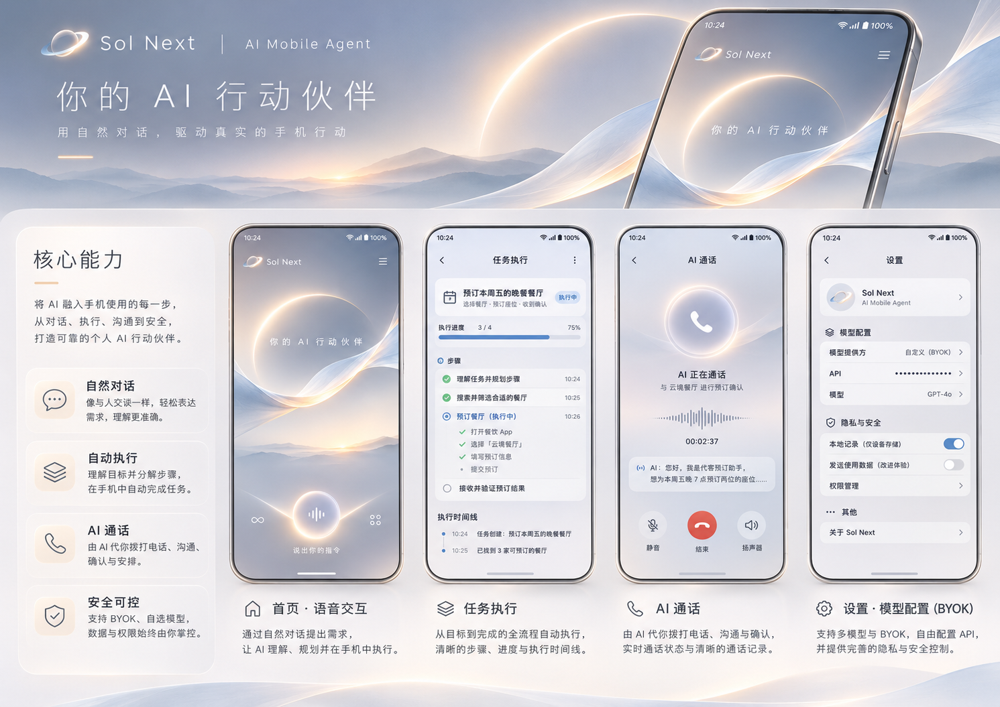

  

# Sol Next 9.0.4 — Dawn Orbit · Trợ Lý Hành Động AI Của Bạn

### Điều khiển Android bằng giọng nói & văn bản · Hỗ trợ 20 ngôn ngữ (tự động theo ngôn ngữ điện thoại)

> **👨‍💻 Tác giả: Zhang Chongyang (Bệnh viện Xuchang Beihai) · RedNote 871348474 / Mã QR WeChat bên dưới**

 

&nbsp;

&nbsp;

  

🌐 [简体中文](../../README.md) · [繁體中文](README.zh-TW.md) · [English](../../README.en.md) · [日本語](README.ja.md) · [한국어](README.ko.md) · [Español](README.es.md) · [Français](README.fr.md) · [Deutsch](README.de.md) · [Português](README.pt.md) · [Русский](README.ru.md) · [العربية](README.ar.md) · [हिन्दी](README.hi.md) · [Bahasa Indonesia](README.id.md) · **Tiếng Việt** · [ภาษาไทย](README.th.md) · [Türkçe](README.tr.md) · [Italiano](README.it.md) · [Nederlands](README.nl.md) · [Polski](README.pl.md) · [Bahasa Melayu](README.ms.md)

---

## ✨ Điểm mới trên v9.0.4

- **20 ngôn ngữ toàn cầu + tự động theo ngôn ngữ điện thoại**: Chỉ dựa vào ngôn ngữ hệ thống (không theo khu vực), chuyển đổi tức thì trong Cài đặt.
- **Popup cập nhật OTA tự động + Ghi chú phiên bản + Tăng tốc tải đa luồng**: Tự động hiện hộp thoại cập nhật kèm chi tiết phiên bản mới; tăng tốc bằng đua mirror + 4 luồng HTTP Range song song (kiểm tra chặt SHA-256 & chữ ký).
- **Tích hợp miễn phí DeepSeek V4.1 Flash mã hóa Rust**: Dùng ngay không cần cấu hình, không lưu khóa văn bản thuần, TLS pinning và hỗ trợ BYOK.
- **Giữ kết nối Wireless Debugging Shell ngay cả khi tắt Wi-Fi** cho màn hình ảo nền & cuộc gọi AI HD.

---

## 💬 Liên hệ Tác giả (Quét mã QR WeChat)

Quét mã QR WeChat bên dưới để liên hệ trực tiếp với tác giả (RedNote ID: `871348474`):

   
  <b>Sol Next 9.0.4</b> · Apache-2.0 · <a href="https://chongyangzhang92-hub.github.io/Sol-Next/">Official Multi-Language Website</a> · <a href="../../SHA256SUMS.txt">SHA256SUMS.txt</a>

