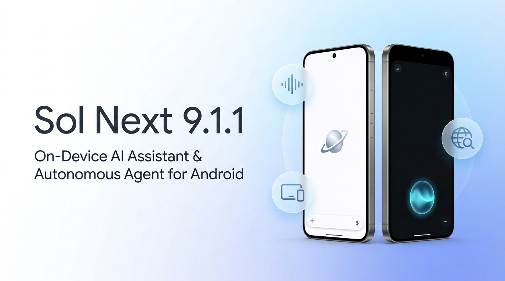

  

# Sol Next 9.3.0 — 晨曦軌道 · 你的全球多語言 AI 行動夥伴

### 用自然對話與文字，驅動真實手機行動 · 支援全球 20 種語言（依手機語言自動切換）

> **👨‍💻 作者：許昌北海醫院張重陽 · 關注小紅書 871348474（映像河南）或掃描下方微信二維碼聯絡作者**

 

&nbsp;

&nbsp;

  

🌐 [简体中文](../../README.md) · **繁體中文** · [English](../../README.en.md) · [日本語](README.ja.md) · [한국어](README.ko.md) · [Español](README.es.md) · [Français](README.fr.md) · [Deutsch](README.de.md) · [Português](README.pt.md) · [Русский](README.ru.md) · [العربية](README.ar.md) · [हिन्दी](README.hi.md) · [Bahasa Indonesia](README.id.md) · [Tiếng Việt](README.vi.md) · [ภาษาไทย](README.th.md) · [Türkçe](README.tr.md) · [Italiano](README.it.md) · [Nederlands](README.nl.md) · [Polski](README.pl.md) · [Bahasa Melayu](README.ms.md)

---

## ✨ v9.3.0 核心進化

- **全球 20 種語言 + 依手機系統語言自動切換**：嚴格依據手機語言（不依賴地區）自動切換介面與 AI 回覆語言，支援繁/簡中文、英、日、韓、西、法、德、葡、俄、阿（RTL 鏡像）等 20 國語言，並可在「設定 › 語言」一鍵手動固定。
- **OTA 新版本自動彈窗 + 版本說明 + 多執行緒高速下載**：推送新版後 App 內自動彈窗提示並展示完整更新說明；內建多鏡像並行競速 + 4 通道 HTTP Range 分片加速，並保持 SHA-256 與簽名證書嚴格校驗。
- **免費內建 Rust 原生加密 DeepSeek V4.1 Flash**：開箱即用，零明文金鑰、TLS 證書綁定防抓包，並支援隨時切換任意雲端模型 BYOK。
- **關閉 Wi-Fi 持續在線的無線偵錯 Shell 助手**：連線後即使關閉 Wi-Fi，背景獨立虛擬螢幕與 AI 高清通話依然穩定不斷線。
- **Android 16/17 前沿實裝**：Generative UI 原生互動卡片、Magic Cue、AppFunctions、60Hz 遊戲即時操控與端側隱私防火牆。

---

## 💬 聯絡作者（掃碼加微信 / 小紅書）

微信掃描下方二維碼即可直接聯絡作者，或關注小紅書號 `871348474`（映像河南）：

   
  <b>Sol Next 9.3.0</b> · Apache-2.0 · <a href="https://chongyangzhang92-hub.github.io/Sol-Next/">Official Multi-Language Website</a> · <a href="../../SHA256SUMS.txt">SHA256SUMS.txt</a>

